# Command Center Backend

Trade receptionist booking authentication and setup: [docs/trade-booking-auth.md](docs/trade-booking-auth.md).

> A multi-tenant Express + TypeScript API that powers the **Command Center** call‑center
> application. It owns its own users and operational data in **Supabase**, and acts as an
> authenticated **proxy** to the external **BMS Black** workshop platform (and provisions
> identities into **Firebase Black / Pink**).

This document is the single, full explanation of the backend: how it is structured, how
**login** and **agent registration** work, how the **4‑hour session** is implemented, every
**API endpoint**, the **folders and files**, the **database tables**, and the **request
lifecycle** — with diagrams.

---

## Table of contents

1. [What this backend is](#1-what-this-backend-is)
2. [High-level architecture](#2-high-level-architecture)
3. [Technology stack](#3-technology-stack)
4. [Repository layout (folders & files)](#4-repository-layout-folders--files)
5. [Getting started](#5-getting-started)
6. [Environment variables](#6-environment-variables)
7. [The data systems: Supabase + 3 Firebase projects](#7-the-data-systems-supabase--3-firebase-projects)
8. [Application bootstrap (how the server starts)](#8-application-bootstrap-how-the-server-starts)
9. [Authentication overview](#9-authentication-overview)
10. [Login flow in detail](#10-login-flow-in-detail)
11. [The 4-hour session (Supabase + Firebase)](#11-the-4-hour-session-supabase--firebase)
12. [Token refresh endpoints and headers](#12-token-refresh-endpoints-and-headers)
13. [Middleware chain](#13-middleware-chain)
14. [Super admin registration](#14-super-admin-registration)
15. [Agent registration](#15-agent-registration)
16. [The BMS Black proxy layer](#16-the-bms-black-proxy-layer)
17. [The service / pipeline pattern](#17-the-service--pipeline-pattern)
18. [Realtime (SMS WebSocket)](#18-realtime-sms-websocket)
19. [Full API reference](#19-full-api-reference)
20. [Database tables reference](#20-database-tables-reference)
21. [Request lifecycle (end to end)](#21-request-lifecycle-end-to-end)
22. [Conventions & error handling](#22-conventions--error-handling)
23. [Build, run & deploy](#23-build-run--deploy)
24. [Troubleshooting](#24-troubleshooting)
25. [Glossary](#25-glossary)

---

## 1. What this backend is

The Command Center is a call‑center operations tool. Agents and super admins sign in, view
calls, manage bookings, chat with workshop owners, handle SMS conversations, track
attendance, and so on.

This backend plays three roles at once:

| Role | Description |
|------|-------------|
| **Identity bridge** | The frontend signs in with **Supabase** credentials. The backend also signs the same user into **Firebase Black** and **Firebase Pink** (the external BMS platforms) behind the scenes and remembers those tokens server‑side. |
| **System of record** | The backend owns operational tables in Supabase: agents, calls, attendance, leave, shifts, SMS, audit logs, sales suburb data, DID mappings, internal agent chat. |
| **Authenticated proxy** | For workshop/booking data, the backend forwards requests to the **BMS Black** API (`black.bmspros.com.au`) using the user's stored Firebase Black idToken. |

A key design choice: **the client only ever sends one token** — the Supabase
`access_token`. The backend maps that to the correct Firebase token internally, so the
frontend never has to juggle multiple credentials.

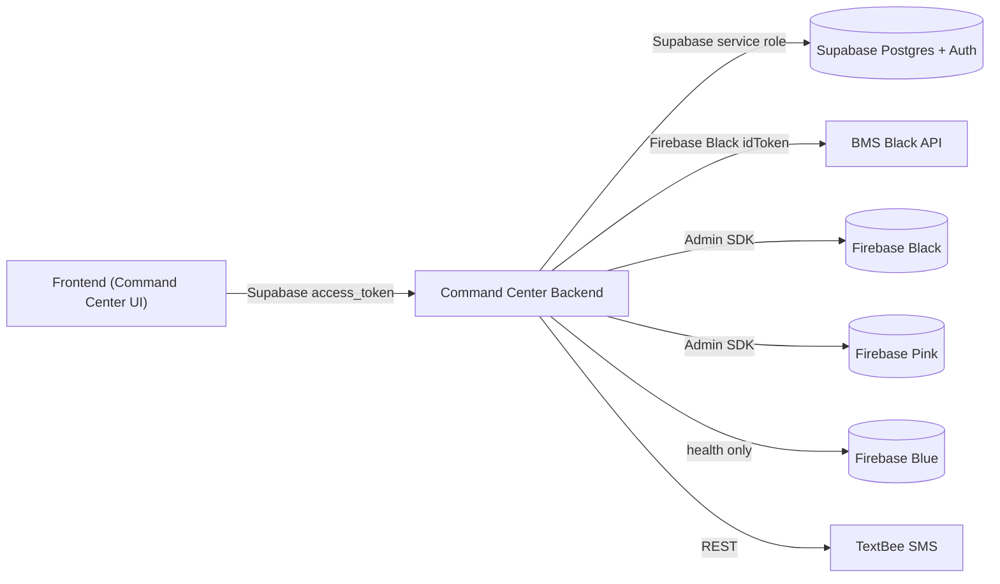

---

## 2. High-level architecture

The backend is a single Node process running Express 5. Requests come in under `/api`,
pass through global middleware, then hit one of the route groups. Routes delegate to
**services**, which either talk to Supabase, Firebase, or the BMS Black API.

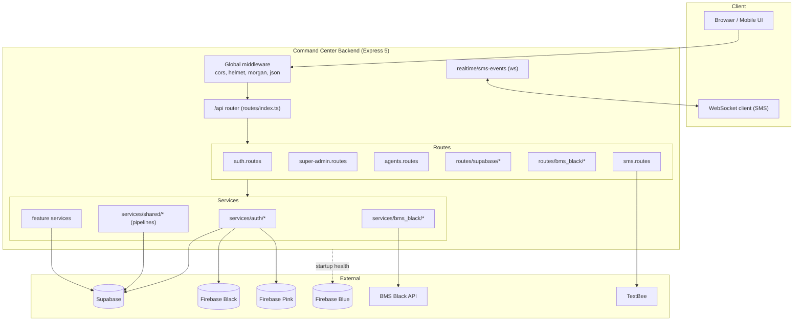

### Layered responsibilities

| Layer | Folder | Responsibility |
|-------|--------|----------------|
| **Entry** | `src/server.ts`, `src/app.ts` | Boot env, print DB status, create Express app, attach WebSocket, listen. |
| **Routing** | `src/routes/**` | HTTP method/path, parse query/body, enforce auth, choose status codes. |
| **Middleware** | `src/middleware/**` | Validate Supabase Bearer, auto‑refresh sessions, super‑admin / setup‑secret gates. |
| **Services** | `src/services/**` | Business logic, external calls, Supabase queries. |
| **Pipelines** | `src/services/shared/*.pipeline.ts` | Thin Supabase env gate + delegation to low‑level Supabase services. |
| **DB clients** | `src/db/**` | Supabase client factory, Firebase Admin apps, startup status. |
| **Config** | `src/config/**` | Read env for BMS Black URL, TextBee, super‑admin role names. |
| **Types** | `src/types/**` | Row shapes and request/response DTOs (used instead of `models/`). |
| **Realtime** | `src/realtime/**` | SMS WebSocket server. |

---

## 3. Technology stack

| Concern | Choice |
|---------|--------|
| Runtime | Node.js (ESM, `"type": "module"`) |
| Language | TypeScript (compiled with `tsc` to `dist/`) |
| Web framework | Express 5 |
| Auth & primary DB | Supabase (`@supabase/supabase-js`) |
| External identities | Firebase Admin SDK (`firebase-admin`) — black, pink, blue |
| Realtime | `ws` (WebSocket server) |
| Security headers | `helmet` |
| CORS | `cors` |
| Request logging | `morgan` |
| Env loading | `dotenv` (via custom bootstrap) |
| SMS | TextBee REST API |
| Hashing / JWT helpers | `bcryptjs`, `jsonwebtoken` (utility) |
| Dev runner | `tsx watch` |

### npm scripts

```json
{
  "dev":   "tsx watch src/server.ts",
  "build": "tsc",
  "start": "node dist/server.js"
}
```

> **Important:** `npm start` runs the compiled `dist/` output. After editing `src/`, you must
> run `npm run build` before `npm start`, otherwise you will be running stale code. `npm run
> dev` watches and recompiles automatically.

---

## 4. Repository layout (folders & files)

AI onboarding setup, MCP tools, owner approval and provisioning boundaries are
documented in [docs/ai-onboarding.md](docs/ai-onboarding.md).

The authoritative source is under `src/`. The `dist/` directory contains compiled output and
should not be edited by hand. (Note: some `dist/models/**` files exist from older builds but
are empty stubs; the live code uses `src/types/` instead of `src/models/`.)

```
command-center-backend/
├─ package.json
├─ tsconfig.json
├─ README.md                      ← this file
├─ src/
│  ├─ server.ts                   ← process entry: boot, listen, attach ws
│  ├─ app.ts                      ← Express app + global middleware
│  ├─ env-bootstrap.ts            ← loads .env then .env.local
│  ├─ dotenv-quiet-preflight.ts   ← silences dotenv v17 logs
│  │
│  ├─ config/
│  │  ├─ black-api.ts             ← BLACK_API_BASE_URL + blackEndpoint()
│  │  ├─ supabase-app-role.ts     ← super-admin role names + roleMayRegisterAgents()
│  │  └─ textbee.ts               ← TextBee API key / device / webhook secret
│  │
│  ├─ db/
│  │  ├─ startup-status.ts        ← printStartupDatabaseStatus()
│  │  ├─ supabase/
│  │  │  └─ supabase.client.ts    ← createSupabaseClient(), key resolution helpers
│  │  └─ firebase/
│  │     ├─ firebase.helpers.ts   ← resolveFirebaseServiceAccount("BLACK"|"PINK"|"BLUE")
│  │     ├─ firebase.black.ts     ← getFirebaseBlackApp()  (bmspro-black)
│  │     ├─ firebase.pink.ts      ← getFirebasePinkApp()   (bmspro-pink)
│  │     └─ firebase.blue.ts      ← getFirebaseBlueApp()   (bmspro-blue, health only)
│  │
│  ├─ middleware/
│  │  ├─ supabase-auth.middleware.ts       ← attachSupabaseUser, requireSupabaseSuperAdmin
│  │  └─ super-admin-or-setup.middleware.ts← authorizeSuperAdminOrSetup / requireSuperAdminOrSetup
│  │
│  ├─ realtime/
│  │  └─ sms-events.ts            ← attachSmsRealtime(server), broadcastSmsUpdated()
│  │
│  ├─ routes/
│  │  ├─ index.ts                 ← mounts everything under /api + GET /api + /api/health/db
│  │  ├─ auth.routes.ts           ← /api/auth/login, /refresh, /me
│  │  ├─ super-admin.routes.ts    ← /api/super-admin/register
│  │  ├─ agents.routes.ts         ← /api/agents (register, list, performance, get, patch, delete)
│  │  ├─ sms.routes.ts            ← /api/sms/*
│  │  ├─ supabase/
│  │  │  ├─ calls.routes.ts
│  │  │  ├─ dashboard-metrics.routes.ts
│  │  │  ├─ agent-chat.routes.ts
│  │  │  ├─ agent-attendance.routes.ts
│  │  │  ├─ agent-leave-requests.routes.ts
│  │  │  ├─ agent-shift-schedules.routes.ts
│  │  │  ├─ sales-suburb-workshops.routes.ts
│  │  │  ├─ sales-agent-suburb-assignments.routes.ts
│  │  │  ├─ sales-suburb-workshop-agent-contacts.routes.ts
│  │  │  ├─ did-mappings.routes.ts
│  │  │  └─ system-audit-logs.routes.ts
│  │  └─ bms_black/
│  │     ├─ black-proxy.helpers.ts
│  │     ├─ booking.routes.ts
│  │     ├─ chat.routes.ts
│  │     ├─ notifications.routes.ts
│  │     ├─ services.routes.ts
│  │     └─ branch.routes.ts
│  │
│  ├─ services/
│  │  ├─ auth/
│  │  │  ├─ supabase-auth.service.ts                 ← loginWithSupabasePassword, refresh
│  │  │  ├─ supabase-session.store.ts                ← Supabase refresh-token store (4h)
│  │  │  ├─ firebase-stored-session.config.ts        ← 4h window config + helpers
│  │  │  ├─ firebase-black-login.service.ts          ← Identity Toolkit (Black) sign-in
│  │  │  ├─ firebase-pink-login.service.ts           ← Identity Toolkit (Pink) sign-in
│  │  │  ├─ firebase-black-login.store.ts            ← Black idToken store + auto-refresh
│  │  │  ├─ firebase-pink-login.store.ts             ← Pink idToken store + auto-refresh
│  │  │  ├─ firebase-identity-toolkit-refresh.service.ts ← Secure Token API refresh
│  │  │  ├─ register-command-center-agent-supabase.service.ts
│  │  │  ├─ ensure-firebase-pink-auth-user.service.ts
│  │  │  └─ provision-call-center-lead-firebase.service.ts
│  │  ├─ cc-agent/
│  │  │  └─ bootstrap-super-admin.service.ts
│  │  ├─ bms_black/
│  │  │  ├─ black-call-center.proxy.util.ts          ← headers + fetch to Black
│  │  │  ├─ black-call-center-staff.proxy.service.ts
│  │  │  ├─ black-call-center-services.proxy.service.ts
│  │  │  ├─ black-call-center-branches.proxy.service.ts
│  │  │  └─ black-call-center-notifications.proxy.service.ts
│  │  ├─ shared/
│  │  │  ├─ *.pipeline.ts                            ← env gate + delegation per feature
│  │  │  └─ supabase-*.service.ts                    ← low-level table queries
│  │  ├─ agent-register.service.ts
│  │  ├─ calls.service.ts
│  │  ├─ agent-chat.service.ts
│  │  ├─ agent-attendance.service.ts
│  │  ├─ agent-leave-requests.service.ts
│  │  ├─ agent-shift-schedules.service.ts
│  │  ├─ did-mappings.service.ts
│  │  ├─ system-audit-logs.service.ts
│  │  ├─ sales-suburb-workshops.service.ts
│  │  ├─ sales-agent-suburb-assignments.service.ts
│  │  ├─ sales-suburb-workshop-agent-contacts.service.ts
│  │  └─ sms.service.ts
│  │
│  ├─ types/
│  │  ├─ agent-attendance.types.ts
│  │  ├─ agent-chat.types.ts
│  │  ├─ agent-leave-request.types.ts
│  │  ├─ agent-management.types.ts
│  │  ├─ agent-registration.types.ts
│  │  ├─ agent-shift-schedule.types.ts
│  │  ├─ call.types.ts
│  │  ├─ did-mapping.types.ts
│  │  ├─ sales-agent-suburb-assignment.types.ts
│  │  ├─ sales-suburb-workshop.types.ts
│  │  ├─ sales-suburb-workshop-agent-contact.types.ts
│  │  ├─ sms.types.ts
│  │  └─ system-audit-log.types.ts
│  │
│  └─ utils/
│     └─ jwt-payload.util.ts      ← decodeJwtPayloadUnsafe()
│
└─ dist/                          ← compiled output (do not edit)
```

---

## 5. Getting started

### Prerequisites

- Node.js (recent LTS; the project uses native ESM and top‑level `await`).
- A Supabase project (URL + service role key + anon key).
- Firebase service accounts for **black** and **pink** projects (and optionally **blue**).
- The BMS Black Web API key (for Firebase Identity Toolkit login).

### Install

```bash
npm install
```

### Configure environment

Create a `.env` (and optionally `.env.local` for overrides) in the project root. See
[Environment variables](#6-environment-variables) for the full list. A minimal dev file:

```bash
PORT=5050
HOST=0.0.0.0

# Supabase
SUPABASE_URL=https://YOUR-PROJECT.supabase.co
SUPABASE_SERVICE_ROLE_KEY=eyJ...service-role...
SUPABASE_ANON_KEY=eyJ...anon...

# Session length (hours) for Supabase + Firebase tokens
AUTH_SESSION_HOURS=4

# Bootstrap secret for super-admin / agent register
SETUP_SECRET_KEY=some-long-random-string

# Firebase Black Web API key (enables Black login at /api/auth/login)
FIREBASE_BLACK_WEB_API_KEY=AIza...black...
# Firebase Pink Web API key (enables Pink login)
FIREBASE_PINK_WEB_API_KEY=AIza...pink...

# Firebase Admin (black) — JSON or separated keys
FIREBASE_BLACK_SERVICE_ACCOUNT={"type":"service_account", ...}
# Firebase Admin (pink)
FIREBASE_PINK_SERVICE_ACCOUNT={"type":"service_account", ...}

# BMS Black API base (optional; has a default)
BLACK_API_BASE_URL=https://black.bmspros.com.au
BLACK_ADMIN_BASE_URL=https://black.bmspros.com.au

# BMS Pink API base for /api/bms-pink/* (optional; has a default)
PINK_API_BASE_URL=https://pink.bmspros.com.au

# BMS Trade (Blue) API base for /api/bms-blue/* (defaults to a local Trade server)
BLUE_API_BASE_URL=http://127.0.0.1:3000

# TextBee SMS (optional)
TEXTBEE_API_KEY=...
TEXTBEE_DEVICE_ID=...
TEXTBEE_WEBHOOK_SECRET=...
```

### Run

```bash
# development (auto-reload)
npm run dev

# production
npm run build
npm start
```

On startup you'll see a database status banner and the listening URL.

> **macOS note:** Port `5000` is used by AirPlay/ControlCenter and returns 403. The default
> here is `5050`. Always use the port printed at startup.

---

## 6. Environment variables

The backend reads configuration from environment variables (loaded by
`src/env-bootstrap.ts` from `.env` then `.env.local`). Below is the complete catalog grouped
by purpose. Many have fallbacks; the **first non‑placeholder** value wins. A placeholder is an
empty string or a value starting with `your_`.

### Server / bootstrap

| Variable | Default | Purpose |
|----------|---------|---------|
| `PORT` | `5050` | HTTP listen port. |
| `HOST` | `0.0.0.0` | Bind address (IPv4 explicit for Postman/curl reliability). |
| `DOTENV_CONFIG_QUIET` | `true` (set if unset) | Suppresses dotenv v17 injection logs. |
| `DISABLE_HELMET` | unset | If `"true"`, skips the helmet middleware (debugging only). |

### Supabase

| Variable | Purpose |
|----------|---------|
| `SUPABASE_URL` | Project URL (preferred). |
| `VITE_SUPABASE_URL` | Fallback project URL. |
| `SUPABASE_SERVICE_ROLE_KEY` | Service role key — privileged admin operations, role lookups, registration. |
| `SUPABASE_ANON_KEY` | Anon/publishable key — used for login & session refresh. |
| `VITE_SUPABASE_ANON_KEY` | Fallback anon key. |
| `VITE_SUPABASE_PUBLISHABLE_KEY` | Fallback publishable key. |

**Key resolution rules:**

- Default client key preference: `SERVICE_ROLE → ANON → VITE_ANON → VITE_PUBLISHABLE`.
- `getSupabaseAnonKeyForEdge()` (login/refresh): `ANON → VITE_ANON → VITE_PUBLISHABLE` only.
- `getSupabaseServiceRoleKey()` (admin): `SERVICE_ROLE` only.
- Registration requires both `SUPABASE_URL` and `SUPABASE_SERVICE_ROLE_KEY`.

### Roles

| Variable | Purpose |
|----------|---------|
| `SUPABASE_SUPER_ADMIN_ROLE` | Preferred super‑admin role name (must match the Supabase `app_role` enum). |
| `APP_ROLE_SUPER_ADMIN` | Fallback super‑admin role name. |

If neither is set, the bootstrap insert uses `super_admin`, and authorization accepts a
legacy set: `super_admin`, `super-admin`, `superadmin`, `admin`.

### Session

| Variable | Default | Purpose |
|----------|---------|---------|
| `AUTH_SESSION_HOURS` | `4` | Length of the unified auth session (Supabase + Firebase). |
| `FIREBASE_STORED_SESSION_HOURS` | `4` | Legacy alias for the same window. |

### Firebase Web API keys (login)

| Variable | Purpose |
|----------|---------|
| `FIREBASE_BLACK_WEB_API_KEY` | Enables Black Identity Toolkit login + Black idToken refresh. |
| `FIREBASE_PINK_WEB_API_KEY` | Enables Pink Identity Toolkit login + Pink idToken refresh. |

> Without these, the corresponding Firebase login is **SKIPPED** (login still succeeds for
> Supabase, but no Black/Pink idToken is stored).

### Firebase Admin SDK credentials

For each project (`BLACK`, `PINK`, `BLUE`), credentials resolve as either a full JSON blob or
separated fields:

| JSON form | Separated form |
|-----------|----------------|
| `FIREBASE_BLACK_SERVICE_ACCOUNT` (or `FIREBASE_SERVICE_ACCOUNT`) | `FIREBASE_BLACK_PROJECT_ID` + `FIREBASE_BLACK_CLIENT_EMAIL` + `FIREBASE_BLACK_PRIVATE_KEY` |
| `FIREBASE_PINK_SERVICE_ACCOUNT` | `FIREBASE_PINK_PROJECT_ID` + `FIREBASE_PINK_CLIENT_EMAIL` + `FIREBASE_PINK_PRIVATE_KEY` |
| `FIREBASE_BLUE_SERVICE_ACCOUNT` | `FIREBASE_BLUE_PROJECT_ID` + `FIREBASE_BLUE_CLIENT_EMAIL` + `FIREBASE_BLUE_PRIVATE_KEY` |

Private keys may contain literal `\n` which is normalized to real newlines.

### BMS Black proxy

| Variable | Default | Purpose |
|----------|---------|---------|
| `BLACK_API_BASE_URL` | `https://black.bmspros.com.au` | Base URL of the BMS Black REST API. |
| `BLACK_ADMIN_BASE_URL` | `https://black.bmspros.com.au` | Public HTTPS Black site used for owner login and account setup links. Keep this public URL even when `BLACK_API_BASE_URL` points to a local Black server. |
| `PINK_API_BASE_URL` | `https://pink.bmspros.com.au` | Base URL of the BMS Pink REST API, used by the `/api/bms-pink/*` proxy routes. |
| `BLUE_API_BASE_URL` | `http://127.0.0.1:3000` | Base URL of the BMS Trade (Blue) REST API, used by the `/api/bms-blue/*` proxy routes. Set it to the deployed Trade URL in production. |

### Bootstrap secret

| Variable | Purpose |
|----------|---------|
| `SETUP_SECRET_KEY` | Shared secret for `x-setup-secret` header on super‑admin & agent registration (and some admin reads). |

### TextBee SMS

| Variable | Purpose |
|----------|---------|
| `TEXTBEE_API_KEY` | Required to send outbound SMS. |
| `TEXTBEE_DEVICE_ID` | Required device id for outbound SMS. |
| `TEXTBEE_WEBHOOK_SECRET` | Validates inbound webhook calls. |
| `TEXTBEE_SIM_SUBSCRIPTION_ID` | Optional SIM subscription selector. |

> Login does **not** use `JWT_SECRET`. All JWT validation is delegated to Supabase.

---

## 7. The data systems: Supabase + 3 Firebase projects

### Supabase

Supabase is both the **auth provider** for Command Center users and the **primary database**
for operational data. The backend uses two kinds of keys:

- **Anon/publishable key** for user sign‑in and refresh (`signInWithPassword`,
  `refreshSession`).
- **Service role key** for privileged work: creating users, reading `user_roles`, and all
  table reads/writes in the pipelines.

`createSupabaseClient(url, key)` wraps `@supabase/supabase-js` and injects the `ws` transport
so Realtime works on older Node versions.

### Three Firebase projects

| Color | Named Admin app | Project | Used for |
|-------|-----------------|---------|----------|
| **Black** | `"black"` | `bmspro-black` | Auth + Firestore; the main external platform the proxy talks to; agent/super‑admin provisioning; Identity Toolkit login bridge. |
| **Pink** | `"pink"` | `bmspro-pink` | Auth + Firestore; same provisioning patterns for the Pink BMS platform. |
| **Blue** | `"blue"` | `bmspro-blue` | Connectivity/health check only (shown in the startup banner). |

Each Admin app is a cached singleton: resolve the service account → reuse the existing named
app or `initializeApp(..., name)` → return `null` if credentials are missing or init fails.

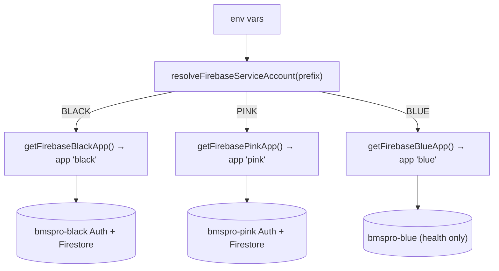

### Why both Supabase and Firebase?

The Command Center user system lives in **Supabase**. But the workshop/booking platform
(**BMS Black**) authenticates with **Firebase**. To let one Supabase login drive both, the
backend signs the same email/password into Firebase at login time and stores the resulting
idToken keyed by the Supabase user id. Later, when the user hits a `/api/bms-black/*` route,
the backend looks up that stored Firebase token and forwards it upstream.

---

## 8. Application bootstrap (how the server starts)

`src/server.ts` is the entry point. The order matters:

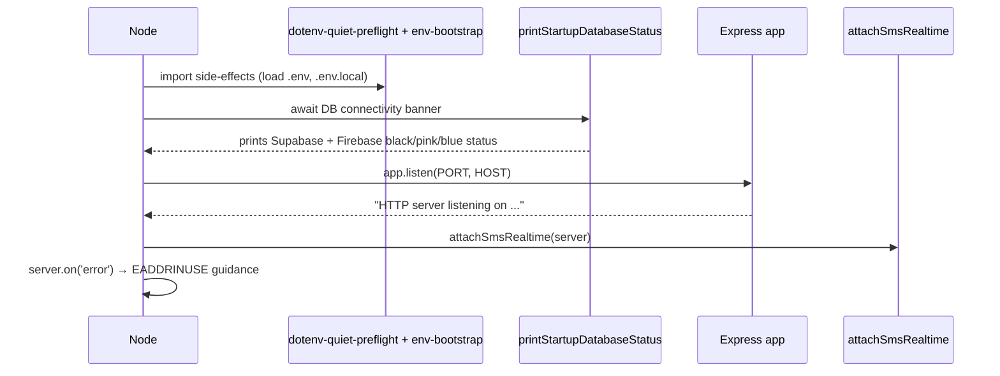

1. `import "./dotenv-quiet-preflight.js"` — sets `DOTENV_CONFIG_QUIET` so dotenv v17 stays
   quiet.
2. `import "./env-bootstrap.js"` — loads `.env`, then `.env.local` (overrides), relative to
   `package.json`.
3. `printStartupDatabaseStatus(PORT, HOST)` — checks Supabase Auth health and each Firebase
   project's Firestore, then prints a banner.
4. `app.listen(PORT, HOST)` — start HTTP.
5. `attachSmsRealtime(server)` — attach the SMS WebSocket server to the same HTTP server.
6. An `error` handler gives friendly `EADDRINUSE` guidance (especially for macOS `:5000`).

### `app.ts` global middleware

```text
cors()                         → allow cross-origin
helmet({ csp: false })         → security headers (unless DISABLE_HELMET=true)
morgan("dev")                  → request logging
express.json()                 → parse JSON bodies
app.use("/api", routes)        → mount everything under /api
```

### Startup banner format

```
============================================================
  Command Center Backend  |  0.0.0.0:5050
------------------------------------------------------------
  Supabase           OK (Auth reachable)
  Firebase (black)   OK (Firestore)
  Firebase (pink)    OK (Firestore)
  Firebase (blue)    not configured
============================================================
```

Each line is one of: `not configured`, `OK (...)`, or `FAIL (...)`.

---

## 9. Authentication overview

There are three distinct credentials in play, with three different lifetimes and storage
locations:

| Credential | Issued by | Where it lives | Lifetime |
|-----------|-----------|----------------|----------|
| **Supabase `access_token`** | Supabase Auth | Sent by the client on every request as `Authorization: Bearer` | JWT ~1h internally, **auto‑refreshed for 4h** server‑side |
| **Firebase Black idToken** | Firebase (Black) | Server‑side store keyed by Supabase user id | ~1h, **auto‑refreshed for 4h** |
| **Firebase Pink idToken** | Firebase (Pink) | Server‑side store keyed by Supabase user id | ~1h, **auto‑refreshed for 4h** |

The client only ever handles the **Supabase** token. The two Firebase idTokens never leave the
server (they are not returned in the login JSON).

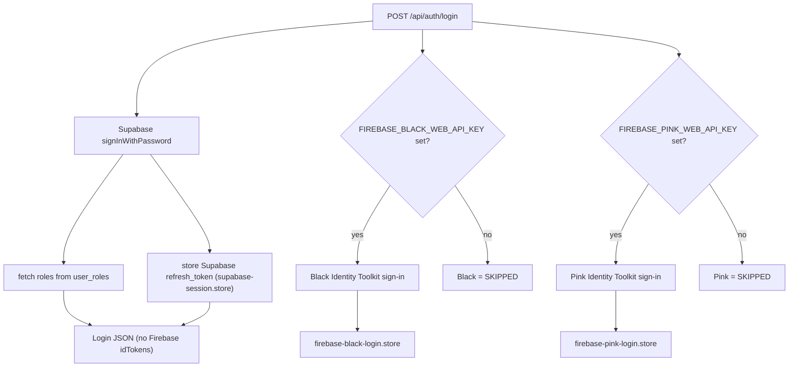

---

## 10. Login flow in detail

**Endpoint:** `POST /api/auth/login`
**Body:** `{ "email": "...", "password": "..." }`
**Auth:** none (this is how you get a token)

Handled by `loginWithSupabasePassword` in `src/services/auth/supabase-auth.service.ts`.

### Step by step

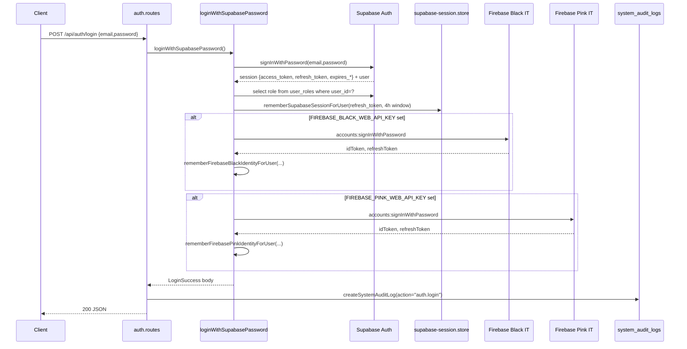

1. **Validate body** — `email` and `password` required (400 otherwise).
2. **Supabase sign‑in** — uses anon key. On failure returns 401 (or 503 if it looks like a
   network/DNS problem).
3. **Roles** — `SELECT role FROM user_roles WHERE user_id = <id>`.
4. **Store Supabase refresh token** — `rememberSupabaseSessionForUser(...)` saves the
   `refresh_token` and starts a 4‑hour window.
5. **Firebase Black** — if `FIREBASE_BLACK_WEB_API_KEY` is set, sign into Identity Toolkit and
   store the idToken via `rememberFirebaseBlackIdentityForUser`. Otherwise the response marks
   Black as `SKIPPED`.
6. **Firebase Pink** — same with `FIREBASE_PINK_WEB_API_KEY`.
7. **Audit log** — the route writes an `auth.login` row to `system_audit_logs` (best‑effort).
8. **Terminal banner** — a bordered `[BMS LOGIN]` summary prints to the server console showing
   Supabase + Black + Pink status (SUCCESS / FAILED / SKIPPED).

### Login response shape

```json
{
  "access_token": "eyJ...",
  "refresh_token": "...",
  "expires_in": 14400,
  "expires_at": 1780654011,
  "token_type": "bearer",
  "user": {
    "id": "5910b9f1-f558-47e1-b009-534e3e0affea",
    "email": "agent@example.com",
    "user_metadata": { "display_name": "Agent", "agent_type": "command-centre" }
  },
  "roles": ["agent"],
  "agentType": "command-centre",
  "sessionValidUntil": 1780654011,
  "sessionValidHours": 4,
  "firebaseBlackIdentityToolkit": {
    "ok": true,
    "stored": true,
    "localId": "u8Fc4QJh6cYh0PlsgNv1q0KMTrY2",
    "email": "agent@example.com",
    "registered": true,
    "sessionValidUntil": 1780654011,
    "sessionValidHours": 4
  },
  "firebasePinkIdentityToolkit": {
    "ok": true,
    "stored": true,
    "sessionValidUntil": 1780654011,
    "sessionValidHours": 4
  }
}
```

Key points:

- **Firebase idTokens are not in the response.** Only a status object (`ok`, `stored`,
  `localId`, …) is returned. The actual tokens stay server‑side.
- `expires_in` / `expires_at` reflect the **4‑hour session window**, not Supabase's raw ~1h
  JWT (see next section).
- If a Firebase project is not configured, its block is `{ "ok": false, "error": "SKIPPED — ..." }`.

### `GET /api/auth/me`

Returns the current profile derived from the Bearer token:

```json
{ "uid": "...", "email": "...", "displayName": "...", "roles": ["agent"], "role": "agent", "agentType": "command-centre" }
```

---

## 11. The 4-hour session (Supabase + Firebase)

By default Supabase access tokens expire in ~1 hour and Firebase idTokens in ~1 hour. The
requirement here is that a user stays signed in for **4 hours** without re‑entering
credentials. This is achieved with **one shared config** and **auto‑refresh on every API
call**.

### The single source of truth

`src/services/auth/firebase-stored-session.config.ts` defines the window:

```12:23:src/services/auth/firebase-stored-session.config.ts
/**
 * How long stored auth sessions stay valid after login (Supabase access_token refresh +
 * Firebase Black/Pink idToken auto-refresh).
 * Override with `AUTH_SESSION_HOURS` or `FIREBASE_STORED_SESSION_HOURS` in `.env` (e.g. `4`).
 */
export function getFirebaseStoredSessionMs(): number {
  return sessionHoursFromEnv() * 60 * 60 * 1000;
}

/** JWT `expires_in` seconds aligned with the configured session window. */
export function getAuthSessionExpiresInSeconds(): number {
  return sessionHoursFromEnv() * 60 * 60;
}
```

And builds the login/refresh expiry fields:

```39:54:src/services/auth/firebase-stored-session.config.ts
/** `expires_in` / `expires_at` / `sessionValidUntil` for login and refresh JSON (default 4h). */
export function authSessionTokenExpiryForResponse(validUntilSec?: number): {
  expires_in: number;
  expires_at: number;
  sessionValidUntil: number;
  sessionValidHours: number;
} {
  const sessionValidUntil =
    validUntilSec ?? Math.floor(authStoredSessionValidUntil() / 1000);
  return {
    expires_in: getAuthSessionExpiresInSeconds(),
    expires_at: sessionValidUntil,
    sessionValidUntil,
    sessionValidHours: getAuthSessionHours(),
  };
}
```

### Three layers of "4 hours"

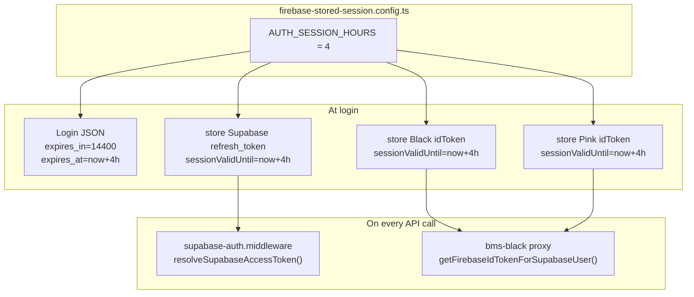

| Layer | Real token lifetime | How 4 hours is achieved |
|-------|---------------------|-------------------------|
| **Login JSON** (`expires_in`, `expires_at`) | Supabase JWT ~1h internally | Response fields are overwritten to the 4h window. |
| **Supabase `access_token`** | JWT ~1h | Middleware auto‑refreshes via `refreshSession` for up to 4h. |
| **Firebase Black/Pink idToken** | idToken ~1h | Proxy auto‑refreshes via the Secure Token API for up to 4h. |

### Supabase auto-refresh store

`src/services/auth/supabase-session.store.ts` keeps, per Supabase user id:

- the latest `refresh_token`,
- the access token's expiry (`accessTokenExpiresAt`),
- the `sessionValidUntil` (login time + 4h).

On each protected request the middleware calls `resolveSupabaseAccessToken(token)`:

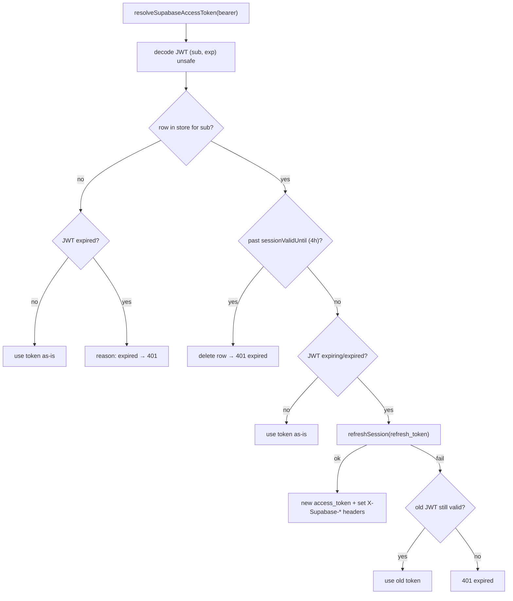

When a refresh happens mid‑request, the middleware sets response headers so the client can
adopt the new token:

```76:81:src/middleware/supabase-auth.middleware.ts
    if (resolved.refreshed) {
      res.setHeader("X-Supabase-Access-Token", resolved.accessToken);
      if (resolved.expiresAt !== undefined) {
        res.setHeader("X-Supabase-Expires-At", String(resolved.expiresAt));
      }
    }
```

Importantly, the refresh **preserves the original 4‑hour window** — it does not extend it on
every call. After 4 hours the user must log in again.

### Firebase idToken auto-refresh

`firebase-black-login.store.ts` (and the pink equivalent) store each idToken with a
`sessionValidUntil` (login + 4h). When a `/api/bms-black/*` route needs the token,
`getFirebaseIdTokenForSupabaseUser` is called:

- If past `sessionValidUntil` → drop the row, return `null` (route responds 403 "sign in
  again").
- If the idToken is within ~5 minutes of its ~1h expiry → refresh it via
  `refreshIdTokenWithRefreshToken` (Google Secure Token API), deduping concurrent refreshes.
- Otherwise → return the cached idToken.

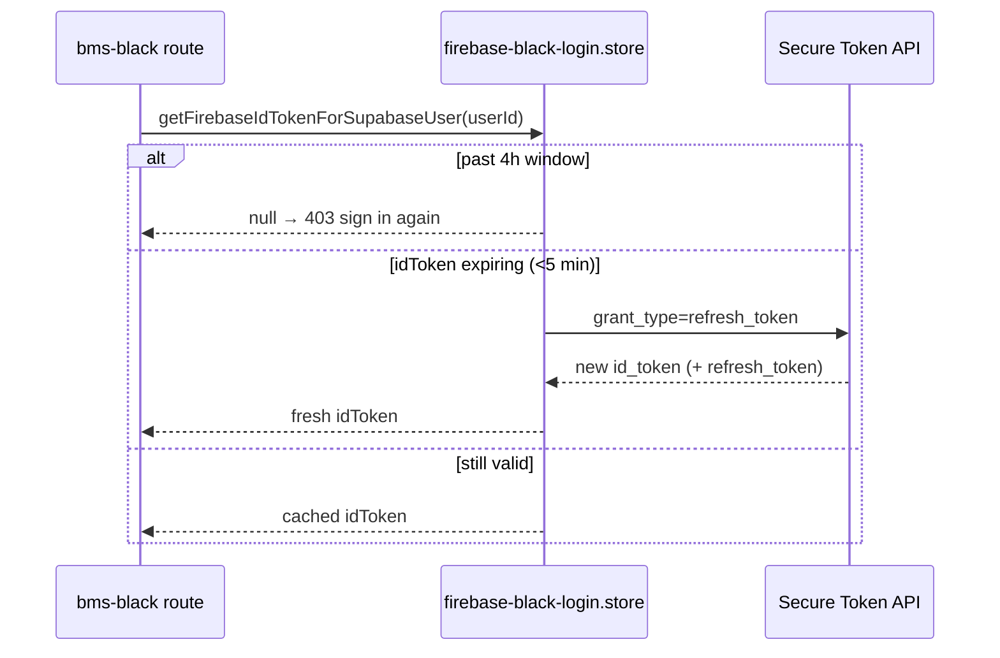

### Session timeline example

```
Login at 10:00
├── expires_in: 14400
├── expires_at: 14:00
├── sessionValidUntil: 14:00
│
10:55  API call → Supabase JWT near expiry → middleware refreshes automatically
11:55  API call → Supabase refreshed again
12:55  Black proxy call → Black idToken refreshed via Secure Token API
14:00  sessionValidUntil reached → next call returns 401/403 → must log in again
```

---

## 12. Token refresh endpoints and headers

### Automatic (preferred)

Just keep sending the same `Authorization: Bearer <access_token>`. The middleware refreshes it
for you for up to 4 hours. When it rotates the token, read these response headers and update
your stored token:

| Header | Meaning |
|--------|---------|
| `X-Supabase-Access-Token` | A freshly minted Supabase access token. |
| `X-Supabase-Expires-At` | Unix seconds for the 4h session end. |

### Explicit refresh

**Endpoint:** `POST /api/auth/refresh`
**Body:** `{ "refresh_token": "<from login>" }`

Returns a new session with the same 4‑hour window:

```json
{
  "access_token": "eyJ...",
  "refresh_token": "...",
  "expires_in": 14400,
  "expires_at": 1780654011,
  "token_type": "bearer",
  "sessionValidUntil": 1780654011,
  "sessionValidHours": 4
}
```

This is implemented by `refreshSupabaseAuthSession` → `refreshSupabaseSessionWithRefreshToken`,
which also updates the server‑side store so subsequent automatic refreshes keep working.

---

## 13. Middleware chain

There are two middleware files, exposing several functions.

### `supabase-auth.middleware.ts`

| Function | Purpose |
|----------|---------|
| `attachSupabaseUser` | Validates the Bearer token (with auto‑refresh), loads roles, and sets `res.locals.supabaseAuth = { user, roles }`. |
| `requireSupabaseSuperAdmin` | After `attachSupabaseUser`, requires a super‑admin role (defined but not currently wired to a route). |

`attachSupabaseUser` pipeline:

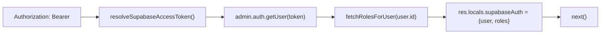

If the token is missing → 401 with guidance to log in. If invalid/expired → 401. If Supabase
is not configured → 500.

### `super-admin-or-setup.middleware.ts`

| Function | Purpose |
|----------|---------|
| `authorizeSuperAdminOrSetup(req, res)` | Returns `{ kind: "setup-secret" }`, or `{ kind: "bearer", user, roles }`, or sends 401/403 and returns `null`. |
| `requireSuperAdminOrSetup` | Wraps the above and stores the result in `res.locals.superAdminAuth`. |

Authorization order:

1. If `x-setup-secret` is present and equals `SETUP_SECRET_KEY` → authorize as **setup‑secret**.
2. Otherwise require a Bearer token, fetch roles, and check `roleMayRegisterAgents`.

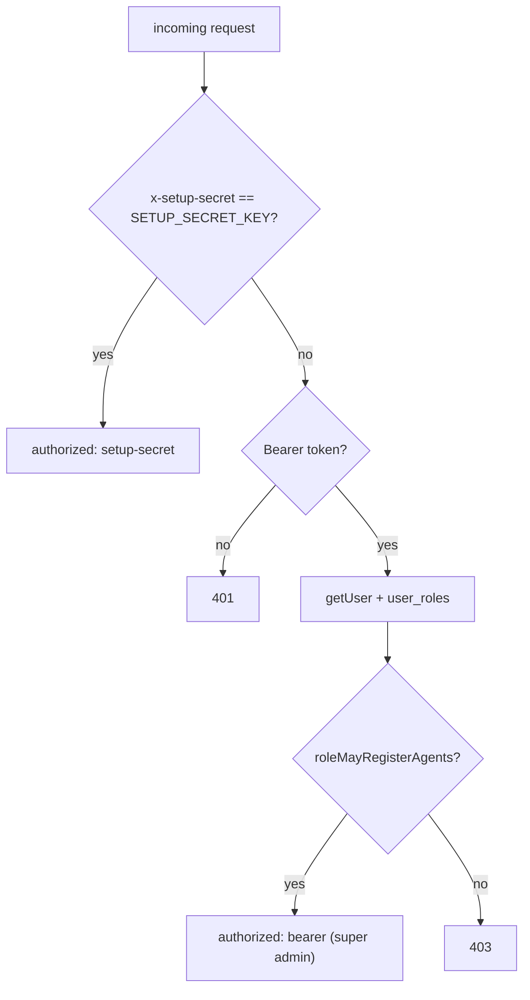

This gate is used by agent management, dashboard metrics, DID mappings, and audit‑log listing.

### Role rules — `config/supabase-app-role.ts`

- `getSuperAdminRoleForInsert()` → role string used when bootstrapping a super admin.
- `roleMayRegisterAgents(role)` → true if the role is the configured super‑admin role
  (`SUPABASE_SUPER_ADMIN_ROLE` / `APP_ROLE_SUPER_ADMIN`) or one of the legacy aliases
  (`super_admin`, `super-admin`, `superadmin`, `admin`).

---

## 14. Super admin registration

The first user must be bootstrapped because there is no super admin yet to authorize the
request. This is gated by the shared setup secret instead of a Bearer token.

**Endpoint:** `POST /api/super-admin/register`
**Header:** `x-setup-secret: <SETUP_SECRET_KEY>`
**Body:** `{ "email", "password", "displayName" }` (password ≥ 6 chars)
**Service:** `bootstrapSuperAdminSupabase`

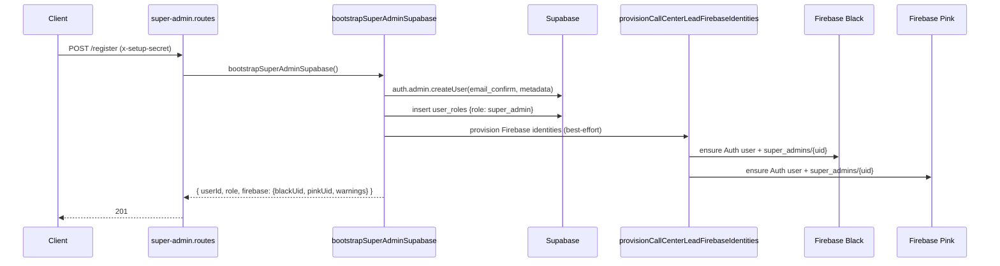

What gets written:

| System | Write |
|--------|-------|
| Supabase Auth | new user, `email_confirm: true`, metadata `display_name`, `agent_type: "command-centre"` |
| Supabase `user_roles` | `{ user_id, role }` (super‑admin role) |
| Firebase Black Auth | user via `ensureFirebaseBlackAuthUser` |
| Firebase Black Firestore | `super_admins/{blackUid}` |
| Firebase Pink Auth | user via `ensureFirebasePinkAuthUser` |
| Firebase Pink Firestore | `super_admins/{pinkUid}` |

Supabase creation is **required**; Firebase provisioning is **best‑effort** (failures become
`warnings`, not errors). It does **not** write to the `agents` table.

**Response (201):**

```json
{
  "success": true,
  "userId": "…",
  "role": "super_admin",
  "firebase": { "blackUid": "…", "pinkUid": "…", "warnings": [] },
  "message": "Super admin created in Supabase + Firebase Black + Firebase Pink. Sign in with POST /api/auth/login."
}
```

---

## 15. Agent registration

Agents are created on the Command Center (Supabase) **and** provisioned into Firebase Black and
Pink, so they can later be authenticated against the BMS platforms.

**Endpoint:** `POST /api/agents/register`
**Auth (either):**
- `Authorization: Bearer <super-admin access_token>`, or
- `x-setup-secret: <SETUP_SECRET_KEY>` (bootstrap/local)

**Body (required):** `name`, `email`, `phone`, `password`, `extension`
**Body (optional):** `notes`, `agentType` (`command-centre` | `workshop`), `tenantId`,
`workshopOwnerUid`, `workshopBranchId`, `workshopUserRole` (`owner` | `branch_admin` | `staff`)

Both auth paths converge on `registerAgentOnCommandCenter`.

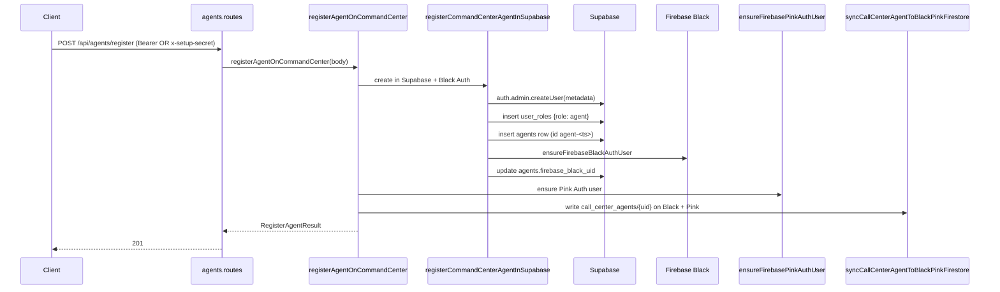

What gets written:

| System | Write |
|--------|-------|
| Supabase Auth | new user (`display_name`, `agent_type`) |
| Supabase `user_roles` | `{ user_id, role: "agent" }` |
| Supabase `agents` | full agent row (`id: agent-<timestamp>`), then `firebase_black_uid` |
| Supabase `tenants` | read‑only validation when `tenantId` is supplied |
| Firebase Black Auth | `ensureFirebaseBlackAuthUser` |
| Firebase Pink Auth | `ensureFirebasePinkAuthUser` |
| Firebase Black Firestore | `call_center_agents/{blackUid}` |
| Firebase Pink Firestore | `call_center_agents/{pinkUid}` |

**Validation highlights:**

- `extension` is required.
- For workshop agents, `workshopOwnerUid`, `workshopBranchId`, and a valid `workshopUserRole`
  are required.
- If `tenantId` is provided, it is validated against the `tenants` table.

> Registration uses the Firebase **Admin SDK** only — it does not need the Web API keys, and it
> does not call the BMS Black HTTP API.

### Agent management endpoints

All under `/api/agents` and gated by `authorizeSuperAdminOrSetup`:

| Method | Path | Purpose |
|--------|------|---------|
| GET | `/api/agents` | List command‑center + workshop agents (filters: `agentType`, `tenantId`, `ownerUid`, `branchId`, `role`, `status`, `search`, `limit`, `offset`). |
| GET | `/api/agents/performance` | Performance from `agents` + `calls` (many filters). |
| GET | `/api/agents/:id` | View one agent. |
| PATCH | `/api/agents/:id` | Edit an agent. |
| DELETE | `/api/agents/:id` | Delete an agent (also best‑effort removes `user_roles` + Supabase Auth user). |

---

## 16. The BMS Black proxy layer

Routes under `/api/bms-black/*` do not store data locally — they forward to the external BMS
Black API. The incoming request carries a **Supabase** Bearer token; the outgoing request
carries the user's **Firebase Black** idToken.

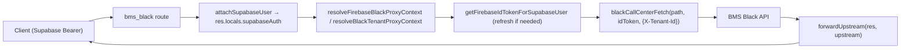

### Helpers — `routes/bms_black/black-proxy.helpers.ts`

| Function | Role |
|----------|------|
| `resolveFirebaseBlackProxyContext(res)` | Requires `res.locals.supabaseAuth.user.id`; loads/refreshes the Firebase Black idToken. 401 if no Supabase session, 403 if no stored Firebase token. |
| `resolveBlackTenantProxyContext(req, res)` | Same, **plus** requires the `X-Tenant-Id` header (owner uid). 400 if missing. |
| `optionalTenantId(req)` | Returns `X-Tenant-Id` if present, else `undefined`. |
| `runBlackProxy(res, call)` | Executes the upstream call; 502 on network error, else forwards. |
| `forwardUpstream(res, upstream)` | Copies status; parses JSON or plain text. |

### Forwarding util — `services/bms_black/black-call-center.proxy.util.ts`

- `blackEndpoint(path)` → `{BLACK_API_BASE_URL}{path}` (default host `https://black.bmspros.com.au`).
- `firebaseBlackHeaders(idToken, tenantId?)` →
  - `Authorization: Bearer <idToken>`
  - `Accept: application/json`
  - `X-Tenant-Id: <tenantId>` (only when provided)
- `blackCallCenterFetch(path, idToken, init?)` → `fetch` with those headers merged.

### Two tenant modes

| Mode | Used by | `X-Tenant-Id` |
|------|---------|---------------|
| Firebase‑only | e.g. `GET /getallbooking`, notifications, some chats | Not required (sent only when explicitly passed). |
| Tenant‑scoped | most bookings, services, branches, staff | **Required** on the incoming request; forwarded upstream. |

---

## 17. The service / pipeline pattern

Most Supabase features follow a three‑layer separation so HTTP concerns, business rules, and
raw queries stay decoupled.

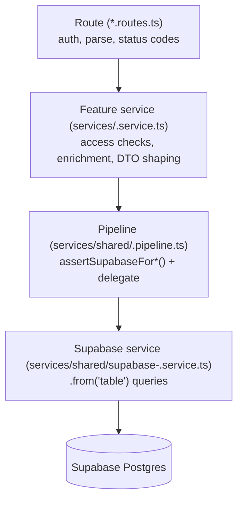

| Layer | Owns |
|-------|------|
| Route | Express handlers, `attachSupabaseUser`, filter parsing, HTTP status codes. |
| Feature service | Domain rules not tied to HTTP/SQL (e.g. "can this agent view this call?", report building, public DTOs). |
| Pipeline | Validates `SUPABASE_URL` + `SUPABASE_SERVICE_ROLE_KEY`, then delegates to the low‑level service. |
| Supabase service | PostgREST operations on specific tables. |

Pipelines (in `src/services/shared/`):

| Pipeline | Main tables |
|----------|-------------|
| `calls.pipeline.ts` | `calls`, `agents` |
| `agent-chat.pipeline.ts` | `agent_conversations`, `agent_messages`, `agents` |
| `agent-attendance.pipeline.ts` | `agent_attendance_events`, `agents` |
| `agent-leave-requests.pipeline.ts` | `agent_leave_requests` |
| `agent-shift-schedules.pipeline.ts` | `agent_shift_schedules` |
| `did-mappings.pipeline.ts` | `did_mappings` |
| `system-audit-logs.pipeline.ts` | `system_audit_logs` |
| `sales-suburb-workshops.pipeline.ts` | `sales_suburb_workshops`, `sales_agent_suburb_assignments` |
| `sales-agent-suburb-assignments.pipeline.ts` | `sales_agent_suburb_assignments` |
| `sales-suburb-workshop-agent-contacts.pipeline.ts` | `sales_suburb_workshop_agent_contact` |

Exceptions: `sms.service.ts` and the dashboard metrics service talk to Supabase directly.
Agent registration uses `agent-register.service.ts` and
`auth/register-command-center-agent-supabase.service.ts`, followed by Firebase provisioning.

> Domain shapes live in `src/types/` (not `src/models/`). The `dist/models/**` files are empty
> leftover stubs and are not used.

---

## 18. Realtime (SMS WebSocket)

`src/realtime/sms-events.ts` runs a `ws` `WebSocketServer` attached to the same HTTP server,
at path `/api/sms/socket`. It is the only realtime feature (there are no Supabase Realtime
subscriptions).

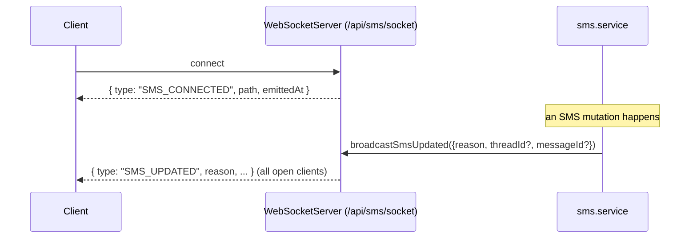

Events:

| Event | When | Payload |
|-------|------|---------|
| `SMS_CONNECTED` | On connect | `{ path, emittedAt }` |
| `SMS_UPDATED` | After an SMS mutation | `{ reason, threadId?, messageId?, emittedAt }` |

`SMS_UPDATED` reasons: `inbound`, `thread_started`, `thread_claimed`, `message_sent`,
`thread_resolved`.

---

## 19. Full API reference

All endpoints are mounted under `/api`. Auth column legend:

- **none** — no auth.
- **Bearer** — `Authorization: Bearer <Supabase access_token>` (via `attachSupabaseUser`).
- **SA/Setup** — super‑admin Bearer **or** `x-setup-secret`.
- **Setup** — `x-setup-secret` only.
- **Webhook** — TextBee webhook secret.

### Root & health

| Method | Path | Auth | Description |
|--------|------|------|-------------|
| GET | `/api` | none | Service info + the full API index. |
| GET | `/api/health/db` | none | Supabase + Firebase (black/pink) connectivity. |

### Auth — `/api/auth`

| Method | Path | Auth | Description |
|--------|------|------|-------------|
| POST | `/api/auth/login` | none | Sign in; returns Supabase session (4h) + Firebase Black/Pink status. |
| POST | `/api/auth/refresh` | none | Refresh Supabase token with `{ refresh_token }`; same 4h window. |
| GET | `/api/auth/me` | Bearer | Current profile. |

### Super admin — `/api/super-admin`

| Method | Path | Auth | Description |
|--------|------|------|-------------|
| POST | `/api/super-admin/register` | Setup | Bootstrap super admin (Supabase + Firebase Black/Pink). |

### Agents — `/api/agents`

| Method | Path | Auth | Description |
|--------|------|------|-------------|
| POST | `/api/agents/register` | SA/Setup | Create agent across Supabase + Firebase Black/Pink. |
| GET | `/api/agents` | SA/Setup | List agents (filters above). |
| GET | `/api/agents/performance` | SA/Setup | Agent performance from `agents` + `calls`. |
| GET | `/api/agents/:id` | SA/Setup | View one agent. |
| PATCH | `/api/agents/:id` | SA/Setup | Edit one agent. |
| DELETE | `/api/agents/:id` | SA/Setup | Delete one agent (+ linked role / auth user). |

### BMS Black proxy — `/api/bms-black`

Bookings:

| Method | Path | Tenant header | Description |
|--------|------|---------------|-------------|
| GET | `/api/bms-black/getallbooking` | optional | List bookings. |
| GET | `/api/bms-black/bookings/availability` | required | Availability (`branchId`, `date`, `serviceIds`). |
| GET | `/api/bms-black/staff` | required | Workshop staff (`branchId`, optional `role`, `status`). |
| POST | `/api/bms-black/bookings` | required | Create a booking. |
| GET | `/api/bms-black/bookings/:bookingId` | required | Get booking by id. |
| PATCH | `/api/bms-black/bookings/:bookingId` | required | Workflow status `{ status: Confirmed \| Canceled }`. |
| POST | `/api/bms-black/bookings/:bookingId/confirm` | required | Confirm with staff assignments. |
| PATCH | `/api/bms-black/bookings/:bookingId/reschedule` | required | Reschedule (`newDate`, `newTime`, `reason`). |
| POST | `/api/bms-black/bookings/:bookingId/cancel` | required | Cancel (`reason`). |
| GET | `/api/bms-black/bookings/:bookingId/additional-issues` | required | List additional issues. |
| PATCH | `/api/bms-black/bookings/:bookingId/additional-issues/:issueId` | optional | Customer response (`accept`/`reject`). |
| PATCH | `/api/bms-black/bookings/:bookingId/additional-issues/:issueId/price` | optional | Price approve/reject. |

> Note on PATCH status: BMS Black production returns 405 for a raw `PATCH` on a booking, so the
> Command Center maps `Canceled` → the POST cancel endpoint and `Confirmed` → the POST confirm
> endpoint.

Notifications:

| Method | Path | Description |
|--------|------|-------------|
| GET | `/api/bms-black/customer-notifications` | All call‑center notifications (optional `all=1`). |
| POST | `/api/bms-black/customer-notifications/:notificationId/notification-reviewed` | Mark/unmark reviewed. |
| POST | `/api/bms-black/customer-notifications/:notificationId/called-customer` | Log a customer call. |

Support chat (`/agent/conversations/*`):

| Method | Path | Description |
|--------|------|-------------|
| GET | `/api/bms-black/agent/conversations` | Queue + my conversations. |
| GET | `/api/bms-black/agent/conversations/:conversationId/messages` | Messages. |
| POST | `/api/bms-black/agent/conversations/:conversationId/messages` | Send agent message. |
| POST | `/api/bms-black/agent/conversations/:conversationId/claim` | Claim. |
| POST | `/api/bms-black/agent/conversations/:conversationId/read` | Mark read. |
| POST | `/api/bms-black/agent/conversations/:conversationId/close` | Close (optional `farewellMessage`). |

Call‑center chats (`/chats/*`, `cc_...` ids):

| Method | Path | Description |
|--------|------|-------------|
| GET | `/api/bms-black/chats/workshop-owners` | List workshop owners. |
| POST | `/api/bms-black/chats/start-with-owner` | Start chat (`workshopOwnerUid`, optional `text`). |
| GET | `/api/bms-black/chats/:chatId/messages` | Messages (`limit`, `before`). |
| POST | `/api/bms-black/chats/:chatId/messages` | Send message (`text`). |
| POST | `/api/bms-black/chats/:chatId/close` | Close chat (optional `farewellMessage`). |

Services & branches:

| Method | Path | Tenant header | Description |
|--------|------|---------------|-------------|
| GET | `/api/bms-black/services` | required | List services. |
| GET | `/api/bms-black/services-by-branch` | required | Services for `branchId`. |
| GET | `/api/bms-black/services/:id` | required | Service by id. |
| GET | `/api/bms-black/services/:serviceId/staff` | required | Staff for service (`branchId`, `date`). |
| GET | `/api/bms-black/branches` | required | Branches for owner (optional `ownerUid`). |
| GET | `/api/bms-black/branches/:branchId` | required | Branch by id. |

### Calls — `/api/calls`

| Method | Path | Auth | Description |
|--------|------|------|-------------|
| GET | `/api/calls` | Bearer | List calls. Super admin: all + `recording_url`; agent: own answered only. Filters: `callerName`, `direction`/`inbound`/`outbound`, `date` or `from`+`to`, `tenantId`, `queueId`, `agentId` (super admin), `result`, `limit`, `offset`. |
| GET | `/api/calls/:id` | Bearer | Get one call (same access rules). |

### Dashboard — `/api/dashboard`

| Method | Path | Auth | Description |
|--------|------|------|-------------|
| GET | `/api/dashboard/metrics` | SA/Setup | All KPIs. |
| GET | `/api/dashboard/online-agents-count` | SA/Setup | Online agent count. |
| GET | `/api/dashboard/today-calls-count` | SA/Setup | Today's calls. |
| GET | `/api/dashboard/answer-rate` | SA/Setup | Answer rate %. |
| GET | `/api/dashboard/abandon-rate` | SA/Setup | Abandon rate %. |
| GET | `/api/dashboard/avg-handle` | SA/Setup | Average handle seconds. |
| GET | `/api/dashboard/sla` | SA/Setup | SLA % (default 20s). |

Filters: `date` or `from`+`to`, `tenantId`, `queueId`, `agentId`, `direction`, `onlineStatus`,
`slaSeconds`.

### Internal agent chat — `/api/agent-chat`

| Method | Path | Auth | Description |
|--------|------|------|-------------|
| GET | `/api/agent-chat/conversations` | Bearer | List conversations (agent: own + unread; super admin: all). |
| POST | `/api/agent-chat/conversations` | Bearer | Get or create (`peerAgentId`, optional `selfAgentId`). |
| GET | `/api/agent-chat/conversations/:id` | Bearer | Get one. |
| GET | `/api/agent-chat/conversations/:id/messages` | Bearer | Messages (`limit`, `offset`, `after`). |
| POST | `/api/agent-chat/conversations/:id/messages` | Bearer | Send (`content`, optional `selfAgentId`). |
| POST | `/api/agent-chat/conversations/:id/read` | Bearer | Mark peer messages read. |

### SMS — `/api/sms`

| Method | Path | Auth | Description |
|--------|------|------|-------------|
| POST | `/api/sms/textbee-webhook` | Webhook | Inbound SMS webhook. |
| GET | `/api/sms/inbox` | Bearer | Queues + active threads. |
| GET | `/api/sms/threads/:threadId/messages` | Bearer | Thread messages (oldest first). |
| POST | `/api/sms/threads/start` | Bearer | Start/reopen + send (`customerPhone`, `messageBody`, optional `queueId`). |
| POST | `/api/sms/threads/:threadId/claim` | Bearer | Claim a thread. |
| POST | `/api/sms/threads/:threadId/messages` | Bearer | Send outbound on a claimed thread (`messageBody`). |
| POST | `/api/sms/threads/:threadId/resolve` | Bearer | Resolve thread. |

WebSocket: `/api/sms/socket` (events `SMS_CONNECTED`, `SMS_UPDATED`).

### Agent attendance — `/api/agent-attendance`

| Method | Path | Auth | Description |
|--------|------|------|-------------|
| GET | `/api/agent-attendance/status` | Bearer | Current shift state (`agentId` or `userId`). |
| GET | `/api/agent-attendance/reports` | Bearer | Summary (`groupBy=day\|week\|month`, `from`, `to`). |
| GET | `/api/agent-attendance/events` | Bearer | List events (agent: own; super admin: filters). |
| POST | `/api/agent-attendance/events` | Bearer | Record `clock_in\|break_start\|break_end\|clock_out` (409 on invalid transition). |
| GET | `/api/agent-attendance/events/:id` | Bearer | Get one event (agent: own). |

### Agent leave requests — `/api/agent-leave-requests`

| Method | Path | Auth | Description |
|--------|------|------|-------------|
| GET | `/api/agent-leave-requests` | Bearer | List (agent: own; super admin: all + filters). |
| POST | `/api/agent-leave-requests` | Bearer | Apply (`startDate`, `endDate`, `durationType`, `halfDayPart?`, `reason?`, `attachmentStoragePath?`). |
| GET | `/api/agent-leave-requests/:id` | Bearer | Get one. |
| DELETE | `/api/agent-leave-requests/:id` | Bearer | Delete own pending request. |
| PATCH | `/api/agent-leave-requests/:id/review` | Bearer (super admin) | Approve/reject (`status`, `reviewComment?`). |

### Agent shift schedules — `/api/agent-shift-schedules`

| Method | Path | Auth | Description |
|--------|------|------|-------------|
| GET | `/api/agent-shift-schedules` | Bearer | List (agent: own; super admin: all). |
| GET | `/api/agent-shift-schedules/me` | Bearer | Current agent's schedule. |
| GET | `/api/agent-shift-schedules/:agentId` | Bearer | Get one by `agents.id`. |
| PUT | `/api/agent-shift-schedules/:agentId` | Bearer (super admin) | Upsert weekly schedule (`monday`…`sunday`). |

### Sales suburb workshops — `/api/sales-suburb-workshops`

| Method | Path | Auth | Description |
|--------|------|------|-------------|
| GET | `/api/sales-suburb-workshops` | Bearer | List (agent: assigned suburbs). |
| POST | `/api/sales-suburb-workshops` | Bearer | Create (`tenantId` fixed to `t-1775956177847`). |
| GET | `/api/sales-suburb-workshops/:id` | Bearer | View one. |
| PATCH | `/api/sales-suburb-workshops/:id` | Bearer (super admin) | Edit. |
| DELETE | `/api/sales-suburb-workshops/:id` | Bearer (super admin) | Delete. |

### Sales agent suburb assignments — `/api/sales-agent-suburb-assignments`

| Method | Path | Auth | Description |
|--------|------|------|-------------|
| GET | `/api/sales-agent-suburb-assignments` | Bearer | List (agent: own). |
| POST | `/api/sales-agent-suburb-assignments` | Bearer (super admin) | Assign (`tenantId`, `agentId`, `suburb`). |
| GET | `/api/sales-agent-suburb-assignments/:id` | Bearer | View one. |
| PATCH | `/api/sales-agent-suburb-assignments/:id` | Bearer (super admin) | Edit. |
| DELETE | `/api/sales-agent-suburb-assignments/:id` | Bearer (super admin) | Delete. |

### Sales workshop agent contacts — `/api/sales-suburb-workshop-agent-contacts`

| Method | Path | Auth | Description |
|--------|------|------|-------------|
| GET | `/api/sales-suburb-workshop-agent-contacts` | Bearer | List (agent: own). |
| GET | `/api/sales-suburb-workshop-agent-contacts/workshops/:workshopId` | Bearer | One row by workshop (super admin: `?agentId=`). |
| POST | `/api/sales-suburb-workshop-agent-contacts` | Bearer | Create (`workshopId`, optional fields). |
| GET | `/api/sales-suburb-workshop-agent-contacts/:id` | Bearer | View one. |
| PATCH | `/api/sales-suburb-workshop-agent-contacts/:id` | Bearer | Update (agent: limited fields; super admin: any). |
| DELETE | `/api/sales-suburb-workshop-agent-contacts/:id` | Bearer (super admin) | Delete. |

### DID mappings — `/api/did-mappings`

| Method | Path | Auth | Description |
|--------|------|------|-------------|
| GET | `/api/did-mappings` | SA/Setup | List (`?tenantId=&queueId=`). |
| GET | `/api/did-mappings/:did` | SA/Setup | Get one by DID. |
| POST | `/api/did-mappings` | SA/Setup | Create mapping. |
| PATCH | `/api/did-mappings/:did` | SA/Setup | Partial update. |
| DELETE | `/api/did-mappings/:did` | SA/Setup | Delete. |

### System audit logs — `/api/system-audit-logs`

| Method | Path | Auth | Description |
|--------|------|------|-------------|
| POST | `/api/system-audit-logs` | Bearer | Create a log (`action`, `resourceType`, `resourceId?`, `details?`). |
| GET | `/api/system-audit-logs` | SA/Setup | List (`?userId=&action=&resourceType=&resourceId=&from=&to=&limit=&offset=`). |
| GET | `/api/system-audit-logs/:id` | SA/Setup | Get one by UUID. |

### AI agent activity — `/api/ai/agent-activity/events`

The voice bridge posts append-only call lifecycle, model usage, and MCP tool outcome
events to `POST /api/ai/agent-activity/events`. Regular calls authenticate with the
existing `AI_VOICE_BRIDGE_SECRET`; onboarding calls use the separate
`AI_ONBOARDING_BRIDGE_SECRET`. Super-admins read the paginated feed through
`GET /api/ai/agent-activity/events?limit=&offset=&brand=&mode=&did=&from=&to=`.
Apply `scripts/add-ai-agent-activity.sql` to the Command Centre Supabase project before
enabling bridge telemetry. The event table stores safe identifiers, durations, audio
byte counts, reported token counters, and tool status; it intentionally excludes caller
audio, transcripts, tool arguments, and raw tool results.

---

## 20. Database tables reference

These are the Supabase (Postgres) tables the backend reads/writes. (BMS Black data lives in
the external platform, not here.)

| Table | Used by |
|-------|---------|
| `user_roles` | Auth middleware, role checks, registration. |
| `agents` | Almost everything (calls, chat, attendance, shifts, leave, SMS, dashboard, sales, agents API). |
| `tenants` | Agent registration validation. |
| `calls` | Calls API, dashboard metrics, agent performance. |
| `agent_attendance_events` | Attendance. |
| `agent_conversations` | Internal agent chat. |
| `agent_messages` | Internal agent chat. |
| `agent_leave_requests` | Leave requests. |
| `agent_shift_schedules` | Shift schedules. |
| `did_mappings` | DID → tenant/queue routing. |
| `sales_suburb_workshops` | Sales workshop directory. |
| `sales_agent_suburb_assignments` | Agent↔suburb assignments + scoping. |
| `sales_suburb_workshop_agent_contact` | Per‑agent workshop contact tracking. |
| `sms_queues` | SMS inbox. |
| `sms_threads` | SMS threads. |
| `sms_messages` | SMS messages. |
| `system_audit_logs` | Audit trail. |
| `ai_agent_activity_events` | AI call usage transactions and per-call tool audit events. |

Row shapes for these are defined in `src/types/*.types.ts`.

---

## 21. Request lifecycle (end to end)

Putting it together, here is what happens for a typical authenticated request to a Supabase
feature and to a BMS Black proxy.

### A Supabase feature request (e.g. `GET /api/calls`)

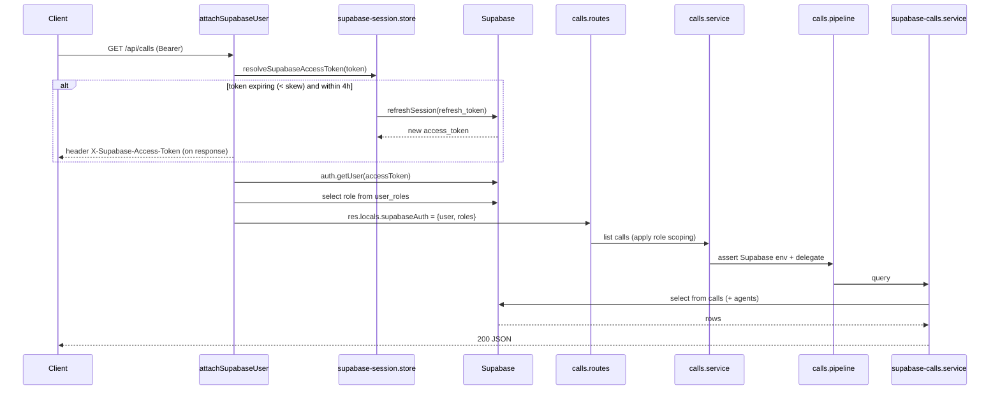

### A BMS Black proxy request (e.g. `GET /api/bms-black/services`)

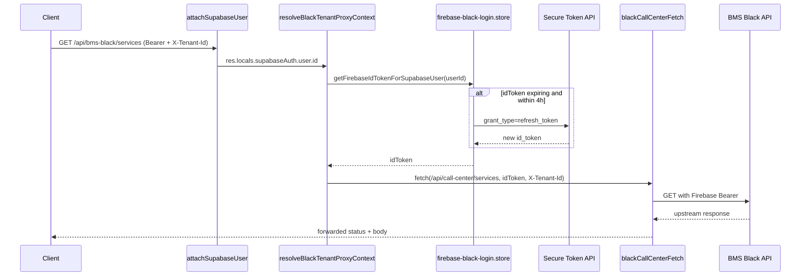

---

## 22. Conventions & error handling

### Status codes

| Code | Meaning in this backend |
|------|--------------------------|
| 200 / 201 | Success / created. |
| 400 | Missing/invalid input (e.g. missing `X-Tenant-Id`, missing body fields). |
| 401 | Missing/invalid/expired Supabase session. |
| 403 | Authorized user lacks permission, or no stored Firebase token for a proxy call. |
| 405 | (From BMS Black upstream for raw PATCH on bookings — handled by mapping.) |
| 409 | Invalid state transition (e.g. attendance events). |
| 500 | Supabase not configured / unexpected server error. |
| 502 | Upstream BMS Black network error. |
| 503 | Login could not reach Supabase (network/DNS). |

### Response conventions

- JSON everywhere; proxy routes forward upstream JSON (or plain text) and status.
- Auth failures include a human‑readable hint pointing back to `POST /api/auth/login`.
- Secrets (idTokens, refresh tokens) are never logged or returned by debug helpers.

### Auth scoping pattern

Many feature endpoints behave differently for **agents** vs **super admins**:

- Agents are scoped to their own rows (own calls, own attendance, assigned suburbs, etc.).
- Super admins see everything and can target a specific agent via `?agentId=` / `?userId=`.

This scoping is enforced in the **feature service** layer, after `attachSupabaseUser` resolves
the caller's roles.

---

## 23. Build, run & deploy

### Local development

```bash
npm run dev      # tsx watch — recompiles on save
```

### Production build

```bash
npm run build    # tsc → dist/
npm start        # node dist/server.js
```

> After any change to `src/`, run `npm run build` before `npm start`. A common "my new route
> returns 404" symptom is running stale `dist/` output.

### Process & ports

- The server binds `HOST` (default `0.0.0.0`) on `PORT` (default `5050`).
- On `EADDRINUSE`, the startup error explains the conflict (and the macOS `:5000` AirPlay
  gotcha).

### Health checks

- `GET /api` — quick "is it up + what port" check.
- `GET /api/health/db` — Supabase + Firebase black/pink connectivity (good for readiness
  probes).

### Scaling note

Token stores (Supabase refresh, Firebase Black/Pink idTokens) are **in‑memory**. This means:

- A server restart clears them → users must log in again.
- Horizontal scaling needs a shared store (e.g. Redis) keyed by Supabase user id with TTL
  aligned to the session window. Today the design assumes a single Node process.

---

## 24. Troubleshooting

| Symptom | Likely cause | Fix |
|---------|--------------|-----|
| New route returns 404 with `npm start` | Stale `dist/` | `npm run build`, then restart. |
| Login shows Firebase Black/Pink `SKIPPED` | Missing `FIREBASE_BLACK_WEB_API_KEY` / `FIREBASE_PINK_WEB_API_KEY` | Add the Web API key(s) to `.env`, restart. |
| `403` on `/api/bms-black/*` | No stored Firebase token (never logged in with the Web API key set, or server restarted, or 4h window elapsed) | Log in again at `/api/auth/login`. |
| `400` on a tenant‑scoped proxy route | Missing `X-Tenant-Id` header | Send the owner uid as `X-Tenant-Id`. |
| `401` mid‑session unexpectedly | Past the 4h `sessionValidUntil`, or refresh token revoked (password change) | Log in again. |
| `503` on login | Cannot reach Supabase (DNS/VPN) | Check network; login does not use `JWT_SECRET`. |
| Postman hits 403 on macOS `:5000` | AirPlay owns `:5000` | Use the printed port (default `5050`). |
| BMS Black `PATCH` booking status fails (405) | Upstream rejects raw PATCH | Use the mapped flow: `Canceled` → cancel POST, `Confirmed` → confirm POST. |
| `dist/models/**` look empty | Old build artifacts | Ignore; live shapes are in `src/types/`. |

---

## 25. Glossary

| Term | Meaning |
|------|---------|
| **Supabase access_token** | The JWT the client sends as `Authorization: Bearer`. Auto‑refreshed server‑side for 4h. |
| **Firebase idToken** | Short‑lived (~1h) token used to call BMS Black; stored server‑side per user, auto‑refreshed. |
| **Identity Toolkit** | Firebase REST endpoint (`accounts:signInWithPassword`) used to sign a user into Firebase at login. |
| **Secure Token API** | Google endpoint (`securetoken.googleapis.com`) used to exchange a refresh token for a new idToken. |
| **`sessionValidUntil`** | Unix seconds marking the end of the 4h session window for all tokens. |
| **`X-Tenant-Id`** | Header carrying the workshop owner uid, required by tenant‑scoped BMS Black routes. |
| **Setup secret** | `SETUP_SECRET_KEY`; allows bootstrap/admin operations without a Bearer token via `x-setup-secret`. |
| **Pipeline** | A thin shared layer that validates Supabase env and delegates to a low‑level table service. |
| **BMS Black / Pink / Blue** | The three external BMS platforms; Black is the actively proxied one, Pink is provisioned, Blue is health‑only. |
| **CC** | Command Center (this backend + its UI). |

---

### Appendix A — Auth function → route map

| Route | Service function |
|-------|------------------|
| `POST /api/super-admin/register` | `bootstrapSuperAdminSupabase` |
| `POST /api/agents/register` (setup) | `registerAgentViaSetupSecret` → `registerAgentOnCommandCenter` |
| `POST /api/agents/register` (Bearer) | `registerAgent` → `registerAgentOnCommandCenter` |
| `POST /api/auth/login` | `loginWithSupabasePassword` |
| `POST /api/auth/refresh` | `refreshSupabaseAuthSession` |
| `GET /api/auth/me` | `attachSupabaseUser` + `sessionSummaryFromLocals` |

### Appendix B — Session config functions

| Function (in `firebase-stored-session.config.ts`) | Returns |
|----------------------------------------------------|---------|
| `getFirebaseStoredSessionMs()` | Session window in milliseconds (default 4h). |
| `getAuthSessionExpiresInSeconds()` | `expires_in` seconds (default 14400). |
| `getFirebaseStoredSessionHours()` / `getAuthSessionHours()` | Session window in hours. |
| `firebaseStoredSessionValidUntil()` / `authStoredSessionValidUntil()` | Epoch ms when the session ends. |
| `authSessionTokenExpiryForResponse(validUntilSec?)` | `{ expires_in, expires_at, sessionValidUntil, sessionValidHours }` for login/refresh JSON. |

### Appendix C — Quick curl examples

Bootstrap a super admin:

```bash
curl -X POST http://127.0.0.1:5050/api/super-admin/register \
  -H "Content-Type: application/json" \
  -H "x-setup-secret: $SETUP_SECRET_KEY" \
  -d '{"email":"admin@example.com","password":"secret123","displayName":"Admin"}'
```

Log in:

```bash
curl -X POST http://127.0.0.1:5050/api/auth/login \
  -H "Content-Type: application/json" \
  -d '{"email":"admin@example.com","password":"secret123"}'
```

Call a protected route:

```bash
curl http://127.0.0.1:5050/api/auth/me \
  -H "Authorization: Bearer <access_token>"
```

Refresh the session:

```bash
curl -X POST http://127.0.0.1:5050/api/auth/refresh \
  -H "Content-Type: application/json" \
  -d '{"refresh_token":"<refresh_token>"}'
```

Proxy a tenant‑scoped Black route:

```bash
curl http://127.0.0.1:5050/api/bms-black/services \
  -H "Authorization: Bearer <access_token>" \
  -H "X-Tenant-Id: <ownerUid>"
```

---

_This README documents the backend as implemented in `src/`. When code changes, update the
relevant section (especially the API reference, env vars, and the 4‑hour session config)._
# Owner review links by SMS and email

After a confirmed, complete onboarding draft is submitted for owner review,
the backend sends its product-specific owner review URL to the saved owner's
mobile and email. Black and Trade use their existing review pages and login /
verified-owner approval checks. Notifications never approve or activate accounts.
The voice agent confirms the destinations before submission and reports the
separate `reviewNotifications.sms` and `.email` statuses returned by the tools.

Deploy the backend and run `scripts/add-ai-onboarding-review-notifications.sql`
in the same Supabase project as `ai_onboarding_drafts`. This adds a server-only
send ledger; no Black/Trade frontend or voice-bridge environment change is needed.
Provider requests are made only on review submission, never on draft saves.

Configure these variables **on the Command Centre backend**:

```dotenv
TEXTBEE_API_KEY=<existing TextBee API key>
TEXTBEE_DEVICE_ID=<registered online TextBee device id>
# Optional: TEXTBEE_SIM_SUBSCRIPTION_ID=<SIM selector>
ZEPTOMAIL_SYSTEM_TOKEN=<existing verified system mail-agent token>
ZEPTOMAIL_SYSTEM_FROM_ADDRESS=noreply@bmspros.com.au
ZEPTOMAIL_SYSTEM_FROM_NAME=BMS Pro
ZEPTOMAIL_URL=https://api.zeptomail.com.au/v1.1/email
```

`ZEPTOMAIL_TOKEN` is supported as a fallback. Use the sender and regional API URL
approved for your ZeptoMail account, matching the existing admin-panel email
setup. SMS uses TextBee's existing device-specific send API. Confirm the owner's
mobile in international format, for example `+61400000000`; local numbers are
not guessed or replaced with the onboarding DID. Review URLs must be public
HTTPS URLs, so configure production `BLACK_API_BASE_URL` and `TRADE_ADMIN_BASE_URL`
correctly before sending. A new onboarding call fetches the updated instructions.

The ledger claims each `(draft, configuration hash, channel)` before sending.
Concurrent or repeated submissions do not duplicate an accepted, failed, in-flight
or uncertain attempt. A provider timeout / interrupted attempt remains unknown;
staff must verify provider history before any manual resend. No background retry
worker or automatic resend is provided. Missing credentials or storage problems
are reported without falsely claiming a message was sent; the draft remains
submitted for review. `accepted` means provider acceptance, not delivery to an
inbox or handset. Delivery receipts are not implemented in this change.

Offline checks (mock providers only; no paid SMS, email or OpenAI calls):

```bash
node --import tsx --test tests/ai-onboarding-review-notifications.test.ts
```
