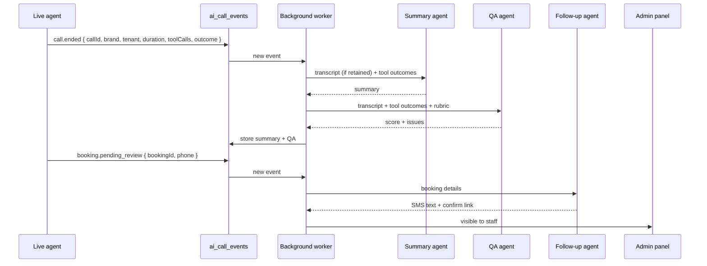

# AI Voice Agent: Errors, Improvements and Multi-Agent Setup

This is the working list for fixing the AI phone agent code in the command-center backend.
It goes with [ai.md](ai.md), which explains the architecture and theory.

- **Part 1** lists every error found, with where it is, what goes wrong, and a code-level fix.
- **Part 2** lists improvements that are not bugs but make calls better.
- **Part 3** is the concrete multi-agent setup: brand profiles, an optional in-call hand-off,
  and after-call background agents.
- **Part 4** is the checklist to work through.

> These findings come from reading the code. Nothing was run against a live call. Line numbers
> are from the `bms-pink-integration-sri` branch at commit `d20eb54` and will drift.

---

## Contents

- [Part 1. Errors](#part-1-errors)
  - [1.1 Summary](#11-summary)
  - [1.2 High severity](#12-high-severity)
  - [1.3 Medium severity](#13-medium-severity)
  - [1.4 Low severity](#14-low-severity)
- [Part 2. Improvements](#part-2-improvements)
- [Part 3. Multi-agent setup](#part-3-multi-agent-setup)
  - [3.1 Which agents we need](#31-which-agents-we-need)
  - [3.2 Overall diagram](#32-overall-diagram)
  - [3.3 Live agents: brand profiles](#33-live-agents-brand-profiles)
  - [3.4 Optional: in-call specialist hand-off](#34-optional-in-call-specialist-hand-off)
  - [3.5 Background agents after the call](#35-background-agents-after-the-call)
  - [3.6 Data model](#36-data-model)
  - [3.7 Configuration](#37-configuration)
  - [3.8 Rollout order](#38-rollout-order)
- [Part 4. Checklist](#part-4-checklist)

---

## Part 1. Errors

### 1.1 Summary

| ID | Sev | File | One line |
|---|---|---|---|
| E1 | High | `openai-live.routes.ts:392` | Every call goes to one test workshop. |
| E2 | High | `openai-live.routes.ts:409-412` | Setup failure leaves the caller ringing. |
| E3 | High | `openai-live.routes.ts:259-266` | Tool socket never reconnects; dead air after a drop. |
| E4 | High | `openai-live.routes.ts:329-330` | Socket attaches after accept; early tool calls can be missed. |
| E5 | High | `openai-live.routes.ts:209-232` | Tool calls have no timeout and no filler. |
| E6 | High | `openai-live.routes.ts:306-323` | No noise reduction, turn detection or language set. |
| E7 | High | `openai-live.routes.ts:115-128` | Booking needs an email captured by voice; schema not strict. |
| E8 | High | `openai-live.routes.ts:309,315` | Model names and endpoints unverified; wrong values fail every call. |
| E9 | Med | several | Call state, dedupe, sessions, offers, idempotency are in memory. |
| E10 | Med | `live-onboarding.service.ts:62` | Agent mode is process-wide. |
| E11 | Med | `yeastar-mcp.routes.ts:31,127-138` | Rate-limit map never pruned. |
| E12 | Med | `openai-live.routes.ts:22,213` | `handledCalls` grows for the whole call. |
| E13 | Med | `voice-call-orchestrator.service.ts:74-94` | Hand-off and close leave state wrong if a step throws. |
| E14 | Med | `yeastar-mcp.routes.ts:110,124` | Tenant config JSON re-parsed on every request. |
| E15 | Low | orchestrator + adapters | Real call path bypasses the orchestrator. |
| E16 | Low | three places | Tool definitions written three times. |
| E17 | Low | `brand-adapter.ts:11`, `voice-route.service.ts:32` | Pink declared but not supported. |
| E18 | Low | `openai-live.routes.ts` | No call telemetry on the live path. |
| E19 | Low | `yeastar-mcp.routes.ts`, `trade-mcp.routes.ts` | Auth and rate limiting copy-pasted. |

### 1.2 High severity

#### E1. Every call goes to one test workshop

**Where:** `src/routes/ai/openai-live.routes.ts:389-394`

```ts
// This pilot is intentionally restricted to one server-configured DID.
const did = requiredEnv("AI_LIVE_TEST_DID");
```

**What happens:** whatever number the caller dialed, the agent answers as the workshop mapped
to `AI_LIVE_TEST_DID`. A second workshop cannot go live on this path.

**Why it was done:** the comment says the SIP headers in the webhook are caller-controlled, so
they must not choose the tenant. That concern is correct.

**Fix:** get the dialed number from a source the caller cannot forge:

1. Have Yeastar add a trusted header (for example `X-BMSPro-DID`) on the trunk leg to the
   voice provider, and only accept calls arriving on that trunk. Or
2. Use one provider project or SIP endpoint per DID group, so the webhook URL or project
   identifies the tenant set. Or
3. Move to a runtime where our backend receives the call from the PBX directly (LiveKit SIP)
   and reads the dialed number there.

Then replace the line with the call router from Part 3:

```ts
const routed = await routeCall(trustedDid);   // profile + tenant, or throws
```

**Test:** two DIDs mapped to two workshops; each call gets the right workshop name in the
greeting; an unmapped DID is rejected.

---

#### E2. Setup failure leaves the caller ringing

**Where:** `src/routes/ai/openai-live.routes.ts:409-412`

```ts
} catch (error) {
  console.error(`[ai live] Incoming call setup failed: ${message}`);
  res.status(503).json({ error: "Incoming call setup failed." });
}
```

**What happens:** if `acceptCall` throws (bad model name, upstream 4xx/5xx, timeout, missing
env var), we answer the *webhook* with 503 but never tell the provider to reject the *call*.
The caller hears ringing or silence until the provider gives up. The provider may also retry
the webhook.

**Fix:** reject the call explicitly, so the PBX can fail over to a human queue:

```ts
} catch (error) {
  console.error(`[ai live] Incoming call setup failed: ${message}`);
  if (sessionId) await rejectCall(sessionId, 503).catch(() => undefined);
  res.status(200).json({ received: true, rejected: true });
}
```

`sessionId` must be lifted out of the inner closure so the catch can see it. Returning 200
after rejecting stops the provider from retrying a call that is already handled.

**Also:** configure the Yeastar inbound route so a rejected AI call falls through to a ring
group or voicemail.

**Test:** make `request` return HTTP 400 for `/accept`; assert `/reject` is called once and
the webhook returns 200.

---

#### E3. Tool socket never reconnects

**Where:** `src/routes/ai/openai-live.routes.ts:259-266`

```ts
socket.on("close", () => {
  const active = activeCalls.get(sessionId);
  if (active?.socket === socket) active.socket = null;
  activeCalls.delete(sessionId);
});
```

**What happens:** a network blip closes the sideband WebSocket. The call stays connected to
the caller, but `activeCalls` loses it. The model keeps asking for tools, nobody answers, and
the caller hears silence until they hang up.

**Fix:**

```ts
socket.on("close", (code) => {
  if (callEnded(sessionId)) { activeCalls.delete(sessionId); return; }
  const call = activeCalls.get(sessionId);
  if (!call || call.socket !== socket) return;
  call.socket = null;
  call.reconnectAttempts = (call.reconnectAttempts ?? 0) + 1;
  if (call.reconnectAttempts > 3) { void transferOrHangUp(sessionId, call, "socket_lost"); return; }
  const delay = 250 * 2 ** (call.reconnectAttempts - 1);       // 250, 500, 1000 ms
  setTimeout(() => connectSideband(sessionId, call), delay);
});
```

- Only delete the call on `session.closed` or a real hang-up, not on any socket close.
- Reset `reconnectAttempts` when a message arrives successfully.
- Add a ping every 15 s and treat a missed pong as a close.

**Test:** inject a fake socket, emit `close` with no `session.closed`, assert a new socket is
opened and tool calls work afterwards; after 4 failures assert transfer is attempted.

---

#### E4. Socket attaches after accept

**Where:** `src/routes/ai/openai-live.routes.ts:329-330`

```ts
activeCalls.set(sessionId, call);
connectSideband(sessionId, call);
```

**What happens:** the session starts talking as soon as it is accepted. If the model calls a
tool (for example `get_workshop_profile` to greet with the workshop name) before the
WebSocket is open, that event may never reach us.

**Fix (pick what the provider supports):**

1. Attach first, then accept, if the provider allows attaching to a pending session.
2. Otherwise, after attaching, ask the provider for the conversation items so far and process
   any `function_call` items not yet in `handledCalls`.
3. Avoid an early tool call: put the workshop name and branch in the instructions at accept
   time, so the greeting needs no tool.

Option 3 is cheap and should be done anyway.

---

#### E5. Tool calls have no timeout and no filler

**Where:** `src/routes/ai/openai-live.routes.ts:209-232`

**What happens:** `await executeTool(...)` waits as long as Firebase or the Black proxy takes.
The caller hears silence. There is no limit.

**Fix:**

```ts
function withTimeout<T>(work: Promise<T>, ms: number): Promise<T> {
  return Promise.race([
    work,
    new Promise<T>((_, reject) => setTimeout(() => reject(new ToolTimeoutError()), ms)),
  ]);
}

const TOOL_TIMEOUT_MS: Record<string, number> = {
  get_workshop_profile: 4000, list_services: 4000, get_available_slots: 6000,
  create_booking: 10000, transfer_to_staff: 8000,
};

output = await withTimeout(executeTool(sessionId, call, name, args), TOOL_TIMEOUT_MS[name] ?? 5000);
```

Map `ToolTimeoutError` to:

```json
{ "error": "This is taking longer than expected. Offer to transfer the caller to staff." }
```

For `create_booking`, a timeout does **not** mean failure (the write may have landed). Return
`UNKNOWN` and tell the model not to retry with new details.

**Filler:** add to the instructions: "Before calling a tool, say a short phrase such as 'One
moment while I check that.'" With a cascaded runtime the server can play it directly (Part 3).

---

#### E6. No noise reduction, turn detection or language

**Where:** `src/routes/ai/openai-live.routes.ts:306-323`

```ts
audio: { output: { voice: "shimmer" } },
```

**What happens:** default audio handling. On noisy workshop lines and speakerphones the agent
mishears, hears speech in noise, and replies while the caller is pausing.

**Fix:** add input settings. Check the exact field names for the API version in use:

```ts
audio: {
  input: {
    noise_reduction: { type: process.env.AI_AUDIO_NOISE_REDUCTION ?? "near_field" },
    transcription: { language: process.env.AI_AUDIO_LANGUAGE ?? "en" },
    turn_detection: {
      type: "server_vad",
      threshold: Number(process.env.AI_AUDIO_VAD_THRESHOLD ?? 0.6),
      prefix_padding_ms: 300,
      silence_duration_ms: Number(process.env.AI_AUDIO_SILENCE_MS ?? 700),
    },
  },
  output: { voice: process.env.AI_AUDIO_VOICE ?? "shimmer" },
},
```

Tuning guide: see [ai.md section 5.4](ai.md#54-what-to-add-openai-style-session-config).

---

#### E7. Booking requires an email captured by voice

**Where:** `src/routes/ai/openai-live.routes.ts:115-128` and
`src/services/ai/front-office-booking.service.ts:15`

```ts
required: ["slotToken", "customerConfirmed", "customerName", "customerEmail", "customerPhone"],
...
strict: false,
```

**What happens:**

- Spoken emails are the most error-prone field ("j dot smith at gmail" → `jdotsmith@gmail`).
  A wrong email means the customer never gets their confirmation.
- `strict: false` lets the model send arguments that do not match the schema; they are only
  caught later by zod, which costs another round trip.
- The JSON schema here is hand-written and can drift from `bookingArguments` in zod.

**Fix:**

1. Make `customerEmail` optional in `bookingArguments`.
2. After `PENDING_REVIEW`, send an SMS to `customerPhone` with a link to confirm details and
   add an email. Use the existing SMS path.
3. Generate the OpenAI schema from zod (see E16) and set `strict: true`.
4. Check whether the Black booking contract accepts a missing email. If not, send a
   placeholder flagged for staff, or keep it required but add a spell-back rule in the prompt.

---

#### E8. Model names and endpoints unverified

**Where:** `src/routes/ai/openai-live.routes.ts:309,315` and the `/live/sessions/...` paths.

```ts
model: process.env.OPENAI_LIVE_MODEL?.trim() || "gpt-live-1",
...
model: process.env.OPENAI_LIVE_BACKEND_MODEL?.trim() || "gpt-6-luna",
```

**What happens:** if any of these do not match the provider's current API, every `/accept`
fails, and then E2 leaves callers ringing.

**Fix:**

1. Check names and paths against the provider's current docs.
2. Remove silent defaults. Require `OPENAI_LIVE_MODEL` when `AI_LIVE_SIP_ENABLED=true`.
3. Add a startup self-check that validates config and logs one clear line if something is
   missing, instead of failing per call.

---

### 1.3 Medium severity

#### E9. State is in memory

**Where:**

| Map | File | Holds |
|---|---|---|
| `activeCalls` | `openai-live.routes.ts:35` | Live calls |
| `completedWebhookIds`, `inFlightWebhookIds`, `inFlightSessionIds` | `openai-live.routes.ts:36-38` | Webhook dedupe |
| `sessions` | `yeastar-mcp.routes.ts:30` | Black MCP sessions |
| `offers`, `completed`, `pending` | `front-office-booking.service.ts:34-36` | Slot tokens, booking idempotency |

**What happens:**

- A restart or deploy during business hours drops every live call's state.
- With two replicas, a webhook retry can land on the other replica and accept the same call
  twice; an MCP request can land on a replica that does not know its session (404).
- Booking idempotency only protects within one process.

**Fix:** a `SessionStore` interface with Redis or Supabase behind it
([ai.md section 7.5](ai.md#75-session-store)). Make the Black MCP stateless like Trade, with
slot offers in the store keyed by call id.

---

#### E10. Agent mode is process-wide

**Where:** `src/services/ai/live-onboarding.service.ts:62-66`

```ts
const mode = process.env.AI_LIVE_AGENT_MODE?.trim() || "receptionist";
```

**What happens:** one deployment answers every call as either receptionist or onboarding. You
cannot run both without two deployments.

**Fix:** decide per call from the dialed DID (onboarding DIDs are already listed in
`AI_ONBOARDING_DIDS_JSON`). See the router in Part 3.

---

#### E11. Rate-limit map never pruned

**Where:** `src/routes/ai/yeastar-mcp.routes.ts:31,127-138`

**What happens:** `requestWindows` adds one entry per credential and DID and never deletes old
ones. Small, steady memory growth. Trade's version (`trade-mcp.routes.ts:55`) prunes.

**Fix:** copy Trade's prune loop, or move to the shared rate limiter in Part 3.

```ts
for (const [key, window] of requestWindows) {
  if (window.startedAt + RATE_WINDOW_MS <= now) requestWindows.delete(key);
}
```

---

#### E12. `handledCalls` grows for the whole call

**Where:** `src/routes/ai/openai-live.routes.ts:22,213`

**What happens:** each tool call id is added and never removed. Harmless for short calls,
wasteful for long ones, and lost on restart (so a replayed event after reconnect could run a
tool twice).

**Fix:** store handled ids in the session store with a TTL equal to the max call length.

---

#### E13. Orchestrator leaves wrong state when a step throws

**Where:** `src/services/ai/voice-call-orchestrator.service.ts:74-94`

```ts
await this.telephony.transfer(call.callId, fallback);
await this.media.close(call.sessionId);     // if this throws...
call.status = "handed_off";                  // ...this never runs
this.calls.delete(callId);
```

and

```ts
await this.media.close(call.sessionId);     // if this throws...
await this.telephony.hangup(call.callId);   // ...the caller is never hung up
```

**What happens:** after a successful transfer, a media close error leaves the call marked
`active`. In `close()`, a media error means the PBX call is never hung up.

**Fix:** treat the telephony step as the source of truth and always clean up:

```ts
async close(callId: string) {
  const call = this.requireActiveCall(callId);
  try { await this.media.close(call.sessionId); }
  catch (error) { log("media close failed", error); }
  finally {
    try { await this.telephony.hangup(call.callId); }
    finally { call.status = "closed"; this.calls.delete(callId); this.fallbackByCall.delete(callId); }
  }
  return { ...call };
}
```

Apply the same pattern to `handoffToStaff`.

---

#### E14. Tenant config re-parsed on every request

**Where:** `src/routes/ai/yeastar-mcp.routes.ts:110,124`

**What happens:** `loadTenantConfigurations()` runs `JSON.parse` and validation on every MCP
request, sometimes twice. Not a bug, but wasted work, and a config error only shows up when a
call arrives.

**Fix:** parse once at startup (or cache keyed by the raw string) and fail fast if invalid.

---

### 1.4 Low severity

#### E15. Real call path bypasses the orchestrator

`VoiceCallOrchestrator`, `VoiceMediaAdapter` and `TelephonyControlAdapter` are good
abstractions, but only the mocks use them. The live path re-implements accept, transfer and
close in the route file. The orchestrator also hard-codes `["get_workshop_profile",
"list_services"]` as allowed tools.

**Fix:** implement `OpenAiLiveMediaAdapter implements VoiceMediaAdapter`, and have the
orchestrator take allowed tools from the profile.

#### E16. Tool definitions written three times

| Where | Form |
|---|---|
| `openai-live.routes.ts:108-137` | Hand-written JSON Schema |
| `yeastar-mcp.routes.ts:173-216` + `front-office-booking.service.ts:7-20` | zod shapes |
| `voice-call-orchestrator.service.ts:43` | Name list |

**Fix:** one registry of `defineTool({ name, description, args: zod, run })` with exporters
to MCP and OpenAI. `live-onboarding.service.ts:192` already does this with
`toJsonSchemaCompat`, so reuse that helper.

#### E17. Pink declared but not supported

`telephony-control-adapter.ts:18` and `voice-call-orchestrator.service.ts:13` allow
`"pink"`, but `FrontOfficeBrand` is `"black"` only (`brand-adapter.ts:11`) and
`resolveVoiceProductForDid` returns only black or trade (`voice-route.service.ts:32`).

**Fix:** see Part 3.3 and [ai.md section 9.2](ai.md#92-pink).

#### E18. No call telemetry on the live path

Only `console.error`. You cannot answer "why was that call bad?".

**Fix:** emit `call.started`, `call.accepted`, `tool.called`, `socket.reconnected`,
`call.transferred`, `call.ended` to the existing agent-activity feed.

#### E19. Auth and rate limiting copy-pasted

Black and Trade MCP routes each parse bearer tokens, check the bridge secret, look up the DID
and rate-limit, with small differences (one prunes, one does not).

**Fix:** one `authenticateVoiceRequest()` and one rate limiter, used by every MCP route.

---

## Part 2. Improvements

These are not bugs, but each one makes calls noticeably better.

### 2.1 Conversation quality

| # | Improvement | Why |
|---|---|---|
| I1 | Put workshop name, branch, hours and timezone in the instructions at accept time. | Faster greeting, no early tool call (helps E4). |
| I2 | Cache `list_services` per call. | Services do not change mid-call; saves a round trip each time. |
| I3 | Prompt rules for spelling and read-back (phone in groups, rego letter by letter). | Fewer wrong details. |
| I4 | "If unsure, ask again" rule. | Stops the model guessing unclear words. |
| I5 | Short sentences, one question at a time, no lists longer than three options. | Easier to follow on the phone. |
| I6 | Say a filler before slow tools. | No silence over one second. |
| I7 | Keyword hints for service names, car makes, local suburbs (cascaded STT). | Better recognition of domain words. |
| I8 | Use `en-AU` voices and STT locale where supported. | Matches callers. |

### 2.2 Booking flow

| # | Improvement | Why |
|---|---|---|
| I9 | Email optional; SMS link after booking to confirm and add email. | Removes the worst voice field (E7). |
| I10 | `find_my_booking` by caller ID (read only). | Common question: "did my booking go through?" |
| I11 | `request_callback` tool for after hours. | Transfer is useless when nobody is there. |
| I12 | Per-branch transfer target stored with the DID mapping. | One env var cannot serve many workshops. |
| I13 | Business-hours check before offering transfer. | Do not promise a person who is not there. |

### 2.3 Reliability

| # | Improvement | Why |
|---|---|---|
| I14 | Startup config self-check for all AI env vars. | Fail at deploy time, not on the first call. |
| I15 | Max call duration with polite wrap-up. | Stops runaway costs and stuck calls. |
| I16 | Circuit breaker on brand adapters: after N failures in a minute, skip tools and offer transfer. | Graceful when Firebase or the Black proxy is down. |
| I17 | Region: run the voice runtime and backend near callers (Sydney) where possible. | Lower latency. |

### 2.4 Observability and quality

| # | Improvement | Why |
|---|---|---|
| I18 | Call events to the activity feed (E18). | Basic visibility. |
| I19 | Dashboard: calls, transfer rate, tool errors, latency p50/p95, dead-air count. | Spot regressions. |
| I20 | QA background agent scoring each call (Part 3.5). | Finds bad calls without listening to all of them. |
| I21 | Test call script run before every release ([ai.md 16.3](ai.md#163-call-scripts-manual-per-release)). | Catches voice regressions unit tests miss. |

### 2.5 Code structure

| # | Improvement | Why |
|---|---|---|
| I22 | Split `openai-live.routes.ts` (421 lines) into webhook, session, tools and runtime files. | Easier to read, test and change. |
| I23 | One tool registry (E16). | No drift between runtimes. |
| I24 | One stateless MCP router for all brands (E19). | Less duplicated security code. |
| I25 | Use the orchestrator for the real path (E15). | One lifecycle for every runtime. |

---

## Part 3. Multi-agent setup

### 3.1 Which agents we need

Two kinds of agent, with different jobs and different constraints:

| Kind | Runs | Must be | Model size | Examples |
|---|---|---|---|---|
| **Live agents** | During the call | Fast (sub-second), safe, short | Small/fast | Black, Trade, Pink receptionists; onboarding |
| **Background agents** | After the call | Thorough, accurate | Larger | Summary, QA, follow-up, CRM notes |

| Agent | Kind | Trigger | Output | Writes |
|---|---|---|---|---|
| Black receptionist | Live | Black DID called | Conversation, drop-off request | Booking (staff approval) |
| Trade receptionist | Live | Trade (Blue) DID called | Conversation, inspection request | Request (staff review) |
| Pink receptionist | Live | Pink DID called | Conversation, booking | Booking (workflow TBD) |
| Onboarding agent | Live | Onboarding DID called | Draft, account | Draft, account |
| Booking specialist (optional) | Live, hand-off | Front agent hands off | Booking | Booking |
| Summary agent | Background | `call.ended` | 3–5 line summary for staff | Summary row |
| QA agent | Background | `call.ended` | Score + issues | QA row |
| Follow-up agent | Background | `booking.pending_review` | SMS with confirm link | SMS |
| CRM notes agent (later) | Background | `call.ended` with a known customer | Note on customer record | Note |

### 3.2 Overall diagram

```
                                 ┌──────────────────────────────────────────┐
 Caller ─► Yeastar ─► SIP ─────► │ Voice runtime                            │
                                 │ (OpenAI Live / LiveKit / Yeastar bridge) │
                                 └───────────────┬──────────────────────────┘
                                                 │ webhook / MCP / function calls
                                                 ▼
┌──────────────────────────────────── Our backend ──────────────────────────────────────┐
│                                                                                       │
│  Call router (code) ── dialed DID ──► which profile?                                  │
│        │                                                                              │
│        ├──► Black profile ──┐                                                         │
│        ├──► Trade profile ──┤   LIVE AGENTS                                           │
│        ├──► Pink profile  ──┤   (one per call, chosen by code, never by the model)    │
│        └──► Onboarding    ──┘                                                         │
│                 │                                                                     │
│                 ├── optional hand-off ──► Booking specialist (same brand only)        │
│                 │                                                                     │
│                 ▼                                                                     │
│  Tool executor ─► Brand adapters ─► Firebase Black / Blue / Pink, Supabase            │
│                 │                                                                     │
│                 ▼ events                                                              │
│  ai_call_events table / queue                                                         │
│                 │                                                                     │
│                 ▼  call.ended, booking.pending_review                                 │
│  ┌──────────────────────────── BACKGROUND AGENTS ─────────────────────────────┐       │
│  │ Summary agent   QA agent   Follow-up agent   CRM notes agent (later)      │       │
│  └────────────────────────────────────────────────────────────────────────────┘       │
│                 │                                                                     │
│                 ▼                                                                     │
│  ai_call_summaries · ai_call_qa · SMS · admin panel                                   │
└───────────────────────────────────────────────────────────────────────────────────────┘
```

### 3.3 Live agents: brand profiles

#### Profile type

```ts
// src/ai/core/profile.ts
export type ProfileId = "black" | "trade" | "pink" | "onboarding";

export type AgentProfile<Ctx = unknown> = {
  id: ProfileId;
  resolveTenant(did: string): Promise<Ctx>;          // server-side only
  instructions(ctx: Ctx): string;
  voice: { name: string; language: string };
  audio?: Partial<AudioTuning>;
  tools: ToolDefinition<Ctx>[];
  humanFallback(ctx: Ctx): string | null;
  writesEnabled(): boolean;
  maxCallSeconds: number;
};
```

#### Router

```ts
// src/ai/core/call-router.ts
export async function routeCall(did: string): Promise<{ profile: AgentProfile; ctx: unknown }> {
  if (onboardingDids().includes(did)) {
    return { profile: onboardingProfile, ctx: await onboardingProfile.resolveTenant(did) };
  }
  const product = await resolveVoiceProductForDid(did);   // extend to return "pink"
  const profile = { black: blackProfile, trade: tradeProfile, pink: pinkProfile }[product.brand];
  if (!profile) throw new RouteError("NO_PROFILE");
  return { profile, ctx: await profile.resolveTenant(did) };
}
```

#### Black profile (example)

```ts
// src/ai/profiles/black.profile.ts
export const blackProfile: AgentProfile<FrontOfficeTenantContext> = {
  id: "black",
  resolveTenant: resolveBlackTenantForDid,                 // from existing tenantForDid logic
  instructions: ctx => blackInstructions(ctx),            // ai.md section 8.3
  voice: { name: "shimmer", language: "en-AU" },
  tools: [getWorkshopProfile, listServices, getAvailableSlots, createBooking, transferToStaff, requestCallback],
  humanFallback: ctx => branchTransferTarget(ctx.branchId),
  writesEnabled: () => process.env.AI_MCP_BOOKINGS_ENABLED === "true",
  maxCallSeconds: 600,
};
```

Trade, Pink and onboarding follow the same shape with their own tools and adapters.

#### Rules for live agents

1. **One profile per call.** The router picks it. The model has no tool to change brand or
   tenant.
2. **Tools are scoped by the profile.** A Black call never sees Pink tools.
3. **Every tool goes through one executor** (timeout, validation, safe errors, telemetry).
4. **Every failure path ends with a human or a callback**, never silence.

### 3.4 Optional: in-call specialist hand-off

Only add this if one brand's prompt becomes too big for one agent to follow reliably.

```
Black call
  │
  ▼
Front agent (greets, answers questions, works out intent)
  │  intent = booking
  ▼
hand_off_to_booking { reason }        ← a tool the front agent can call
  │
  ▼
Booking specialist (same tenant context, short focused prompt, booking tools only)
  │  done / caller asks something else
  ▼
hand_back_to_front { summary }
```

How it works in practice:

- A hand-off is a **tool call** that the server handles by swapping the session's
  instructions and tool list (`session.update` on speech-to-speech, or switching the active
  agent in LiveKit Agents / Pipecat).
- The **tenant context does not change**. Only the prompt and tool subset change.
- Pass a short structured summary, not the whole transcript, to keep latency low.
- Allowed hand-offs are defined in code per profile:

```ts
handOffs: { front: ["booking"], booking: ["front"] }
```

**Cost:** each hand-off adds a short pause. Measure before and after; remove it if callers
notice.

### 3.5 Background agents after the call

Background agents run on events after the call. They add no delay for the caller and can use
a larger model.

#### Event flow



#### Summary agent

- **Input:** tool outcomes, call metadata, and a transcript if retained.
- **Output (JSON):** `{ reason, outcome, customer, nextAction, summary }`, 3–5 lines.
- **Used by:** staff in the admin panel, especially after a transfer, so the caller does not
  repeat themselves.

#### QA agent

Scores each call against a fixed rubric:

| Check | Pass when |
|---|---|
| Greeting | Named the correct workshop |
| Accuracy | Every fact stated came from a tool result |
| Read-back | Details read back before `create_booking` |
| Honesty | Never said "confirmed"; never claimed a transfer that failed |
| Clarifying | Asked again when unclear instead of guessing |
| Dead air | No gap over 5 s |
| Outcome | Caller's request handled, transferred, or callback taken |

- **Output:** `{ score: 0–100, failedChecks: [...], notes }`.
- **Used for:** a weekly list of the worst calls to review, and to compare prompt or vendor
  changes.

#### Follow-up agent

- **Trigger:** `booking.pending_review`.
- **Action:** SMS to the caller: what was requested, that staff will confirm, and a link to
  confirm details and add an email.
- **Rules:** template-based text with only the variable parts filled in; no free-form model
  text in SMS; respect opt-out.

#### Transcripts and privacy

Summary and QA agents work best with a transcript. Today the design says
`persistTranscript: false`. Before retaining any:

1. Add a short notice to the greeting ("This call may be recorded for quality").
2. Set a short retention period (for example 30 days), then delete.
3. Restrict access to super-admins.
4. Without transcripts, run summary and QA on tool outcomes and metadata only. Less useful,
   but still worth having.

#### Worker

```ts
// src/ai/background/worker.ts
const handlers: Record<string, (event: CallEvent) => Promise<void>> = {
  "call.ended": async e => { await runSummaryAgent(e); await runQaAgent(e); },
  "booking.pending_review": async e => { await runFollowUpAgent(e); },
};

export async function processEvent(event: CallEvent) {
  const handler = handlers[event.type];
  if (!handler) return;
  if (!(await claimEvent(event.id))) return;     // idempotent across replicas
  await handler(event);
}
```

Start with a simple poll of `ai_call_events` where `processed_at is null`. Move to a queue if
volume grows.

### 3.6 Data model

```sql
create table ai_call_events (
  id            uuid primary key default gen_random_uuid(),
  call_id       text not null,
  type          text not null,          -- call.started, tool.called, call.ended, ...
  brand         text not null,          -- black | trade | pink | onboarding
  tenant_id     uuid,
  payload       jsonb not null,         -- no raw PII beyond what staff already see
  created_at    timestamptz not null default now(),
  processed_at  timestamptz
);
create index on ai_call_events (call_id);
create index on ai_call_events (processed_at) where processed_at is null;

create table ai_call_summaries (
  call_id     text primary key,
  brand       text not null,
  tenant_id   uuid,
  summary     jsonb not null,
  created_at  timestamptz not null default now()
);

create table ai_call_qa (
  call_id       text primary key,
  score         int not null,
  failed_checks text[] not null,
  notes         text,
  created_at    timestamptz not null default now()
);

create table ai_sessions (               -- session store if not using Redis
  key         text primary key,          -- e.g. webhook:<id>, call:<id>, offer:<call>:<token>
  value       jsonb not null,
  expires_at  timestamptz not null
);
```

Enable row-level security so tenants only see their own rows, matching the existing Supabase
tables.

### 3.7 Configuration

| Variable | Purpose |
|---|---|
| `AI_SESSION_STORE` | `redis`, `supabase` or `memory` (tests). |
| `AI_REDIS_URL` | Redis connection, if used. |
| `AI_PROFILES_ENABLED` | Comma list, e.g. `black,trade,onboarding`. |
| `AI_MCP_PINK_ENABLED`, `AI_MCP_PINK_BOOKINGS_ENABLED` | Pink live agent and writes. |
| `AI_HANDOFFS_ENABLED` | Turns on in-call specialist hand-offs. Off by default. |
| `AI_BACKGROUND_AGENTS` | Comma list, e.g. `summary,qa,followup`. |
| `AI_BACKGROUND_MODEL` | Model for background agents (a larger one). |
| `AI_TRANSCRIPT_RETENTION_DAYS` | `0` = do not keep transcripts. |
| `AI_FOLLOWUP_SMS_ENABLED` | Follow-up SMS on pending bookings. |

Remove after migration: `AI_LIVE_TEST_DID`, `AI_LIVE_AGENT_MODE`.

### 3.8 Rollout order

```
Week 1   Fix E2, E5, E6, E8 + prompt rules (I1, I3, I4, I6)      → calls stop failing badly
Week 2   Fix E3, E4, E7, E11, E12, E13 + telemetry (E18)         → calls stop dying mid-way
Week 3   Session store (E9), tool registry (E16), router (E1, E10)
         Black profile on the new core                           → multi-workshop, multi-replica
Week 4   Trade + onboarding profiles; one MCP router (E19)
         Summary agent (no transcripts)                          → staff get summaries
Week 5+  Pink profile; QA agent; follow-up SMS agent
         Optional: specialist hand-off if a prompt is too big
         Optional: cascaded runtime (LiveKit + Deepgram + ElevenLabs)
```

---

## Part 4. Checklist

### Errors

- [ ] E1 Per-call routing by trusted DID; remove `AI_LIVE_TEST_DID`
- [ ] E2 Reject the call on setup failure; PBX fallback route configured
- [ ] E3 Sideband reconnect with backoff and heartbeat; transfer after 3 failures
- [ ] E4 Workshop details in instructions; fix attach ordering
- [ ] E5 Per-tool timeouts; `UNKNOWN` for write timeouts; filler rule
- [ ] E6 Noise reduction, turn detection, language configured from env
- [ ] E7 Email optional + SMS link; schema from zod; `strict: true`
- [ ] E8 Model names and endpoints verified; no silent defaults; startup check
- [ ] E9 Session store (Redis or Supabase); Black MCP stateless
- [ ] E10 Agent mode per call
- [ ] E11 Prune Black rate-limit map
- [ ] E12 Handled tool-call ids in session store with TTL
- [ ] E13 Orchestrator cleanup in `finally`
- [ ] E14 Parse tenant config once at startup
- [ ] E15 OpenAI Live as a `VoiceMediaAdapter`
- [ ] E16 One tool registry
- [ ] E17 Pink routing and adapter
- [ ] E18 Live-path telemetry
- [ ] E19 Shared MCP auth and rate limiting

### Multi-agent

- [ ] `AgentProfile` type and router
- [ ] Black, Trade, onboarding profiles
- [ ] Pink profile (after Pink decisions in [ai.md section 17](ai.md#17-open-questions))
- [ ] `ai_call_events`, `ai_call_summaries`, `ai_call_qa`, `ai_sessions` tables with RLS
- [ ] Background worker with idempotent event claim
- [ ] Summary agent
- [ ] QA agent with rubric
- [ ] Follow-up SMS agent
- [ ] Transcript policy decided (notice, retention, access)
- [ ] Optional specialist hand-off, behind `AI_HANDOFFS_ENABLED`

### Tests to add

- [ ] Accept failure → reject called, webhook 200
- [ ] Socket close without `session.closed` → reconnect; 4th failure → transfer
- [ ] Tool timeout → safe error; write timeout → `UNKNOWN`
- [ ] Two replicas (two router instances, shared store) → webhook accepted once
- [ ] Router: Black, Trade, Pink, onboarding, unmapped, ambiguous DIDs
- [ ] Registry: zod → OpenAI schema and → MCP schema agree
- [ ] Orchestrator: media close throws → hangup still called, call removed
- [ ] Background worker: same event processed once across two workers
