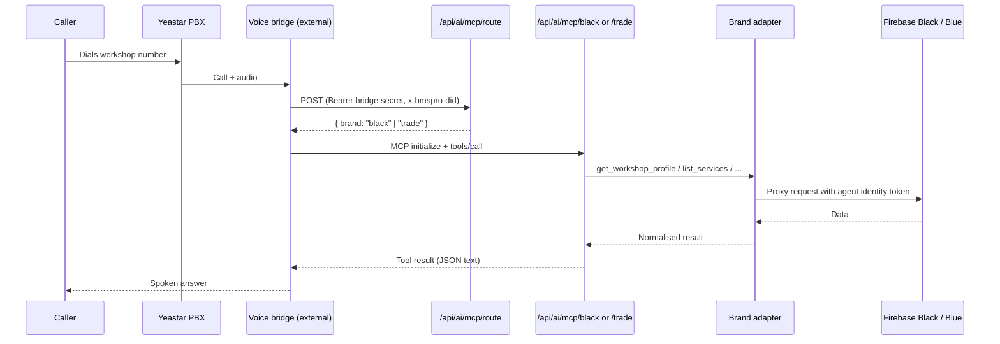
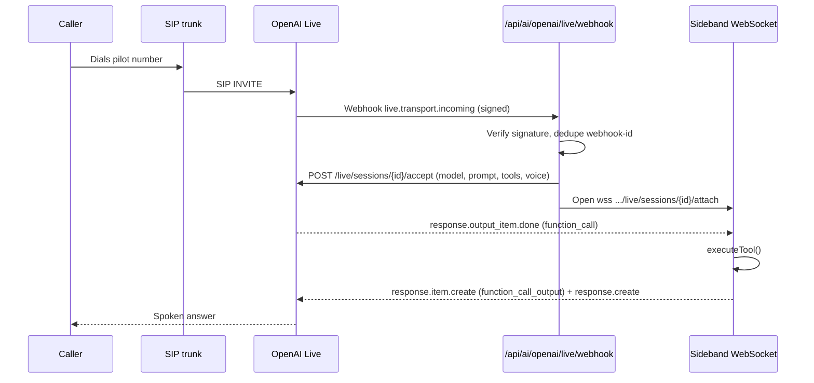
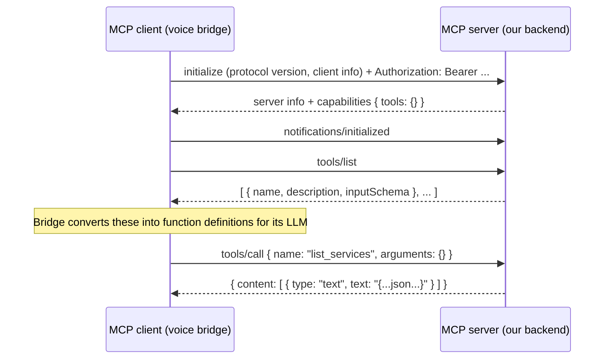
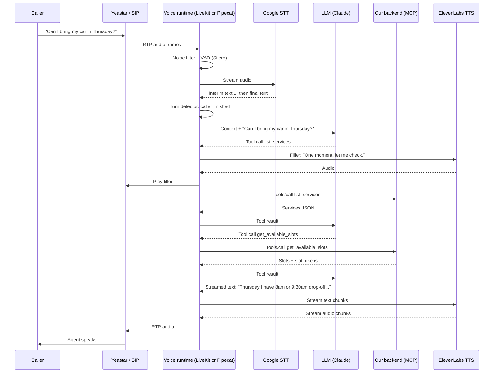

# AI Voice Agent Architecture

This document describes how the AI phone receptionist works in the command-center backend
today, what is wrong with it, and the target architecture for BMS Black, BMS Trade (Blue)
and BMS Pink.

It covers:

1. What exists today, and how the pieces fit together.
2. How tools (function calling) work.
3. How an MCP server is built in this repo, and how to add a new one.
4. Noise filtering and turn detection: what they are and how to configure them.
5. Whether to build three agents (Black, Blue, Pink) or one.
6. The target architecture, with BMS Black as the first brand.
7. Known defects in the current code, with fixes.
8. A phased migration plan.

> Status: design proposal. Nothing in this document has been implemented yet unless it says
> "today". Where this document names OpenAI API fields or endpoints, check them against the
> current provider docs before coding. Provider APIs change often.

---

## Contents

- [1. Glossary](#1-glossary)
- [2. What exists today](#2-what-exists-today)
- [3. How tools (function calling) work](#3-how-tools-function-calling-work)
- [4. How MCP works in this repo](#4-how-mcp-works-in-this-repo)
- [5. Noise filtering and turn detection](#5-noise-filtering-and-turn-detection)
- [6. One agent or three?](#6-one-agent-or-three)
- [7. Target architecture](#7-target-architecture)
- [8. BMS Black in detail](#8-bms-black-in-detail)
- [9. BMS Trade (Blue) and BMS Pink profiles](#9-bms-trade-blue-and-bms-pink-profiles)
- [10. Voice runtime options](#10-voice-runtime-options)
- [11. Security rules that must not regress](#11-security-rules-that-must-not-regress)
- [12. Observability](#12-observability)
- [13. Known defects in the current code](#13-known-defects-in-the-current-code)
- [14. Migration plan](#14-migration-plan)
- [15. Configuration reference](#15-configuration-reference)
- [16. Testing strategy](#16-testing-strategy)
- [17. Open questions](#17-open-questions)
- [18. What kind of AI agents these are](#18-what-kind-of-ai-agents-these-are)
- [19. Multi-agent architecture options](#19-multi-agent-architecture-options)
- [20. Third-party voice APIs (ElevenLabs and others)](#20-third-party-voice-apis-elevenlabs-and-others)
- [21. Prompt to get a second opinion](#21-prompt-to-get-a-second-opinion)
- [22. How it works: theory with diagrams](#22-how-it-works-theory-with-diagrams)

---

## 1. Glossary

| Term | Meaning in this codebase |
|---|---|
| **Black** | BMS Black. Workshop product. Bookings are *drop-off requests* that staff must approve. Data lives in Firebase Black and is reached through the Black call-center proxy (`src/services/bms_black/`). |
| **Trade / Blue** | BMS Trade. Uses the Firebase Blue app (`getFirebaseBlueApp`). Bookings are *inspection requests* with morning/afternoon session preferences. A DID is routed to Trade when its queue name, id or type contains the token `blue` (`voice-route.service.ts`). |
| **Pink** | BMS Pink. Added in commit `d20eb54`. Has branches, services, staff per service, bookings, reschedule and chat proxies (`src/services/bms_pink/`). There is **no AI integration for Pink yet**. |
| **DID** | The phone number a caller dialed. Mapped to a tenant, owner and branch in the `did_mappings` table. |
| **Tenant context** | `{ did, tenantId, ownerId, branchId, branchName, workshopName }`, resolved by the server, never by the model (`brand-adapter.ts`). |
| **Tool / function** | A backend action the model may call, such as `list_services`. The model only sends arguments; the server decides scope. |
| **MCP** | Model Context Protocol. A standard way to expose tools to an AI runtime over HTTP. |
| **Voice bridge** | The external component (Yeastar side) that runs the voice model and calls our MCP endpoints with `AI_VOICE_BRIDGE_SECRET`. |
| **Sideband** | In the OpenAI Live path, a WebSocket our server opens to the live session so it can receive tool calls and send results. |
| **STT / TTS** | Speech-to-text and text-to-speech. |
| **VAD** | Voice activity detection: deciding when the caller started and stopped speaking. |

---

## 2. What exists today

There are **two separate voice paths** and one unused abstraction. They share brand adapters
but not session handling, tool definitions or error handling.

### 2.1 Path A: Yeastar voice bridge → MCP (production-style)



| File | Role |
|---|---|
| `src/routes/ai/voice-route.routes.ts` | Tells the bridge which product (black or trade) a DID belongs to. |
| `src/routes/ai/yeastar-mcp.routes.ts` | **Stateful** MCP server for Black. Sessions held in memory, 15 min TTL. |
| `src/routes/ai/trade-mcp.routes.ts` | **Stateless** MCP server for Trade. New server per request, works across replicas. |
| `src/routes/ai/onboarding-call.routes.ts` | MCP server for onboarding calls (separate bridge secret). |
| `src/services/ai/black-front-office.adapter.ts` | Black data access through the call-center proxy. |
| `src/services/ai/trade-front-office.service.ts` | Trade auth, DID mapping, availability and inspection requests. |
| `src/services/ai/front-office-booking.service.ts` | Black slot offers, slot tokens and idempotent booking. |

In this path, **the voice model, STT, TTS and noise handling all run in the bridge**, not in
this repo. If call quality is poor on this path, the fix is in the bridge configuration.

### 2.2 Path B: OpenAI Live over SIP (pilot)



All of this lives in one 421-line file: `src/routes/ai/openai-live.routes.ts`. It supports two
modes chosen by the environment variable `AI_LIVE_AGENT_MODE`: `receptionist` (Black) and
`onboarding`.

Important: this path is a **pilot**. Every call is mapped to `AI_LIVE_TEST_DID`, regardless of
the number dialed.

### 2.3 Unused abstraction: orchestrator + adapters

| File | Status |
|---|---|
| `voice-call-orchestrator.service.ts` | Provider-neutral call lifecycle (start, hand off, close). Only used with mocks. |
| `voice-media-adapter.ts` | Interface for an audio provider. Only `mock-voice-media.adapter.ts` implements it. |
| `telephony-control-adapter.ts` | Interface for PBX control (answer, transfer, hang up). Only mocked. |

These interfaces are the right idea. The target architecture in section 7 builds on them
rather than replacing them.

### 2.4 Size of the AI code today

About 3,800 lines across 30 files in `src/routes/ai/` and `src/services/ai/`. Roughly 40% is
onboarding, 30% is Black/Trade front office, and the rest is live voice, mocks and activity.

---

## 3. How tools (function calling) work

The model never touches the database. It can only **ask** the server to run a named tool with
JSON arguments. The server validates, scopes and runs it, then returns JSON.

### 3.1 The loop

```
1. Server registers tools:   name + description + JSON schema of arguments
2. Caller speaks:            "Can I bring my car in Thursday for a service?"
3. Model decides:            call list_services {}
4. Server runs tool:         adapter.listServices(context)   ← context from DID, not from model
5. Server returns:           { services: [...] }
6. Model decides:            call get_available_slots { date, serviceIds }
7. Server returns:           { slots: [{ time, slotToken }], message }
8. Model speaks:             "Thursday I have 8am or 9:30am drop-off. Which suits you?"
```

### 3.2 Black tools today

| Tool | Arguments | What it does | Writes? |
|---|---|---|---|
| `get_workshop_profile` | none | Workshop name, branch, hours, timezone. | No |
| `list_services` | none | Services with price, duration and vehicle-type pricing. | No |
| `get_available_slots` | `date`, `serviceIds[]` | Drop-off times for that date. Returns a `slotToken` per time, valid 10 minutes. | No |
| `create_booking` | `slotToken`, `customerConfirmed: true`, name, email, phone, optional vehicle fields, notes | Submits a drop-off request for staff approval. Only when `AI_MCP_BOOKINGS_ENABLED=true`. | Yes |
| `transfer_to_staff` | none | OpenAI Live path only. SIP REFER to `AI_LIVE_STAFF_SIP_URI`. | Call control |

### 3.3 Why `slotToken` exists

The model is not trusted to pass a date, time, branch or service list into `create_booking`.
Instead:

1. `get_available_slots` stores an **offer** server-side: `{ context, date, time, timeZone, serviceIds, expiresAt }`.
2. It returns only a random `slotToken` (UUID) to the model.
3. `create_booking` looks up the offer by token and checks it belongs to the **same** tenant,
   owner, branch and DID (`scoped()` in `front-office-booking.service.ts`).
4. Expired or foreign tokens return `INVALID_SLOT` or `EXPIRED_SLOT`.

This stops the model from booking a slot it was never offered or one in another workshop.

### 3.4 Idempotency (safe retries)

Voice models retry. Networks drop. `createBooking` hashes owner, branch, date, time, services,
email, phone and vehicle into an `idempotencyKey`:

- Same key, same details → returns the earlier result (no duplicate booking).
- Same key, different details → `CONFLICT`.
- In-flight duplicate → waits for the first attempt.

Trade does the same with a model-generated `requestKey` and `submitTradeOnce`.

> Limitation: the Black `completed` and `pending` maps are in memory per tool instance. After a
> restart, or on a second replica, protection relies on the upstream Black API honouring the
> idempotency key. See defect D9.

### 3.5 Result statuses the model must respect

| Status | What the agent may say |
|---|---|
| `PENDING_REVIEW` | "Your request has been submitted for staff approval." Never "confirmed". |
| `PROCESSING` / `UNKNOWN` | Do not claim success. Offer staff follow-up or transfer. Do not retry with new details. |
| `CONFLICT` | Details differ from an earlier request. Hand to staff. |
| `REJECTED` / `DISABLED` | Booking not possible by AI. Transfer or offer callback. |
| `INVALID_SLOT` / `EXPIRED_SLOT` | Check availability again, then re-confirm with the caller. |

### 3.6 Adding a new tool (checklist)

1. Define the argument schema **once** in zod, next to the service that implements it.
2. Write the description for the model: what it does, when to call it, what never to claim.
3. Resolve tenant scope from the server context, never from arguments.
4. Validate arguments with `schema.parse()` inside the tool.
5. Return a small JSON object with a `status` and a human-safe `message`.
6. Catch errors and return a safe error object. Never leak stack traces or upstream URLs.
7. Gate any write behind an environment flag that is off by default.
8. Register it in the tool registry (section 7.4) so every runtime gets the same definition.
9. Add a test for: happy path, invalid arguments, wrong tenant, upstream failure.

---

## 4. How MCP works in this repo

### 4.1 What MCP is

MCP (Model Context Protocol) is a JSON-RPC protocol for exposing tools to an AI client. The
client (here, the voice bridge) does:

1. `initialize` → server replies with its name, version and capabilities.
2. `tools/list` → server replies with tool names, descriptions and JSON schemas.
3. `tools/call { name, arguments }` → server runs the tool and replies with `content`.

We use the official SDK: `@modelcontextprotocol/sdk`, with `McpServer` and
`StreamableHTTPServerTransport` mounted on Express routes.

### 4.2 Minimal MCP server (the pattern used here)

```ts
import { Router } from "express";
import { McpServer } from "@modelcontextprotocol/sdk/server/mcp.js";
import { StreamableHTTPServerTransport } from "@modelcontextprotocol/sdk/server/streamableHttp.js";
import type { Transport } from "@modelcontextprotocol/sdk/shared/transport.js";
import { z } from "zod";

const router = Router();

function createServer(tenant: TenantContext) {
  const server = new McpServer({ name: "bmspro-example", version: "1.0.0" });

  server.tool(
    "list_services",                                   // name
    "List services for the assigned branch.",          // description for the model
    {},                                                // zod shape of arguments
    async () => ({
      content: [{ type: "text", text: JSON.stringify(await listServices(tenant)) }],
    }),
  );

  server.tool(
    "get_available_slots",
    "Get drop-off times for a date.",
    { date: z.string().regex(/^\d{4}-\d{2}-\d{2}$/) },
    async ({ date }) => ({
      content: [{ type: "text", text: JSON.stringify(await slots(tenant, date)) }],
    }),
  );

  return server;
}

router.post("/", async (req, res) => {
  const tenant = await authenticate(req);              // bearer + DID → tenant, or 401
  if (!tenant) { res.status(401).json({ error: "Unauthorized" }); return; }

  const server = createServer(tenant);
  const transport = new StreamableHTTPServerTransport({ enableJsonResponse: true });
  res.on("close", () => { void transport.close(); void server.close(); });

  await server.connect(transport as unknown as Transport);
  await transport.handleRequest(req, res, req.body);
});

export default router;
```

Then mount it in `src/routes/index.ts`:

```ts
router.use("/ai/mcp/pink", pinkMcpRoutes);
```

### 4.3 Stateful vs stateless (both exist today)

| | Black (`yeastar-mcp.routes.ts`) | Trade (`trade-mcp.routes.ts`) |
|---|---|---|
| Transport | `sessionIdGenerator: randomUUID` | No session id, `enableJsonResponse: true` |
| Server lifetime | One per MCP session, kept in a `Map` for 15 min | One per HTTP request |
| Works across replicas | No (session lives in one process) | Yes |
| Per-session memory (slot offers) | Yes, offers survive between calls | No, would need an external store |

**Recommendation:** make every MCP endpoint stateless, and move per-call state (slot offers,
idempotency) into a shared store keyed by call id (section 7.5). Then any replica can serve
any request, and restarts do not break calls.

### 4.4 Authentication used by MCP endpoints

Two credential types exist and must stay separate:

1. **Bridge secret** (`AI_VOICE_BRIDGE_SECRET`, at least 32 chars) plus the `x-bmspro-did`
   header. The DID must map to exactly one row (with or without `+`). Used for Black and Trade.
2. **Per-tenant token** from `AI_MCP_TENANT_CONFIG_JSON` (Black) or
   `AI_MCP_TRADE_TENANT_CONFIG_JSON` (Trade). Each token is bound to one DID.

Onboarding uses its own `AI_ONBOARDING_BRIDGE_SECRET`, which must differ from the voice bridge
secret.

### 4.5 How to add a Pink MCP endpoint

1. Create `src/services/ai/pink-front-office.adapter.ts` implementing the shared
   `FrontOfficeBrandAdapter` (after it is widened to include `"pink"`, see section 9.2).
2. Use the existing Pink proxies: `proxyPinkCallCenterBranchById`,
   `proxyPinkCallCenterServices`, `proxyPinkCallCenterServiceStaff`,
   `proxyPinkCallCenterBookingAvailability`, `proxyPinkCallCenterCreateBooking`.
3. Add Pink to `resolveVoiceProductForDid` so the bridge can route Pink DIDs.
4. Register Pink tools in the tool registry with a Pink profile (section 9.2).
5. Mount `/ai/mcp/pink` behind `AI_MCP_PINK_ENABLED`.
6. Add tests copied from `tests/ai-trade-mcp.test.ts` and adapted.

---

## 5. Noise filtering and turn detection

### 5.1 What these are

| Feature | What it does | What goes wrong without it |
|---|---|---|
| **Noise suppression** | Removes steady background noise (traffic, workshop tools, wind) from caller audio before STT. | Mishearing, wrong names and numbers, the model "hears" speech in noise. |
| **Echo cancellation** | Removes the agent's own voice leaking back from the caller's speakerphone. | The agent interrupts itself or reacts to its own words. |
| **Voice activity detection (VAD)** | Decides when the caller started and finished talking. | Agent cuts callers off mid-sentence, or waits too long and sounds slow. |
| **Barge-in** | Lets the caller interrupt the agent. | Caller must wait for long sentences to finish. |
| **Transcription language hint** | Tells STT which language/accent to expect. | Australian accents, street names and number formats misheard. |

### 5.2 Where each can happen

```
Caller phone ─► PBX / SIP trunk ─► Voice runtime ─► STT ─► LLM ─► TTS ─► back to caller
                 │                  │
                 │ codec, gain,     │ noise suppression, VAD,
                 │ (vendor-specific)│ turn detection, barge-in
```

- **PBX level (Yeastar):** codec choice matters. Prefer a wideband codec (G.722 or Opus) over
  G.711 narrowband where the trunk allows it. Check what the Yeastar model and trunk support.
- **Voice runtime level:** this is where noise suppression and VAD are configured.
- **Prompt level:** instruct the model to confirm unclear details instead of guessing.

### 5.3 What the OpenAI Live path configures today

Only this (from `openai-live.routes.ts`):

```ts
audio: { output: { voice: "shimmer" } }
```

There is **no** input noise reduction, **no** turn detection tuning, and **no** transcription
language set. This is the most likely cause of poor call quality on Path B.

### 5.4 What to add (OpenAI-style session config)

OpenAI's Realtime API exposes settings of the following shape. **Verify the exact field names
for the API version this code targets** (the code uses `/live/sessions`, which may differ from
`/realtime`):

```ts
audio: {
  input: {
    noise_reduction: { type: "near_field" },   // "far_field" for speakerphone / car kits
    transcription: { model: "<stt model>", language: "en" },
    turn_detection: {
      type: "server_vad",
      threshold: 0.6,             // higher = needs louder speech to start a turn (noisy sites)
      prefix_padding_ms: 300,     // audio kept before speech starts
      silence_duration_ms: 700,   // pause before the agent replies; raise if it cuts people off
      interrupt_response: true,   // barge-in
    },
  },
  output: { voice: "shimmer" },
}
```

Starting values for a workshop line:

| Setting | Start at | Raise it if | Lower it if |
|---|---|---|---|
| `threshold` | 0.6 | Background noise triggers false turns | Quiet callers are ignored |
| `silence_duration_ms` | 700 | Agent cuts callers off mid-sentence | Agent feels slow to respond |
| `prefix_padding_ms` | 300 | First syllables are clipped | — |
| `noise_reduction` | `near_field` | Use `far_field` if many callers are on speaker or in cars | — |

Some providers offer a *semantic* turn detector that uses meaning, not just silence, to decide
when the caller has finished. It helps with callers who pause while reading a rego or phone
number. Test it against `server_vad`.

### 5.5 Noise handling with a separate STT + TTS pipeline

If we move to the pipeline runtime (section 10, option B):

| Layer | Option |
|---|---|
| Noise suppression | Krisp (built into LiveKit Cloud), or RNNoise (open source) before STT |
| VAD | Silero VAD (open source, used by LiveKit Agents and Pipecat) |
| Turn detection | LiveKit's turn-detector model, or Pipecat's smart-turn |
| STT | Deepgram streaming with `language=en-AU`, keyword boosting for service names |
| TTS | ElevenLabs or Cartesia, Australian-accented voice |

### 5.6 Prompt rules that reduce mishearing

Add to every brand prompt:

- "If you did not clearly hear a name, number, rego or email, ask the caller to repeat or spell it."
- "Read phone numbers back in groups: 0412, 345, 678."
- "Read regos back letter by letter."
- "Never guess a detail to avoid asking again."

And reduce what must be captured by voice. See defect D7 on spoken email addresses.

---

## 6. One agent or three?

### 6.1 The question

Should we build three separate AI agents (one each for Black, Blue and Pink), or one?

### 6.2 Recommendation

**One agent platform, with one brand profile per product.**

Build one runtime, one call router, one session manager, one tool registry and one
telemetry pipeline. Each brand is a **profile**: a configuration object with its own prompt,
voice, tools, adapter and fallback number. Onboarding is a fourth profile.

```
                     ┌──────────────────────────┐
  Incoming call ───► │  One agent platform      │
                     │  (router, sessions,      │
                     │   registry, telemetry)   │
                     └───────────┬──────────────┘
           ┌───────────┬─────────┴─────┬──────────────┐
           ▼           ▼               ▼              ▼
     Black profile  Blue profile   Pink profile   Onboarding profile
     prompt+tools   prompt+tools   prompt+tools   prompt+tools
     Black adapter  Trade adapter  Pink adapter   Onboarding service
```

To a caller, these sound like three different receptionists. In code, they share everything
except the profile.

### 6.3 Why not three separate agents

| Concern | Three separate agents | One platform, three profiles |
|---|---|---|
| Bug fixes (e.g. socket reconnect) | Fixed three times | Fixed once |
| Noise / VAD tuning | Tuned three times | Tuned once, overridable per profile |
| Security rules (DID scoping) | Three chances to get it wrong | One audited path |
| Adding a fourth brand | New service | New profile + adapter |
| Brand-specific behaviour | Natural | Natural, via profile |
| Deployment | Three services to run | One service |
| Telemetry | Three dashboards | One dashboard, filter by brand |

Today the code already leans toward three agents: Black and Trade have separate MCP routes
with copy-pasted auth and rate limiting, and the OpenAI path has its own tool definitions.
That duplication is the source of several defects in section 13.

### 6.4 Why not one agent that handles all brands in one prompt

A single prompt with all three brands' tools means:

- The model sees tools it must never call for this caller.
- A prompt-injection or confusion could call a Pink tool on a Black call.
- Prompts get long and slow.

So each call gets **exactly one profile**, chosen by the server from the dialed DID before the
model starts. The model cannot switch profiles.

### 6.5 When to split later

Split a brand into its own deployment only if:

- it needs a different voice runtime that cannot share a process, or
- its call volume is large enough to need independent scaling, or
- a customer contract requires data isolation.

The profile design makes that split a deployment change, not a rewrite.

---

## 7. Target architecture

### 7.1 Layers

```
┌───────────────────────────────────────────────────────────────────────┐
│ Telephony         Yeastar PBX · SIP trunk · staff SIP endpoints        │
├───────────────────────────────────────────────────────────────────────┤
│ Voice runtime     Option A: OpenAI speech-to-speech                    │
│ (swappable)       Option B: LiveKit/Pipecat + STT + LLM + TTS          │
│                   Option C: external Yeastar bridge (today's Path A)   │
├───────────────────────────────────────────────────────────────────────┤
│ 1 Ingress         verify signature · timestamp · dedupe (shared store) │
│ 2 Call router     dialed DID → { brand, tenant, branch, profile }      │
│ 3 Session manager call state · tool socket · reconnect · max duration  │
│ 4 Agent core      profile → prompt, voice, VAD, tools                  │
│ 5 Tool registry   zod defs → MCP / OpenAI / LiveKit schemas           │
│ 6 Tool executor   timeout · filler · safe errors · telemetry           │
│ 7 Brand adapters  Black · Trade · Pink · Onboarding                    │
│ 8 Safety net      human fallback on any failure                        │
│ 9 Telemetry       call events · latency · tool outcomes · cost         │
├───────────────────────────────────────────────────────────────────────┤
│ Data              Firebase Black/Blue/Pink · Supabase · Redis          │
└───────────────────────────────────────────────────────────────────────┘
```

### 7.2 Proposed folder layout

```
src/ai/
  core/
    profile.ts               AgentProfile type + registry of profiles
    call-router.ts           DID → profile + tenant context
    session-store.ts         interface + Redis/Supabase implementation
    tool-registry.ts         defineTool(), toMcp(), toOpenAi(), toLiveKit()
    tool-executor.ts         timeout, filler, error mapping, telemetry
    fallback.ts              reject / transfer / callback decisions
    telemetry.ts             call events
  profiles/
    black.profile.ts
    trade.profile.ts
    pink.profile.ts
    onboarding.profile.ts
  adapters/
    black.adapter.ts         (moved from services/ai/black-front-office.adapter.ts)
    trade.adapter.ts
    pink.adapter.ts
  runtimes/
    openai-live.runtime.ts   implements VoiceMediaAdapter
    livekit.runtime.ts       implements VoiceMediaAdapter (later)
    mock.runtime.ts
  transports/
    mcp.router.ts            one stateless MCP router for all profiles
    openai-webhook.router.ts thin: verify → router → runtime.accept
```

Moves can be done gradually. Existing files keep working until each step in section 14
replaces them.

### 7.3 The profile type

```ts
export type BrandId = "black" | "trade" | "pink" | "onboarding";

export type AgentProfile = {
  id: BrandId;
  displayName: string;                       // used in logs only
  buildInstructions(ctx: TenantContext): string;
  voice: { name: string; language: string }; // e.g. { name: "shimmer", language: "en-AU" }
  audio?: Partial<AudioTuning>;              // overrides for VAD / noise settings
  tools: ToolDefinition[];                   // from the registry
  humanFallback(ctx: TenantContext): string | null; // SIP URI or null
  maxCallSeconds: number;
  writesEnabled(): boolean;                  // reads env flag
};
```

### 7.4 The tool registry (define once, export everywhere)

Today the same tools are written three times: as hand-written JSON in
`openai-live.routes.ts`, as zod shapes in `yeastar-mcp.routes.ts`, and as a name list in the
orchestrator. Replace that with:

```ts
export type ToolDefinition<A extends z.ZodTypeAny = z.ZodTypeAny> = {
  name: string;
  description: string;
  args: A;
  writes: boolean;            // true → gated by profile.writesEnabled()
  timeoutMs: number;          // e.g. 4000 for reads, 8000 for writes
  filler?: string;            // "One moment while I check that."
  run(ctx: ToolContext, args: z.infer<A>): Promise<ToolResult>;
};

export function defineTool<A extends z.ZodTypeAny>(def: ToolDefinition<A>) { return def; }

// Exporters
export function toMcp(server: McpServer, tools: ToolDefinition[], ctx: ToolContext) { ... }
export function toOpenAiFunctions(tools: ToolDefinition[]) {
  return tools.map(t => ({
    type: "function", name: t.name, description: t.description,
    parameters: zodToJsonSchema(t.args), strict: true,
  }));
}
```

`live-onboarding.service.ts` already does a version of this (`toJsonSchemaCompat(tool.schema)`),
so the pattern is proven in the codebase.

### 7.5 Session store

Replace every in-memory `Map` used for call state with one interface:

```ts
export interface SessionStore {
  // webhook dedupe
  claimWebhook(id: string, ttlSeconds: number): Promise<"claimed" | "duplicate">;
  // call lifecycle
  putCall(callId: string, state: CallState, ttlSeconds: number): Promise<void>;
  getCall(callId: string): Promise<CallState | null>;
  deleteCall(callId: string): Promise<void>;
  // tool calls
  claimToolCall(callId: string, toolCallId: string): Promise<boolean>;
  // slot offers and booking idempotency
  putOffer(callId: string, token: string, offer: Offer, ttlSeconds: number): Promise<void>;
  getOffer(callId: string, token: string): Promise<Offer | null>;
  rememberResult(key: string, hash: string, result: unknown, ttlSeconds: number): Promise<void>;
}
```

Use Redis (`SET key value NX EX ttl`) if available. Otherwise a Supabase table with a unique
constraint and `expires_at` works at current call volumes. Keep an in-memory implementation
for tests.

### 7.6 Call router

```ts
export async function routeCall(did: string): Promise<RoutedCall> {
  const product = await resolveVoiceProductForDid(did);     // existing function, extended for pink
  const profile = profiles[product.brand];
  const tenant = await profile.resolveTenant(did);           // brand-specific, server-side only
  return { profile, tenant };
}
```

Onboarding DIDs come from `AI_ONBOARDING_DIDS_JSON` and must **not** have a workshop mapping
(this rule already exists in `onboarding-call.routes.ts`). The router checks onboarding DIDs
first.

### 7.7 Tool executor

Every tool call, on every runtime, goes through one function:

```ts
export async function executeTool(call: CallState, name: string, rawArgs: string): Promise<string> {
  const tool = call.profile.tools.find(t => t.name === name);
  if (!tool) return safe({ error: "Tool not enabled for this call." });
  if (tool.writes && !call.profile.writesEnabled()) return safe({ status: "DISABLED", message: "Transfer to staff." });

  const started = Date.now();
  try {
    const args = tool.args.parse(JSON.parse(rawArgs));
    const result = await withTimeout(tool.run(call.toolContext, args), tool.timeoutMs);
    telemetry.tool(call, name, "ok", Date.now() - started);
    return JSON.stringify(result);
  } catch (error) {
    telemetry.tool(call, name, classify(error), Date.now() - started);
    return safe(mapError(error));  // zod → "ask caller to clarify"; timeout → "offer staff"; else generic
  }
}
```

The filler line ("One moment while I check that") is sent to the runtime **before** a tool
that is expected to take more than about one second, so the caller never hears silence.

### 7.8 Safety net (human fallback)

| Failure | Action |
|---|---|
| DID not mapped | Reject call with SIP 480, or route to the PBX default queue. |
| Session accept fails | Reject with SIP 503 so the PBX fails over to a human queue. Never leave the call ringing. |
| Tool socket drops mid-call | Reconnect up to 3 times with backoff. If still down, transfer to staff. |
| Tool times out twice in a call | Say so and transfer to staff. |
| Write returns `UNKNOWN` | Do not retry with new details. Transfer to staff. |
| Call exceeds `maxCallSeconds` | Polite wrap-up, offer transfer, then end. |
| Caller asks for a person | Transfer immediately. |

---

## 8. BMS Black in detail

### 8.1 Call flow

```mermaid
sequenceDiagram
  participant C as Caller
  participant V as Voice runtime
  participant I as Ingress
  participant R as Call router
  participant S as Session store
  participant X as Tool executor
  participant A as Black adapter

  C->>V: Dials workshop DID
  V->>I: Incoming call webhook (signed)
  I->>S: claimWebhook(id)
  I->>R: routeCall(did)
  R-->>I: Black profile + tenant context
  I->>S: putCall(callId, state)
  I->>V: Attach tool channel, then accept (prompt, voice, VAD, tools)
  V-->>C: "Thanks for calling <workshop>, how can I help?"
  C->>V: "Can I book a service Thursday?"
  V->>X: list_services
  X->>A: listServices(ctx)
  A-->>X: services
  X-->>V: result
  V->>X: get_available_slots(date, serviceIds)
  X->>A: getAvailableSlots(ctx)
  X->>S: putOffer(callId, token, offer)
  X-->>V: slots with slotTokens
  V-->>C: Offers times, collects details, reads back
  C->>V: "Yes, that's right"
  V->>X: create_booking(slotToken, customerConfirmed, ...)
  X->>S: getOffer + idempotency check
  X->>A: createBooking(ctx, booking)
  A-->>X: PENDING_REVIEW
  X-->>V: result
  V-->>C: "Submitted for staff approval; you'll get a confirmation."
```

### 8.2 Black conversation states

```
GREETING
  └─► INTENT
        ├─ question about services / hours ─► ANSWER ─► INTENT
        ├─ wants a booking ─► PICK_SERVICE ─► PICK_DATE ─► OFFER_TIMES
        │                                       └─ no slots ─► OTHER_DATE or TRANSFER
        │      OFFER_TIMES ─► COLLECT_DETAILS ─► READ_BACK
        │                                         ├─ caller corrects ─► COLLECT_DETAILS
        │                                         └─ caller confirms ─► SUBMIT
        │      SUBMIT ─► PENDING_REVIEW ─► WRAP_UP
        │             └─ UNKNOWN / REJECTED ─► TRANSFER
        ├─ wants a person ─► TRANSFER
        └─ anything else ─► OFFER_CALLBACK or TRANSFER
```

The model holds this state; the server enforces the parts that matter (slot tokens, confirmed
flag, scoping, write flags).

### 8.3 Black prompt (proposed)

```
You are the phone receptionist for {workshopName}, {branchName}.
Speak naturally and briefly. Ask one question at a time.

Facts come only from tools. Never invent services, prices, hours or availability.
Bookings at this workshop are drop-off requests. Staff approve them. A drop-off time is not an
exclusive mechanic appointment. Never say a booking is confirmed.

Before submitting a booking, read back: service, branch, date, drop-off time, name, phone and
rego. Submit only after the caller clearly says yes.

If you did not clearly hear a name, number or rego, ask the caller to repeat or spell it.
Read phone numbers back in groups and regos letter by letter.

If a tool fails or returns UNKNOWN, do not claim success. Offer to transfer to staff.
If the caller asks for a person, transfer straight away.
```

### 8.4 Black tools (target)

| Tool | Change from today |
|---|---|
| `get_workshop_profile` | Unchanged. Call once at the start of the call and cache in call state. |
| `list_services` | Unchanged. Cache per call. |
| `get_available_slots` | Offers stored in the session store, not in memory. |
| `create_booking` | Make `customerEmail` optional. Send an SMS confirmation link to collect or confirm email instead of spelling it by voice. Set `strict: true`. |
| `transfer_to_staff` | Available on every runtime, not just OpenAI Live. Target from profile, per branch. |
| `request_callback` (new) | Records name, phone and reason for staff when transfer is unavailable (after hours). |
| `find_my_booking` (new, later) | Look up an existing request by caller phone number. Read only. |

### 8.5 Black data access

Unchanged from today: `black-front-office.adapter.ts` calls the Black call-center proxy with an
agent identity token from `getBlackAgentIdToken(did, ownerId)`. The adapter must keep
filtering upstream data through `safeService()` so internal fields never reach the model.

### 8.6 Black configuration

| Variable | Purpose |
|---|---|
| `AI_FEATURE_ENABLED` | Master switch for AI features. |
| `AI_MCP_ENABLED` | Enables MCP endpoints. |
| `AI_MCP_BOOKINGS_ENABLED` | Enables `create_booking`. Off by default. |
| `AI_MCP_TENANT_CONFIG_JSON` | Per-tenant Black tokens bound to DIDs. |
| `AI_LIVE_STAFF_SIP_URI` | Staff transfer target. Move to per-branch config (see section 17). |

---

## 9. BMS Trade (Blue) and BMS Pink profiles

### 9.1 Trade (Blue)

Trade already has a clean stateless MCP and idempotent writes. Changes:

| Item | Change |
|---|---|
| Routing | Unchanged: queue containing `blue` → Trade. |
| Tools | `get_business_profile`, `list_services`, `get_available_slots` (from/to range), `create_inspection_request`. Move into the registry. |
| Prompt | Inspection requests, morning/afternoon sessions, site address read-back. Never "confirmed". |
| Writes | `AI_MCP_TRADE_REQUESTS_ENABLED`. |
| Auth | Shared helper with Black, not copy-pasted. |

### 9.2 Pink

Pink has no AI integration yet. It does have the proxies needed:

| Pink proxy (exists) | Proposed tool |
|---|---|
| `proxyPinkCallCenterBranchById` | `get_business_profile` |
| `proxyPinkCallCenterServices` | `list_services` |
| `proxyPinkCallCenterServiceStaff` | `list_staff_for_service` |
| `proxyPinkCallCenterBookingAvailability` | `get_available_slots` (with optional staff) |
| `proxyPinkCallCenterCreateBooking` | `create_booking` (behind `AI_MCP_PINK_BOOKINGS_ENABLED`) |
| `proxyPinkCallCenterRescheduleBooking` | `reschedule_booking` (later, needs caller verification) |

Pink differs from Black because services can be tied to specific staff. The Pink prompt must
ask about staff preference, and availability must be checked per staff member when one is
chosen.

Before building Pink:

1. Widen `FrontOfficeBrand` from `"black"` to `"black" | "pink"`, or give Pink its own adapter
   type if its booking contract differs too much.
2. Extend `resolveVoiceProductForDid` to return `"pink"`. Today it only returns `black` or
   `trade`, and the Pink rule (queue name? separate mapping column?) is not decided.
3. Decide Pink's booking workflow: confirmed appointment or staff-approved request. This changes
   what the agent may say.
4. Decide how the agent authenticates to Pink (Black uses an agent identity token per DID).

### 9.3 Onboarding

Onboarding is a profile like the others, but its tools write drafts and create accounts.
It already has strong rules (separate bridge secret, separate DIDs, operator id, published
terms). Keep them. The only change is to run it through the same router and executor so it
gets reconnects, timeouts and telemetry.

---

## 10. Voice runtime options

All three implement the existing `VoiceMediaAdapter` interface, so the agent core does not
change when switching.

| | A: OpenAI speech-to-speech | B: STT + LLM + TTS pipeline | C: External Yeastar bridge |
|---|---|---|---|
| Today | Path B pilot | Not built | Path A |
| Latency | Lowest | Slightly higher | Depends on bridge |
| Voice quality | Good, limited voices | Best (ElevenLabs / Cartesia) | Depends on bridge |
| Australian accent STT | Adequate | Strong (Deepgram `en-AU`, keyword boost) | Depends on bridge |
| Noise control | Provider settings only | Full control (Krisp, Silero) | Depends on bridge |
| Ops effort | Low | Highest (run LiveKit/Pipecat workers) | Low for us |
| Cost | One provider bill | Several provider bills | Bridge vendor |

**Recommendation:**

1. Fix Path B first (sections 5.4 and 13). It is cheap and may be enough.
2. If mishearing persists after tuning, build option B with LiveKit Agents or Pipecat,
   Deepgram for STT and ElevenLabs for TTS.
3. Keep option C working for tenants already on it, through the same MCP router.

---

## 11. Security rules that must not regress

These rules exist today and are correct. Every refactor must keep them.

1. **Tenant is resolved by the server from the DID**, never from model arguments or
   caller-controlled SIP headers.
2. **A DID must map to exactly one row** (with or without `+`). Ambiguous → reject.
3. **Black DIDs need a branch; Trade DIDs must not have one.**
4. **Onboarding DIDs must not have a workshop mapping.**
5. **Bridge, per-tenant and onboarding credentials are distinct.** Each is at least 32
   characters and compared with `timingSafeEqual`.
6. **Webhook signatures are verified** on the raw body with a 5-minute timestamp tolerance.
7. **Writes are behind flags that are off by default.**
8. **The model never sees internal ids it can misuse.** It gets `slotToken`s, not raw slots.
9. **No audio or transcripts are persisted** (`persistAudio: false`,
   `persistTranscript: false`). If transcripts are added for debugging, they need retention
   rules and consent wording first.
10. **Tool errors never leak upstream details** to the model.
11. **Rate limits per credential and DID** (120 requests/min today).

---

## 12. Observability

The live path today only uses `console.error`. You cannot see why a call went badly.

### 12.1 Events to record per call

| Event | Fields |
|---|---|
| `call.started` | call id, brand, tenant, DID, runtime, model |
| `call.accepted` / `call.rejected` | latency from webhook, reason |
| `tool.called` | tool name, duration, status, error class (no arguments, no PII) |
| `tool.timeout` | tool name, timeout |
| `socket.reconnected` / `socket.lost` | attempt count |
| `call.transferred` | reason |
| `call.ended` | duration, end reason, tool count, booking status if any |
| `usage` | input/output audio seconds, tokens, cost estimate |

The append-only activity feed described in the README (`/api/ai/agent-activity`) already
accepts bridge events. Send live-path events to the same feed.

### 12.2 Metrics worth a dashboard

- Calls per brand per day, and % transferred to staff.
- Median and p95 time from caller stopping to agent starting to speak.
- Tool error rate per tool.
- Bookings submitted vs. calls that asked for a booking.
- Calls that ended with silence > 5 s (dead air).

---

## 13. Known defects in the current code

Severity: **High** = breaks or degrades real calls. **Medium** = reliability or scale.
**Low** = design debt.

| ID | Sev | Where | Problem | Fix |
|---|---|---|---|---|
| D1 | High | `openai-live.routes.ts:392` | Every call uses `AI_LIVE_TEST_DID`, so all calls go to one workshop. | Call router (7.6) using the trusted dialed number. |
| D2 | High | `openai-live.routes.ts:409` | If accept fails, the webhook returns 503 but never rejects the call. Caller hears ringing or silence. | Call `rejectCall(sessionId, 503)` in the catch, so the PBX fails over. |
| D3 | High | `openai-live.routes.ts:259-266` | Sideband socket has no reconnect or heartbeat. On close, the call is deleted and later tool calls get no answer (dead air). | Reconnect with backoff; transfer to staff if it cannot recover. |
| D4 | High | `openai-live.routes.ts:329-330` | Socket attaches after accept. Tool calls fired in that gap may be missed. | Confirm provider ordering; attach first if supported, or replay missed items on attach. |
| D5 | High | `openai-live.routes.ts:216` | Tool calls have no timeout and no filler line. Slow upstream = silence. | Executor with timeout and filler (7.7). |
| D6 | High | `openai-live.routes.ts:311` | No noise reduction, turn detection or transcription language configured. | Section 5.4. |
| D7 | High | `openai-live.routes.ts:125` | `create_booking` requires an email captured by voice. Error-prone. Also `strict: false`. | Make email optional; SMS link to confirm; `strict: true` with registry schema. |
| D8 | High | `openai-live.routes.ts:309,315` | Defaults `gpt-live-1`, `gpt-6-luna` and the `/live/sessions` endpoints could not be verified. If wrong, every call fails at accept (then D2). | Check against current provider docs; fail fast at startup if config is invalid. |
| D9 | Med | `openai-live.routes.ts:35-38`, `yeastar-mcp.routes.ts:30`, `front-office-booking.service.ts:34-36` | Call state, webhook dedupe, MCP sessions, slot offers and booking idempotency are in memory. Lost on restart; not shared across replicas. | Session store (7.5). |
| D10 | Med | `live-onboarding.service.ts:62` | `AI_LIVE_AGENT_MODE` is process-wide, so one deployment cannot serve receptionist and onboarding calls. | Per-call profile from the router. |
| D11 | Med | `yeastar-mcp.routes.ts:31` | `requestWindows` is never pruned (Trade's is). Slow memory growth. | Prune expired windows, or move rate limiting to the shared store. |
| D12 | Med | `openai-live.routes.ts:22` | `handledCalls` grows for the whole call. | Store in the session store with TTL. |
| D13 | Low | `voice-call-orchestrator.service.ts`, `voice-media-adapter.ts` | Real call path bypasses the orchestrator; it only runs with mocks and hard-codes a different tool list. | Make OpenAI Live a `VoiceMediaAdapter` and route through the orchestrator. |
| D14 | Low | three places | Tool definitions written three times (JSON, zod, list). They will drift. | Tool registry (7.4). |
| D15 | Low | `telephony-control-adapter.ts:18`, `voice-route.service.ts` | `"pink"` exists in types but has no adapter or routing. | Section 9.2. |
| D16 | Low | `openai-live.routes.ts` | No call telemetry on the live path. | Section 12. |
| D17 | Low | `yeastar-mcp.routes.ts`, `trade-mcp.routes.ts` | Auth, rate limiting and bearer parsing copy-pasted between Black and Trade. | Shared MCP router (7.2 `transports/mcp.router.ts`). |

---

## 14. Migration plan

Each phase ships on its own and leaves the system working.

### Phase 0: stop the bleeding (1–2 days)

- [ ] D8: confirm model names and endpoints. Add a startup check that logs clearly if wrong.
- [ ] D6: add noise reduction, turn detection and language to the accept payload.
- [ ] D2: reject the call on setup failure.
- [ ] D5: wrap `executeTool` in a timeout; return a safe error on timeout.
- [ ] Add the prompt rules from 5.6.
- [ ] Test with 10 real calls on the pilot number, including a noisy one and a speakerphone one.

### Phase 1: reliability (about 1 week)

- [ ] D3: reconnect the sideband socket with backoff; transfer on failure.
- [ ] D4: fix attach ordering.
- [ ] D7: optional email and SMS confirmation link.
- [ ] D16: send live-path events to the activity feed.
- [ ] D11, D12: memory leaks.

### Phase 2: shared core (1–2 weeks)

- [ ] Create `src/ai/core/` with profile, registry, executor, session store, router.
- [ ] D14: move Black tools into the registry. Generate OpenAI and MCP definitions from it.
- [ ] D9: session store with Redis or a Supabase table.
- [ ] D1, D10: per-call routing by DID; remove `AI_LIVE_TEST_DID` and `AI_LIVE_AGENT_MODE`.
- [ ] D17: one stateless MCP router serving Black and Trade profiles.

### Phase 3: brands (1 week each)

- [ ] Trade profile on the shared core.
- [ ] Onboarding profile on the shared core.
- [ ] Pink: decisions from 9.2, adapter, profile, tools, tests. Behind `AI_MCP_PINK_ENABLED`.

### Phase 4: runtime options (when needed)

- [ ] D13: OpenAI Live as a `VoiceMediaAdapter` driven by the orchestrator.
- [ ] If call quality still falls short: LiveKit or Pipecat runtime with Deepgram and ElevenLabs.
- [ ] Per-branch transfer targets and after-hours callback flow.

---

## 15. Configuration reference

### 15.1 Variables in use today

| Variable | Used by | Notes |
|---|---|---|
| `AI_FEATURE_ENABLED` | MCP routes, voice route, mock voice | Master switch. |
| `AI_VOICE_PROVIDER` | MCP routes, voice route | Must be `yeastar` for MCP. |
| `AI_MCP_ENABLED` | MCP routes, voice route | |
| `AI_MCP_BOOKINGS_ENABLED` | Black booking, OpenAI Live tools | Write flag. |
| `AI_MCP_TENANT_CONFIG_JSON` | Black MCP auth | `[{ did, token, brand: "black", blackAgentUid }]` |
| `AI_MCP_TRADE_ENABLED` | Trade MCP, voice route | |
| `AI_MCP_TRADE_TENANT_CONFIG_JSON` | Trade MCP auth | `[{ did, token }]` |
| `AI_MCP_TRADE_REQUESTS_ENABLED` | Trade writes | Write flag. |
| `AI_VOICE_BRIDGE_SECRET` | Black/Trade MCP, voice route, activity | At least 32 chars. |
| `AI_ONBOARDING_ENABLED` | Onboarding routes | |
| `AI_ONBOARDING_BRIDGE_SECRET` | Onboarding MCP, activity | Must differ from bridge secret. |
| `AI_ONBOARDING_DIDS_JSON` | Onboarding MCP | Up to 20 DIDs, no workshop mapping. |
| `AI_ONBOARDING_OPERATOR_ID` | Onboarding | UUID. |
| `AI_ONBOARDING_APPROVED_TERMS_JSON` | Onboarding | Published terms. |
| `AI_ONBOARDING_STAFF_SIP_URI` | OpenAI Live onboarding | Transfer target. |
| `AI_LIVE_SIP_ENABLED` | OpenAI Live webhook | |
| `AI_LIVE_AGENT_MODE` | OpenAI Live | `receptionist` or `onboarding`. To be removed (D10). |
| `AI_LIVE_TEST_DID` | OpenAI Live | Pilot only. To be removed (D1). |
| `AI_LIVE_STAFF_SIP_URI` | OpenAI Live receptionist | Transfer target. |
| `OPENAI_API_KEY` | OpenAI Live | |
| `OPENAI_PROJECT_ID` | OpenAI Live | |
| `OPENAI_WEBHOOK_SECRET` | OpenAI Live | `whsec_` prefix supported. |
| `OPENAI_LIVE_MODEL` | OpenAI Live | Default `gpt-live-1` (verify, D8). |
| `OPENAI_LIVE_BACKEND_MODEL` | OpenAI Live | Default `gpt-6-luna` (verify, D8). |

### 15.2 Proposed new variables

| Variable | Purpose |
|---|---|
| `AI_SESSION_STORE` | `redis` or `supabase` or `memory` (tests only). |
| `AI_REDIS_URL` | If using Redis. |
| `AI_VOICE_RUNTIME` | `openai-live`, `livekit` or `bridge`. |
| `AI_AUDIO_NOISE_REDUCTION` | `near_field`, `far_field` or `off`. |
| `AI_AUDIO_VAD_THRESHOLD` | Default `0.6`. |
| `AI_AUDIO_SILENCE_MS` | Default `700`. |
| `AI_AUDIO_LANGUAGE` | Default `en`. Use `en-AU` where the provider supports locale codes. |
| `AI_TOOL_TIMEOUT_MS` | Default read timeout, e.g. `4000`. |
| `AI_MAX_CALL_SECONDS` | Default `600`. |
| `AI_MCP_PINK_ENABLED` | Pink MCP. |
| `AI_MCP_PINK_BOOKINGS_ENABLED` | Pink write flag. |

---

## 16. Testing strategy

### 16.1 Unit tests (exist, keep extending)

`tests/ai-voice-adapters.test.ts`, `tests/ai-trade-mcp.test.ts` and
`tests/ai-onboarding.test.ts` already inject mocks for `request`, `connectSocket` and lookups.
Add for each phase:

- Tool registry: zod → OpenAI JSON schema and → MCP shape produce the same required fields.
- Executor: timeout returns a safe error; zod error asks the caller to clarify; unknown tool
  is refused.
- Session store: duplicate webhook claimed once across two simulated replicas.
- Router: Black, Trade, Pink and onboarding DIDs each pick the right profile; ambiguous and
  unmapped DIDs are refused.
- Fallback: accept failure triggers reject; socket loss triggers transfer.

### 16.2 Offline checks

`scripts/check-trade-mcp.mjs` already runs read-only checks without paid calls. Add a
`scripts/check-black-mcp.mjs` that lists tools and calls `get_workshop_profile` against a test
DID.

### 16.3 Call scripts (manual, per release)

Run each on a test DID and record pass/fail:

1. Ask opening hours.
2. Ask the price of a service.
3. Book a drop-off for tomorrow; confirm; check it appears as pending in Black.
4. Same as 3, but correct the phone number during read-back.
5. Ask for a date with no availability.
6. Ask for a person mid-call.
7. Call from a noisy place (radio on, car).
8. Call on speakerphone.
9. Talk over the agent (barge-in).
10. Stay silent for 20 seconds.

### 16.4 Quality targets

| Metric | Target |
|---|---|
| Median response latency | Under 1.2 s |
| p95 response latency | Under 2.5 s |
| Dead air over 5 s | 0 per call |
| Phone number captured correctly on first read-back | 90%+ |
| Calls ending in failed setup | Under 1% |

---

## 17. Open questions

1. **Pink routing:** how is a Pink DID identified? Queue naming like Blue, or a product column
   on `did_mappings`?
2. **Pink booking workflow:** confirmed appointments or staff-approved requests?
3. **Transfer targets:** one SIP URI per deployment today. Should it be per branch, stored with
   the DID mapping?
4. **After hours:** transfer is pointless when nobody is there. Callback request instead?
5. **Session store:** is Redis available in the deployment, or should we use a Supabase table?
6. **Runtime choice:** keep the external Yeastar bridge for existing tenants, or move everyone
   to one runtime?
7. **Transcripts:** do we want short-retention transcripts for debugging? This needs consent
   wording on the greeting and a retention policy.
8. **SMS confirmation:** which existing SMS path should send the confirmation link?

---

## 18. What kind of AI agents these are

Different vendors and articles use different names for the same thing. This table puts our
agents into the standard categories so they are easier to research and compare.

### 18.1 Classification

| Dimension | Our agents |
|---|---|
| **Interface** | **Real-time voice agents** (also called conversational voice AI or AI phone agents) over the phone network (PSTN/SIP). |
| **Direction** | **Inbound** only today. Outbound (reminders, follow-ups) is not built. |
| **Role** | **AI receptionist / front-office agent** for Black, Trade and Pink. **Onboarding agent** for new businesses. |
| **Pattern** | **Task-oriented, tool-using agents** (function-calling agents). The model talks, decides which tool to call, reads the result, and continues. This is the common *single-agent tool loop* (often described as ReAct-style). |
| **Conversation style** | **Slot-filling**: collect service, date, time, name, phone, rego, then confirm. |
| **Autonomy** | **Bounded autonomy with human-in-the-loop.** The agent can read freely, but writes are flag-gated and every booking needs staff approval. |
| **Knowledge** | **Tool-grounded**, not RAG. Facts come from live tool calls to the brand systems, not from a document search. A knowledge-base tool (RAG) could be added for FAQs. |
| **Multi-agent?** | **No.** Each call has one agent with one brand profile. See section 19 for options. |
| **Tenancy** | **Multi-tenant**: one deployment serves many workshops; the tenant is chosen by the dialed number. |

### 18.2 Per agent

| Agent | Category | Main job | Writes |
|---|---|---|---|
| Black receptionist | Inbound voice, task-oriented, booking agent | Answer workshop questions, submit drop-off requests | Drop-off request (staff approval) |
| Trade (Blue) receptionist | Inbound voice, task-oriented, booking agent | Answer business questions, submit inspection requests | Inspection request (staff review) |
| Pink receptionist (planned) | Inbound voice, task-oriented, appointment agent | Services, staff, availability, bookings | Booking (workflow to be decided) |
| Onboarding agent | Inbound voice, data-collection / form-filling agent | Collect business setup details, create account | Drafts, account creation |

### 18.3 Search terms that find relevant material

"AI voice agent", "AI receptionist", "voice AI telephony SIP", "real-time voice agent
architecture", "speech-to-speech vs cascaded STT LLM TTS", "voice agent function calling",
"voice agent turn detection", "multi-agent handoff voice", "human-in-the-loop booking agent".

---

## 19. Multi-agent architecture options

Section 6 recommends one platform with brand profiles. This section lays out the other
designs so the choice can be compared and reviewed.

A rule that applies to all voice designs: **every hand-off between agents adds delay and can
lose context**. On a phone call, an extra second of silence is noticeable. Text chatbots can
afford many agents per turn; voice agents usually cannot.

### 19.1 Option A: one agent per call, brand profiles (recommended)

```
Dialed DID ─► Router (code, not AI) ─► Black profile agent ─► Black tools
                                   └─► Trade profile agent ─► Trade tools
                                   └─► Pink profile agent  ─► Pink tools
```

- The router is plain code using the DID mapping. No AI decides the brand.
- One agent talks for the whole call.
- **Pros:** lowest latency, simplest, safest (model cannot switch tenants), easy to test.
- **Cons:** each profile's prompt must cover every task for that brand.
- **Use when:** each brand has its own phone numbers. This is our situation.

### 19.2 Option B: triage agent hands off to brand agents

```
Shared number ─► Triage agent ("Which business are you calling about?")
                     ├─► hand-off ─► Black agent
                     ├─► hand-off ─► Trade agent
                     └─► hand-off ─► Pink agent
```

- **Pros:** one phone number can serve several brands or businesses.
- **Cons:** the caller is asked an extra question; tenant choice depends on what the caller
  says, which is a security risk (caller can claim to be any business); hand-off adds delay.
- **Use when:** a single shared number must cover several businesses. Then restrict the
  triage agent to choosing among businesses that number is allowed to reach.

### 19.3 Option C: supervisor with task specialists (inside one brand)

```
Black call ─► Front agent (talks to caller)
                 ├─► Booking specialist
                 ├─► FAQ / knowledge specialist
                 ├─► Reschedule / cancel specialist
                 └─► Escalation specialist
```

- **Pros:** each specialist has a short, focused prompt and a small tool set; easier to tune
  one task without breaking another.
- **Cons:** more latency per turn; context must be passed between agents; harder to debug.
- **Use when:** a brand's prompt grows so large that one agent handles tasks badly. Not needed
  yet. Many voice frameworks (LiveKit Agents, Pipecat, OpenAI Agents SDK, ElevenLabs Agents)
  support agent hand-offs, so this can be added later inside one profile.

### 19.4 Option D: fully separate agent per brand

```
Black number ─► Black agent service (own deployment, own code)
Trade number ─► Trade agent service
Pink number  ─► Pink agent service
```

- **Pros:** brands are fully isolated; teams can move independently.
- **Cons:** every fix, tuning change and security rule is done three times; three things to run
  and monitor. This is where the code is drifting today (section 6.3).
- **Use when:** a contract requires isolation, or brands use completely different runtimes.

### 19.5 Option E: live voice agent plus background agents (recommended addition)

```
During the call:   Caller ◄──► Live voice agent (Option A)
                                     │ call ended event
After the call:                      ▼
                   ┌─────────────────────────────────────────────┐
                   │ Summary agent      → call summary for staff │
                   │ Follow-up agent    → SMS confirmation link  │
                   │ QA agent           → scores the call, flags │
                   │                      mishearing, dead air   │
                   │ CRM agent          → updates customer notes │
                   └─────────────────────────────────────────────┘
```

- Background agents run **after** the call, so they add no delay for the caller.
- They can use a slower, smarter model than the live agent.
- **Pros:** better staff hand-over, automatic quality monitoring, no latency cost.
- **Cons:** needs short-term transcript storage, which needs consent wording and a retention
  policy (section 11, rule 9).
- **Use when:** after Option A is stable. The QA agent is the fastest way to find out why
  calls go badly.

### 19.6 Comparison

| | A: profiles | B: triage | C: specialists | D: separate | E: + background |
|---|---|---|---|---|---|
| Latency | Best | +1 hand-off | +1 per hand-off | Best | No effect on call |
| Security | Best | Weaker (caller chooses) | Good | Good | Good (with consent) |
| Build effort | Low | Medium | High | High | Medium |
| Run effort | Low | Low | Medium | High | Medium |
| Fits us now | **Yes** | Only for shared numbers | Later | No | **Yes, phase 2+** |

**Recommendation:** Option A now. Add Option E (summary and QA agents first) once calls are
stable. Consider Option C inside a single brand only if its prompt becomes unmanageable.

---

## 20. Third-party voice APIs (ElevenLabs and others)

> Prices, model names and features change often. Treat this as a shortlist to evaluate, and
> confirm details on each vendor's site before committing.

### 20.1 The two ways to build a voice agent

| | Speech-to-speech | Cascaded pipeline |
|---|---|---|
| How | One model hears audio and speaks audio. | STT → LLM → TTS, three separate services. |
| Examples | OpenAI Realtime, Google Gemini Live | Deepgram + Claude/GPT + ElevenLabs |
| Latency | Lowest | Slightly higher, but good stacks are close |
| Control | Limited: provider's voices and settings | Full: pick the best of each part |
| Debugging | Hard: no clean text between steps | Easier: you see the transcript and LLM text |
| Accent / jargon accuracy | Provider's choice | Choose STT with locale and keyword boosting |

### 20.2 Categories and vendors

**Managed voice agent platforms** (they run the whole agent; you supply prompt and tools)

| Vendor | Notes |
|---|---|
| **ElevenLabs Agents** (formerly Conversational AI) | ElevenLabs voices, built-in STT, choice of LLM, SIP trunk and telephony integrations, tool calls to your server. Check whether it can use our MCP endpoints directly or needs webhook tools. |
| **Vapi** | Developer-focused, pick your own STT/LLM/TTS, strong telephony support. |
| **Retell AI** | Focused on phone agents, good turn-taking, call analytics. |
| **Synthflow, Bland** | More no-code / call-centre oriented. |

**Agent frameworks** (open source; you run them; most control)

| Framework | Notes |
|---|---|
| **LiveKit Agents** | Python/Node. Built-in SIP, Silero VAD, turn-detector model, Krisp noise cancellation on LiveKit Cloud, plugins for all major STT/LLM/TTS, agent hand-offs. |
| **Pipecat** | Python. Pipeline-based, many provider plugins, smart-turn detection. |

**Speech-to-speech APIs**

| Vendor | Notes |
|---|---|
| **OpenAI Realtime** | What the pilot uses (or a newer version of it). SIP support, noise reduction and VAD settings. |
| **Google Gemini Live** | Alternative speech-to-speech option. |

**Speech-to-text (STT)**

| Vendor | Notes |
|---|---|
| **Deepgram** | Fast streaming, strong on phone audio, `en-AU`, keyword boosting. Top pick for calls. |
| **AssemblyAI** | Strong accuracy, streaming. |
| **Speechmatics** | Good with accents. |
| **ElevenLabs Scribe** | Accurate; check real-time streaming support for phone use. |
| **Google, Azure, AWS** | Mature; good if already on that cloud. |

**Text-to-speech (TTS)**

| Vendor | Notes |
|---|---|
| **ElevenLabs** | Most natural voices, Australian voices, low-latency "Flash" models for real time. Top pick for voice quality. |
| **Cartesia** | Very low latency, good quality. Strong alternative. |
| **Deepgram Aura** | Cheap, fast, same vendor as STT. |
| **Azure Neural, Google, OpenAI TTS** | Solid, wide language support. |

**LLM (for the cascaded pipeline)**

| Option | Notes |
|---|---|
| Claude Haiku (e.g. `claude-haiku-5-5`) | Fast, cheap, good tool use. Suits the live agent. |
| Claude Sonnet (e.g. `claude-sonnet-5-5`) | Smarter; better for background agents (summary, QA). |
| GPT or Gemini fast models | Equivalent alternatives. |

**Noise and turn detection**

| Tool | Notes |
|---|---|
| Krisp | Commercial noise cancellation; built into LiveKit Cloud. |
| RNNoise | Open-source noise suppression. |
| Silero VAD | Open-source voice activity detection; default in LiveKit and Pipecat. |

**Telephony**

| Option | Notes |
|---|---|
| Yeastar (current) | Keep as the PBX; send AI calls over a SIP trunk to the voice runtime. |
| Twilio, Telnyx, Vonage | Alternatives if a cloud SIP trunk or numbers are needed. |

### 20.3 Recommended stacks

| Stack | Parts | Pick it when |
|---|---|---|
| **1. Fix what we have** | OpenAI Live/Realtime + tuning from section 5.4 | First step. Cheapest. Do this regardless. |
| **2. Best quality (recommended target)** | LiveKit Agents + Deepgram STT + Claude Haiku + ElevenLabs Flash TTS + Krisp/Silero, SIP from Yeastar | Stack 1 still mishears or sounds robotic. |
| **3. Fastest managed** | ElevenLabs Agents, tools pointed at our MCP or webhook endpoints, SIP from Yeastar | We want ElevenLabs quality without running workers, and accept less control and per-minute fees. |

All three keep our backend as the place where tools, tenant scoping and booking rules live.
Only the voice runtime changes, behind `VoiceMediaAdapter`.

### 20.4 How to decide

| Priority | Choose |
|---|---|
| Lowest effort | Stack 1 |
| Best voice and accent accuracy | Stack 2 |
| ElevenLabs quality with least ops work | Stack 3 |
| Lowest per-minute cost at scale | Stack 2 with self-hosted LiveKit |
| Most control over noise and turn-taking | Stack 2 |

**Run a bake-off before committing:** the same 10 call scripts (section 16.3) on each
candidate stack, scoring latency, phone-number accuracy, rego accuracy and caller experience.

---

## 21. Prompt to get a second opinion

Copy the block below into a new chat (for example Claude on the web) to get an independent
review. It is self-contained and contains no secrets.

````text
I'm designing AI phone agents (AI receptionists) for a multi-tenant SaaS backend and want your
recommendations.

## Context
- Backend: Node.js + TypeScript + Express. Data in Supabase and three Firebase projects.
- Three products ("brands"):
  - BMS Black: car workshops. Callers book drop-off requests; staff must approve each one.
  - BMS Trade ("Blue"): trade businesses. Callers submit inspection requests with
    morning/afternoon preferences; staff review them.
  - BMS Pink: appointment bookings with services tied to specific staff. No AI yet.
- Plus an onboarding agent that collects a new business's setup details by phone and creates
  the account.
- Phones: Yeastar PBX. Each business has its own phone number (DID). The backend maps the
  dialed DID to tenant/owner/branch. The model is never allowed to choose the tenant.
- Callers are mostly in Australia (accents, regos, Australian phone numbers).

## What the agents are
Inbound real-time voice agents. Task-oriented, tool-using (function calling), slot-filling,
bounded autonomy with human-in-the-loop approval. Tool-grounded (no RAG yet). One agent per
call, no multi-agent hand-offs.

## Current implementation
1. Path A: an external Yeastar voice bridge runs the voice model and calls our MCP servers
   (built with @modelcontextprotocol/sdk over Streamable HTTP) for tools.
2. Path B (pilot): OpenAI speech-to-speech over SIP. OpenAI sends a signed webhook, we accept
   the session with a prompt and tool list, then open a WebSocket to receive tool calls and
   return results.
Tools for Black: get_workshop_profile, list_services, get_available_slots (returns one-time
slotTokens), create_booking (slotToken + confirmed flag + customer details, idempotent),
transfer_to_staff.

## Problems found
- Calls mishear names/numbers and the agent cuts people off: no noise reduction, turn
  detection or language configured on the voice session.
- If session setup fails, the call is not rejected, so the caller hears ringing/silence.
- The tool WebSocket has no reconnect; if it drops, tool calls go unanswered (dead air).
- Tool calls have no timeout and no "one moment" filler.
- Booking requires capturing an email address by voice.
- Call state, webhook dedupe and booking idempotency are kept in memory (lost on restart, not
  shared across replicas).
- Pilot routes every call to one test number; agent mode (receptionist vs onboarding) is a
  process-wide env var.
- Tool definitions are duplicated in three places; Black and Trade MCP servers duplicate auth.
- No call telemetry.

## Proposed design
- One agent platform with one profile per brand (prompt, voice, tools, data adapter, staff
  transfer number). A code router picks the profile from the dialed DID.
- Shared core: call router, session store (Redis or Supabase), single tool registry defined in
  zod and exported to MCP and OpenAI schemas, tool executor with timeouts and safe errors,
  human fallback on any failure, call telemetry.
- Voice runtime swappable behind an interface:
  1) keep OpenAI speech-to-speech but tune noise/VAD,
  2) LiveKit Agents + Deepgram STT + Claude Haiku + ElevenLabs TTS,
  3) ElevenLabs Agents (managed) calling our tool endpoints.
- Later: background agents after each call (summary for staff, QA scoring, SMS follow-up).

## What I want from you
1. Is "one platform, one profile per brand" the right call over three separate agents or a
   triage-and-hand-off design? What would you change?
2. Which voice stack would you pick for Australian phone callers in a noisy workshop setting,
   and why? Compare OpenAI Realtime, LiveKit + Deepgram + ElevenLabs, ElevenLabs Agents, Vapi
   and Retell on latency, accuracy, cost and operational effort.
3. Best practices for noise suppression, turn detection and barge-in on phone audio
   (8 kHz / G.711 vs wideband).
4. How to reliably capture phone numbers, car registrations and email addresses by voice.
5. Anything missing from the reliability and security design (idempotency, tenant isolation,
   fallback to humans, rate limits, transcript retention and consent).
6. A prioritised plan for the next 4 weeks.

Please flag anything you're unsure about, and note where pricing or features may have changed
recently.
````

---

## 22. How it works: theory with diagrams

This section explains the theory behind each part of a voice agent, from sound waves to booking
a slot. It applies to any vendor. Vendor examples use Google Speech-to-Text and ElevenLabs.

> Numbers such as latencies and limits are typical ranges to build intuition, not
> measurements of our system. Vendor limits change; check current docs.

### 22.1 The big picture

```
 ┌────────┐  sound  ┌────────────┐  SIP/RTP   ┌──────────────────── Voice runtime ─────────────────────┐
 │ Caller │ ──────► │ Yeastar PBX│ ─────────► │                                                        │
 │ phone  │ ◄────── │ / SIP trunk│ ◄───────── │  ①Audio in ─► ②VAD ─► ③STT ─► ④LLM ─► ⑥TTS ─► ⑦Audio out│
 └────────┘         └────────────┘            │   (noise       (turn   (text)  (thinks)  (speech)     │
                                              │    filter)     detect)          │  ▲                  │
                                              └─────────────────────────────────┼──┼──────────────────┘
                                                                     ⑤ tool call │  │ tool result
                                                                                 ▼  │
                                              ┌──────────── Our backend (command-center) ──────────────┐
                                              │  MCP server / function handler                          │
                                              │     └─► tool executor ─► brand adapter ─► Firebase/     │
                                              │                                          Supabase       │
                                              └─────────────────────────────────────────────────────────┘
```

| Step | Name | Turns | Into | Example vendors |
|---|---|---|---|---|
| ① | Audio capture + noise filter | Raw phone audio | Clean audio frames | Krisp, RNNoise, provider built-in |
| ② | VAD / turn detection | Audio frames | "Caller is speaking" / "caller finished" | Silero VAD, provider built-in |
| ③ | STT (speech-to-text) | Audio | Text transcript | Google STT, Deepgram, ElevenLabs Scribe |
| ④ | LLM | Transcript + prompt + history | Reply text or a tool call | Claude, GPT, Gemini |
| ⑤ | Tools (via MCP or function calling) | Tool name + arguments | JSON result from our backend | Our MCP server |
| ⑥ | TTS (text-to-speech) | Reply text | Audio | ElevenLabs, Google TTS, Cartesia |
| ⑦ | Audio playback | Audio | Sound to the caller | Voice runtime → SIP |

A **speech-to-speech** model (OpenAI Realtime, Gemini Live) merges ③, ④ and ⑥ into one model.
A **cascaded** pipeline keeps them separate. Section 22.9 compares the two.

### 22.2 Audio basics

Sound is a pressure wave. A microphone turns it into a voltage, and the phone samples that
voltage many times per second.

```
Pressure wave       ∿∿∿∿∿∿∿∿∿∿∿∿∿∿∿∿∿
Sampled (8 kHz)     • • • • • • • • • • • • • •   ← 8,000 numbers per second
Grouped in frames   [──20 ms──][──20 ms──][──20 ms──]   ← 160 samples per frame at 8 kHz
Sent as RTP packets  pkt1        pkt2        pkt3
```

| Term | Meaning | Why it matters |
|---|---|---|
| **Sample rate** | Samples per second. Phone (narrowband) = 8 kHz; wideband = 16 kHz. | 8 kHz cuts off sounds above ~4 kHz, so "s", "f" and "th" blur together. This hurts names, emails and regos. |
| **Codec** | How samples are compressed. G.711 (μ-law/A-law) = narrowband; G.722 and Opus = wideband. | Use wideband end to end if the PBX and trunk allow it. |
| **PCM16** | Raw uncompressed 16-bit samples. | What most STT APIs want. The runtime decodes G.711 to PCM16. |
| **Frame** | A short chunk of audio, usually 10–20 ms. | Streaming APIs send and receive frames continuously. |
| **RTP** | The network protocol that carries audio frames on a SIP call. | Packet loss and jitter here sound like robotic or dropped words. |
| **SIP** | The signalling protocol: ring, answer, transfer (REFER), hang up. | Our `transfer_to_staff` tool sends a SIP REFER. |

### 22.3 Noise filtering theory

```
Caller audio = Speech + Noise (traffic, air tools, radio) + Echo (agent's own voice)
                   │
       ┌───────────┴─────────────┐
       ▼                         ▼
 Noise suppression          Echo cancellation
 (neural model learns       (subtracts the known
  what speech looks like     agent audio from the
  and removes the rest)      incoming signal)
       │                         │
       └───────────┬─────────────┘
                   ▼
           Mostly speech ─► VAD ─► STT
```

- **Classic noise suppression (spectral subtraction):** estimate the noise spectrum during
  silence and subtract it. Cheap, but leaves "musical" artefacts and fails on changing noise.
- **Neural noise suppression (RNNoise, Krisp):** a small neural network trained on speech plus
  noise predicts, for each frequency band, how much is speech. It keeps speech bands and
  attenuates the rest. Handles changing noise like workshop tools much better.
- **Echo cancellation (AEC):** the system knows exactly what audio it played (the agent's
  voice), so it can model the echo path and subtract it. Matters for speakerphones and car
  kits.
- **Trade-off:** aggressive suppression can remove quiet speech too. That is why providers
  offer modes such as "near field" (handset close to mouth) and "far field" (speakerphone).

### 22.4 VAD, turn detection and barge-in theory

**VAD (voice activity detection)** answers "is someone speaking in this frame?"
**Turn detection** answers "has the caller finished their turn?" They are different problems.

```
Time ─────────────────────────────────────────────────────────────────────►
Caller:  "I'd like to book a service for... [pause 600ms] ...Thursday"   [silence]
VAD:      ███████████████████████████████    ░░░░░░░░░░   ██████████       ░░░░░░░░
                                             ▲ pause                        ▲ end of speech
Silence-based turn detector (700 ms):        no reply yet (600 < 700)       │
                                                                            └─ 700 ms later:
                                                                               agent replies
Too short a setting (400 ms):                ✗ agent replies mid-sentence ("Sure, which day?")
```

| Approach | How it works | Strength | Weakness |
|---|---|---|---|
| **Energy-based VAD** | Speech if loudness > threshold. | Very cheap. | Noise counts as speech. |
| **Neural VAD (Silero)** | Small model classifies each frame as speech or not. | Robust to noise. | Still only knows "sound", not meaning. |
| **Silence-based endpointing** | Turn ends after N ms of non-speech. | Simple, predictable. | Cuts off people who pause; slow for quick answers. |
| **Semantic turn detection** | A model reads the transcript so far and predicts whether the sentence is complete ("for..." = not done; "Thursday." = done). | Fewer interruptions with natural pauses. | Slight extra compute; needs testing on our callers. |

**Barge-in:** while the agent is speaking, VAD keeps listening. If the caller starts talking,
the runtime stops TTS playback immediately, discards unspoken text, and sends the new speech
to STT. Without barge-in, callers must wait out long sentences.

### 22.5 Speech-to-text (STT) theory

```
Audio frames
    │
    ▼
┌────────────────────┐  Turn waveform into a picture of frequencies over time
│ Feature extraction │  (log-mel spectrogram: ~80 frequency bands × every 10 ms)
└─────────┬──────────┘
          ▼
┌────────────────────┐  Neural network (Transformer / Conformer) turns the
│ Acoustic encoder   │  spectrogram into a sequence of "what sound is this" vectors
└─────────┬──────────┘
          ▼
┌────────────────────┐  Turns vectors into text tokens. Common methods:
│ Decoder            │  CTC, RNN-Transducer (good for streaming), attention decoder
└─────────┬──────────┘  (Whisper-style, good accuracy, harder to stream)
          ▼
┌────────────────────┐  Language knowledge picks likely words:
│ Language model /   │  "book a service" beats "book a surface".
│ biasing            │  Keyword boosting adds our words: "rego", "Hilux", "wheel alignment"
└─────────┬──────────┘
          ▼
┌────────────────────┐  Punctuation, capitals, numbers: "zero four one two" → "0412"
│ Formatting         │
└─────────┬──────────┘
          ▼
   "I'd like to book a service on Thursday."
```

**Streaming STT** sends results while the caller is still talking:

```
Time ───────────────────────────────────────────────►
Interim:  "I'd"  "I'd like"  "I'd like to book"  "I'd like to book a serve"
Final:                                            "I'd like to book a service on Thursday."
                                                   ▲ is_final / speech_final
```

- **Interim (partial) results** are guesses that may change. Useful for barge-in and for
  starting the LLM early.
- **Final results** are stable. The agent acts on finals.
- **Endpointing** in STT = the STT's own end-of-speech decision (same idea as 22.4).

| STT concept | Meaning | What to set for us |
|---|---|---|
| **WER (word error rate)** | % of words wrong. The standard accuracy measure. | Measure on recordings of our real callers, not vendor benchmarks. |
| **Language / locale** | Which language and accent to expect. | `en-AU`. |
| **Phone/telephony model** | Model trained on 8 kHz call audio. | Use it if audio is narrowband. |
| **Keyword boosting / phrase hints / speech adaptation** | Raise probability of specific words. | Service names, suburbs, car makes, "rego". |
| **Diarization** | Who spoke when. | Not needed: the agent knows its own audio. |
| **Numerals / smart format** | Write numbers as digits. | On, for phone numbers and times. |

#### Google Cloud Speech-to-Text in this picture

```
Voice runtime                                      Google Cloud
─────────────                                      ────────────
open gRPC stream: StreamingRecognize ───────────► config: language en-AU,
                                                   telephony-type model, phrase hints,
                                                   interim results on
send audio frames continuously ─────────────────►
                                ◄───────────────── interim results
                                ◄───────────────── final result + end-of-utterance
stream nears its time limit ─► open a new stream    (Google streams have a maximum duration;
                                                    long calls must restart the stream)
```

- **Strengths:** mature, many languages and locales, speech adaptation (phrase hints and
  custom classes), telephony models, enterprise SLAs, fits if already on Google Cloud.
- **Watch for:** gRPC streaming is more complex than a WebSocket; per-stream duration limits
  mean reconnecting during long calls; latency tends to be higher than Deepgram in voice-agent
  comparisons. Check the current model list (for example the "Chirp" family) and limits.

#### Alternatives in the same slot

| Vendor | Transport | Notable for |
|---|---|---|
| Deepgram | WebSocket | Low latency, phone audio, keyword boosting, `en-AU`. Common voice-agent default. |
| ElevenLabs Scribe | HTTP / streaming (check) | High accuracy; same vendor as ElevenLabs TTS. |
| AssemblyAI | WebSocket | Accuracy, streaming, good docs. |
| Azure Speech | WebSocket/SDK | Strong accents and custom models. |
| Whisper (self-hosted) | Your own server | No per-minute fee; file-oriented, needs work to stream. |

### 22.6 LLM theory

An LLM (large language model) predicts the next **token** (a word piece) given all previous
tokens. Everything it "knows" about this call is in its **context window**.

```
┌─────────────────────────── Context window sent on each turn ───────────────────────────┐
│ System prompt     "You are the phone receptionist for Smith Motors, Parramatta..."     │
│ Tool definitions  get_workshop_profile, list_services, get_available_slots, ...        │
│ Conversation      Agent: "Thanks for calling, how can I help?"                         │
│                   Caller: "I'd like to book a service on Thursday."                    │
│ Tool results      list_services → { services: [...] }                                  │
└─────────────────────────────────────────┬──────────────────────────────────────────────┘
                                          ▼
                                 ┌──────────────────┐
                                 │       LLM        │  predicts tokens one by one
                                 └────────┬─────────┘
                  ┌───────────────────────┴───────────────────────┐
                  ▼                                               ▼
     Plain text reply (streamed)                     Structured tool call
     "Sure. Which service would you like?"           { name: "get_available_slots",
                                                       arguments: { date: "2026-10-29",
                                                                    serviceIds: ["svc_1"] } }
```

| Concept | Meaning | Why it matters for voice |
|---|---|---|
| **Token** | ~¾ of a word. Cost and speed are per token. | Short prompts and short replies = faster and cheaper. |
| **Context window** | Max tokens the model can see at once. | Long calls grow the context; summarise or trim old turns. |
| **System prompt** | Fixed instructions at the top. | Where brand rules live (section 8.3). |
| **Temperature / effort** | Older APIs let you set randomness (`temperature`). Current Claude models reject `temperature`; use `output_config.effort` to trade depth for speed instead. | For live calls use low effort; rely on the prompt and tools, not sampling settings, for consistency. |
| **Streaming output** | Tokens sent as generated. | TTS can start speaking the first sentence before the rest exists. |
| **Time to first token (TTFT)** | Delay before the first token arrives. | The main LLM latency number for voice. Prefer fast models (e.g. Claude Haiku) for the live agent. |
| **Hallucination** | Confident but made-up output. | Why every fact must come from a tool, never from the model's memory. |
| **Prompt injection** | Input text that tries to override instructions. | A caller can say "ignore your rules". Server-side scoping (section 11) makes this harmless. |

### 22.7 Tool calling (function calling) theory

The LLM cannot run code. It can only **output a structured request**. The application runs it.

```
       ┌──────────┐ 1. prompt + tool schemas + conversation   ┌─────────┐
       │          │ ────────────────────────────────────────► │         │
       │   App    │ 2. tool call: get_available_slots {...}   │   LLM   │
       │ (voice   │ ◄──────────────────────────────────────── │         │
       │ runtime) │                                           │         │
       │          │ 3. run the tool ──► our backend           │         │
       │          │    ◄── { slots: [...] }                   │         │
       │          │ 4. tool result added to context           │         │
       │          │ ────────────────────────────────────────► │         │
       │          │ 5. reply text: "I have 8am or 9:30am."    │         │
       │          │ ◄──────────────────────────────────────── │         │
       └──────────┘                                           └─────────┘
            │
            └─► 6. TTS speaks the reply
```

- **Tool schema** = name + description + JSON Schema of arguments. The description is a
  prompt: it tells the model *when* to call the tool and what never to claim.
- **Strict mode** makes the model's arguments match the schema exactly. We still validate
  with zod on the server, because the model's output is untrusted input.
- **Loop:** the model may call several tools in a row before replying (profile → services →
  slots). Each round adds latency, so the runtime should say a filler line ("One moment")
  during slow tools.
- **Trust boundary:** the model chooses *which* tool and *what arguments*. The server decides
  *whose data* (tenant from DID), *whether writes are allowed* (flags), and *what is valid*
  (slot tokens, idempotency). This is what makes the design safe.

### 22.8 MCP (Model Context Protocol) theory

Function calling is how a model **asks** for a tool. MCP is a standard for how an AI
application **discovers and calls tools that live in another service**.

```
┌──────────────────────── MCP host (the AI application) ────────────────────────┐
│  e.g. the Yeastar voice bridge, Claude Desktop, ElevenLabs Agents             │
│                                                                               │
│   LLM ◄──► MCP client ─────────────┐                                          │
└────────────────────────────────────┼──────────────────────────────────────────┘
                                     │  JSON-RPC 2.0 messages
                                     │  over a transport:
                                     │   • stdio (local process), or
                                     │   • Streamable HTTP (remote, what we use)
                                     ▼
┌──────────────────────── MCP server (our backend) ─────────────────────────────┐
│  /api/ai/mcp/black   /api/ai/mcp/trade   /api/ai/mcp/onboarding-call          │
│                                                                               │
│  Primitives it can expose:                                                    │
│   • Tools      — actions the model can call   (we use these)                  │
│   • Resources  — read-only data the app can load (onboarding uses a profile)  │
│   • Prompts    — reusable prompt templates    (not used)                      │
└───────────────────────────────────────────────────────────────────────────────┘
```

**Lifecycle of an MCP session**



**What the messages look like**

```json
// request
{ "jsonrpc": "2.0", "id": 7, "method": "tools/call",
  "params": { "name": "get_available_slots",
              "arguments": { "date": "2026-10-29", "serviceIds": ["svc_1"] } } }

// response
{ "jsonrpc": "2.0", "id": 7,
  "result": { "content": [ { "type": "text",
    "text": "{\"slots\":[{\"time\":\"08:00\",\"slotToken\":\"3f2c...\"}]}" } ] } }
```

**Function calling vs MCP**

| | Function calling | MCP |
|---|---|---|
| What it is | A feature of the LLM API | A protocol between an AI app and a tool server |
| Who defines tools | The app, in each API request | The MCP server; the app discovers them with `tools/list` |
| Where tools run | Inside the app | In a separate service (our backend) |
| Reuse | Re-declare in each app | Any MCP-capable app can use the same server |
| In our code | `openai-live.routes.ts` (Path B) | `yeastar-mcp.routes.ts`, `trade-mcp.routes.ts` (Path A) |

They work together: the MCP client reads our tools, hands them to its LLM as function
definitions, and forwards the LLM's function calls to our server as `tools/call`.

**Stateful vs stateless transport:** a stateful server issues an `mcp-session-id` and keeps
memory between requests (Black today). A stateless server handles each request on its own
(Trade today), which scales across replicas. See section 4.3.

### 22.9 Text-to-speech (TTS) theory

```
"Your drop-off is Thursday at 8:30am, rego ABC123."
    │
    ▼
┌──────────────────────┐  Expand to speakable words:
│ Text normalisation   │  "8:30am" → "eight thirty a m", "ABC123" → "A B C one two three"
└─────────┬────────────┘  (wrong normalisation is a common cause of odd-sounding agents)
          ▼
┌──────────────────────┐  Pronunciation (phonemes) + prosody (rhythm, stress, pitch)
│ Linguistic front-end │  "read" (present) vs "read" (past) decided from context
└─────────┬────────────┘
          ▼
┌──────────────────────┐  Neural model generates acoustic features or audio tokens
│ Acoustic model       │  in the chosen voice
└─────────┬────────────┘
          ▼
┌──────────────────────┐  Turns features into a waveform
│ Vocoder / decoder    │  (modern systems use neural codecs)
└─────────┬────────────┘
          ▼
   Audio frames ─► runtime ─► SIP ─► caller
```

**Streaming TTS** starts speaking before the whole reply exists:

```
LLM tokens:   "Your drop-off" "is Thursday" "at 8:30am," "rego ABC123."
TTS input:    └──── sentence 1 buffered ────┘ └─ sentence 2 ─┘
TTS audio:              ▶ playing sentence 1        ▶ playing sentence 2
                        ▲ time to first audio byte (the number that matters)
```

| TTS concept | Meaning | What to set for us |
|---|---|---|
| **Voice** | The speaker identity. | Australian-accented, calm, clear on phone audio. |
| **Latency model vs quality model** | Fast models trade a little naturalness for speed. | Use the low-latency model for live calls. |
| **Output format** | Sample rate and encoding. | Match the call: 8 kHz μ-law for G.711, or 16 kHz PCM for wideband. Avoid extra resampling. |
| **SSML** | Markup for pauses, spelling, emphasis (`<say-as interpret-as="characters">`). | Google and Azure support it; ElevenLabs uses its own controls. Useful for spelling regos. |
| **Pronunciation dictionary** | Fix how specific words are said. | Suburb names, brand names. |

#### ElevenLabs in this picture

```
Voice runtime                                   ElevenLabs
─────────────                                   ──────────
open WebSocket (text-to-speech stream) ───────► voice id, low-latency model,
                                                 output format matching the call
send LLM text chunks as they arrive ──────────►
                              ◄──────────────── audio chunks (start playing immediately)
caller barges in ─► close / flush stream         (stop sending, drop unplayed audio)
```

- **Products:** TTS (several models, including low-latency "Flash" and higher-quality
  multilingual ones), STT ("Scribe"), voice cloning and design, and **ElevenLabs Agents**, a
  managed platform that runs the whole loop (STT, LLM, TTS, turn-taking, telephony) and calls
  your tools.
- **Strengths:** among the most natural-sounding voices; wide voice library including
  Australian accents; streaming input and output for low latency.
- **Watch for:** per-character or per-minute pricing; voice quality on 8 kHz phone lines is
  limited by the line, not the model; check data-retention settings for call content.

#### Google Text-to-Speech, for comparison

- Neural voices including `en-AU`, full SSML support, enterprise SLAs.
- Generally less expressive than ElevenLabs, but predictable and good at spelling via SSML.

### 22.10 Speech-to-speech vs cascaded, in theory

```
Cascaded:          audio ─► STT ─► text ─► LLM ─► text ─► TTS ─► audio
                            (Google /      (Claude /     (ElevenLabs)
                             Deepgram)      GPT)

Speech-to-speech:  audio ─► one multimodal model (audio tokens in, audio tokens out) ─► audio
                            (OpenAI Realtime / Gemini Live)
```

| | Cascaded | Speech-to-speech |
|---|---|---|
| Information kept | Text only: tone, hesitation and emotion are lost at STT | Model hears tone and can respond to it |
| Latency | Sum of three stages, reduced by streaming each | One model, usually lower |
| Swap a part | Yes (better STT, better voice) | No |
| See what happened | Transcript and LLM text at every step | Harder; rely on provider transcripts |
| Tool calling | Standard LLM function calling | Supported, sometimes via a side channel (our sideband WebSocket) |
| Voices | Any TTS vendor | Provider's voices only |

### 22.11 Latency budget

What makes an agent feel fast is the gap between the caller stopping and the agent starting to
speak. Typical ranges for a well-built cascaded stack:

```
Caller stops speaking
  │ ── turn detection wait ────────  300–800 ms   (biggest lever; section 22.4)
  │ ── STT final result ───────────  100–300 ms
  │ ── LLM time to first token ────  200–600 ms   (more if a tool is called)
  │ ── tool call (if any) ─────────  100–1500 ms  (our backend + Firebase)
  │ ── TTS time to first audio ────  75–300 ms
  │ ── network / SIP ──────────────  50–150 ms
  ▼
Agent starts speaking      ≈ 0.8–1.8 s without a tool, longer with one
```

Ways to cut it:

1. **Stream everything:** interim STT, streamed LLM tokens, streamed TTS.
2. **Tune turn detection** rather than adding hardware.
3. **Use a fast LLM** for the live agent; keep big models for background work.
4. **Cache per call:** workshop profile and services do not change during a call.
5. **Say a filler** before slow tools so silence never exceeds about a second.
6. **Host close together:** voice runtime, our backend and vendors in the same region
   (Australia-based callers → Sydney region where available).

### 22.12 One turn, end to end (cascaded stack with Google STT and ElevenLabs)



### 22.13 Where each piece lives in our system

```
┌─────────────────────────────┐   ┌───────────────────────────────────┐   ┌─────────────────────┐
│ Third parties (pay per use) │   │ Voice runtime (we run or rent)    │   │ Our backend (this   │
│                             │   │                                   │   │ repo)               │
│ Google STT / Deepgram ◄─────┼───┤ LiveKit Agents / Pipecat worker   │   │                     │
│ Claude / GPT          ◄─────┼───┤  • noise filter, VAD, turns       ├──►│ MCP servers         │
│ ElevenLabs TTS        ◄─────┼───┤  • STT ↔ LLM ↔ TTS wiring          │   │ Tool registry       │
│                             │   │  • MCP client → our backend       │   │ Brand adapters      │
│ — or all-in-one —           │   │                                   │   │ Session store       │
│ OpenAI Realtime / ElevenLabs│   │ — or — provider-hosted (OpenAI,   │   │ Call router, DID    │
│ Agents / Vapi / Retell      │   │   ElevenLabs Agents, Yeastar      │   │ mapping, security   │
│                             │   │   bridge)                         │   │ Telemetry           │
└─────────────────────────────┘   └───────────────────────────────────┘   └─────────────────────┘
```

The rule that keeps this flexible: **business logic and tenant security stay in our backend.**
Vendors only turn audio into text, text into decisions, and text into audio. Swapping Google
for Deepgram, or OpenAI for ElevenLabs Agents, must not change a single tool.

### 22.14 Quick comparison: Google vs ElevenLabs vs others

| Need | Google | ElevenLabs | Usual alternative |
|---|---|---|---|
| STT on phone audio | Good; telephony models, phrase hints, `en-AU` | Scribe: accurate; check streaming for live calls | Deepgram (fast, phone-tuned) |
| TTS naturalness | Good, predictable | Best-in-class | Cartesia (very fast) |
| Spelling regos/numbers aloud | Strong via SSML | Needs text formatting/controls | Azure (SSML) |
| Whole agent, managed | Dialogflow CX / Gemini Live | ElevenLabs Agents | Vapi, Retell |
| Streaming transport | gRPC | WebSocket | WebSocket |
| Best fit for us | If we standardise on Google Cloud | For voice quality, or as a managed agent | Deepgram + ElevenLabs in a LiveKit pipeline |
